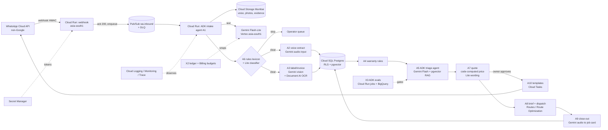

# Keepwell Google stack mapping

As of 15 Nov 2026. Maps Google's models, tools and products to every Keepwell feature (A1-A11, B1-B5, C1-C4, X1-X4, E1). Sources: the three Google-stack research notes, `Keepwell feature specification.md` (Part 1 sections 2, 6, 7, 9; each feature's Model and Knowledge parts) and the cost note. Evidence tags carry the researchers' tags: 🟢 official page fetched, 🟡 secondary, 🔴 unverified or inference. Many official pages were read through a summarising fetch tool, so every price below needs a live-page check before it goes in a deck or contract. Prices are USD per 1M tokens (Standard tier, public Gemini API) unless stated; FX Rs 94/USD 🟡. Where the spec and the new notes disagree, the new notes win and the change is listed in section 1.

---

## 1. Corrections to the spec, and price/route cliffs

### 1.1 Corrections to the spec

| # | Spec says | New notes say | Effect on Keepwell | Tag |
|---|---|---|---|---|
| C1 | `gemini-3.8-flash` name "unverified"; `MODEL_FLASH` unresolved | `gemini-3.8-flash` is a confirmed, Stable model on Google's Models, Pricing and Deprecations pages; $0.75/$3.75 to 31 Dec 2026, then $1.50/$7.50 | Drop the "unverified" flag. Default `MODEL_FLASH` candidate is 3.8 Flash | 🟢 |
| C2 | Mumbai in-region Flash is `gemini-3.5-flash` | AI Studio Models/Deprecations pages say 3.5 Flash is gone and auto-routed to 3.6 Flash; Google's India blog and the Vertex residency page still name 3.5 Flash for in-country ML processing | Genuine conflict between Google's own pages. Treat Mumbai Flash as "3.5 Flash on Vertex, lifecycle unconfirmed". Get lifecycle in writing before promising residency | 🟢/🟢 conflict |
| C3 | `MODEL_LITE` = `gemini-3.5-flash-lite` | Stable, $0.30/$2.50, no 2027 change, free tier yes. `gemini-3.1-flash-lite` retires 7 May 2027 (-> 3.5 Flash-Lite) | `MODEL_LITE` stands. Never pin 3.1 Flash-Lite | 🟢 |
| C4 | Uses "Vertex" throughout | Vertex AI renamed Gemini Enterprise Agent Platform at Cloud Next '26 (Apr 2026); old APIs keep working; Vertex pricing page title now "Agent Platform Pricing". Sub-product renames conflict (Agent Engine -> Agent Runtime per ADK docs; Agent Designer -> Agent Studio per two disagreeing sources) | Keep the code on the `google-genai` SDK with a Vertex/regional endpoint config; write docs as "Vertex AI (now Gemini Enterprise Agent Platform)". Do not rely on sub-product names | 🟡 (title seen 🟢) |
| C5 | Gemini 2.5 never pinned | Confirmed: 2.5 Flash / 2.5 Pro auto-route 1 Dec 2026 (to 3.5 Flash-Lite / 3.8 Flash). 2.5 Flash is also one of the Mumbai models in the spec's residency reading, so Mumbai coverage may shrink | Silent behaviour change risk is real; pin nothing from 2.5 | 🟢 |
| C6 | Not covered: Gemini 4 | Gemini 4 Carbon/Argon/Hydrogen exist (status unlabelled). Carbon/Argon $2/$10 to 30 Nov then $4/$20. Hydrogen $1.50/$7.50, page recommends it for new projects, India region unconfirmed | Not in R1. Hydrogen costs the same as 3.8 Flash from 2027, so only worth it if it wins evals and is Mumbai-listed | 🟢 |
| C7 | A2 fallback Chirp 3 "us/eu" for STT | Chirp 3 STT hi-IN GA, te-IN/ta-IN Preview, us/eu only, $0.016/min list. Chirp 3 HD TTS lists asia-south1 as NOT supported (regions: global, us, eu, asia-southeast1, europe-west2, asia-northeast1) | Any Google TTS/STT path outside Gemini leaves India. Disclose in the consent notice or avoid | 🟢 (STT price 🟡) |
| C8 | Document AI "invoice path with confirm screen" (B1) | Invoice Parser v1.3 only in asia-south1 and English-only; Custom Extractor in asia-south1 for Hindi/Marathi/Nepali/Sanskrit, generative extraction English-only and not in asia-south1; Layout Parser and Expense Parser not in asia-south1 | Document AI is a cross-check, not the primary reader. Gemini vision is primary for Indic invoices | 🟢 |
| C9 | Implies on-device OCR possible | ML Kit text recognition v2 scripts: Latin, Devanagari, Chinese, Japanese, Korean only. No Tamil, Telugu, Kannada. Android API 23+; Document Scanner Android only | On-device OCR only for Latin serial/model plates and Hindi/Marathi; barcode scanning works on any label | 🟢 |
| C10 | Possible Business Messages / Google chat channel | Business Messages is DEAD (discontinued 31 Jul 2024; customers could not start chats after 15 Jul 2024). RCS Business Messaging returning via carriers (Airtel+Google announced 1 Mar 2026; Jio rates 🟡) | WhatsApp Cloud API stays the only channel. RCS = later, via aggregators | 🟢/🟡 |
| C11 | Cloud Vision / Vertex AI Vision as options | Vertex AI Vision deprecated 15 Jun 2026, end of life 30 Sep 2026 (single mirror of the official deprecations page) | Do not use. Use Gemini video/image input | 🟡 |
| C12 | Not covered | Programmable Search / Custom Search JSON API closed to new customers and ends 1 Jan 2027; successor Vertex AI Search covers up to 50 domains, not full web | Never build price/market lookups on it. Use Gemini Search grounding for non-tenant public references | 🟡 |
| C13 | Cost model assumes $300 trial can fund Gemini | $300 trial (90 days) cannot pay for Gemini platform (Vertex AI) or Gemini API in AI Studio for sign-ups or upgrades on or after 16 Nov 2026; no GPUs, Marketplace or quota increases on trial accounts | Gemini spend must come from startup credits, buildathon credits or cash. See section 5.3 | 🟢 |
| C14 | Dev tooling unspecified | Gemini CLI and Gemini Code Assist IDE extensions stopped serving 18 Jun 2026 for free/AI Pro/Ultra/individual users (enterprise and paid API-key users reportedly unaffected, sources differ); replaced by Antigravity (`agy` CLI, desktop, SDK; launched 19 May 2026). Jules winds down: read-only from 11 Nov, closes 31 Dec 2026 (secondary, dates vary) | Build with Antigravity; do not adopt Jules or Gemini CLI | 🟡 |
| C15 | Imagen / Veo possible for visuals | Imagen 4 shut down 17 Aug 2026; Veo 3.x shut down; image generation now Nano Banana family | Irrelevant to core; only optional annotated-photo output | 🟢 |
| C16 | X1 "DLP/Sensitive Data Protection not researched, none specified" | SDP is a global service with India infoTypes (IN_AADHAAR, IN_PAN suspected, names not confirmed in docs) | Optional second-layer redactor; spec's regex + Verhoeff checksum stays primary | 🟡/🔴 |
| C17 | X3 judge availability unverified | Gen AI Evaluation Service listed GA, region support unverified; ADK has evals (open source) | Use ADK evals for the harness; managed service optional | 🔴 |
| C18 | Maps Routes only for A8 (R4) | Route Optimization has an India price list: Single Vehicle (Pro) $0.80/shipment, 35k free; Fleet Routing (Enterprise, 2+ vehicles) $2.40/shipment, 7k free. GA label not stated on the page | Affordable at pilot scale; real cost is OAuth/service-account integration | 🟢 |
| C19 | Firebase phone OTP unmentioned | Firebase phone OTP in India about $0.07/SMS, Blaze plan required, 3,000 SMS/day cap, first 10/day free | Do not use SMS OTP as default auth for customers or technicians | 🟡 |
| C20 | Computer Use implied for OEM portals | Computer Use GA 30 Oct 2026 (🟡 secondary), built into 3.5 Flash since 24 Jun 2026; old preview model shut 28 Jul 2026 | Reliability untested; REJECT for core, WATCH for OEM claim portals | 🟡 |

### 1.2 Price and route cliffs timeline

| Date | Event | What to do | Tag |
|---|---|---|---|
| 30 Sep 2026 (past) | Vertex AI Vision end of life | Confirm nothing depends on it | 🟡 |
| 6 Nov 2026 (past) | `gemini-embedding-2-preview` retired | Use `gemini-embedding-2` or `text-embedding-005`, not the preview ID | 🟢 |
| 11 Nov 2026 (past) | Jules read-only | Do not adopt | 🟡 |
| **16 Nov 2026 (tomorrow)** | $300 trial credit stops covering Gemini/Vertex for new sign-ups and upgrades | If the team has no Google Cloud billing account, create it today (15 Nov). Even so, assume Gemini needs startup/buildathon credits or cash (section 5.3). Use a paid-tier key for anything touching real users | 🟢 |
| 30 Nov 2026 | Last day of Gemini 4 Carbon/Argon $2/$10 | None (Gemini 4 is not in R1) | 🟢 |
| **1 Dec 2026** | Gemini 2.5 Flash/Pro auto-route to 3.5 Flash-Lite / 3.8 Flash; Gemini 4 Carbon/Argon step to $4/$20 | Pin no 2.5 model. Re-run the golden sets on whatever routed model answers; X2 `price_table` gets a dated row | 🟢 |
| **18 Dec 2026** | 2.5 Pro TTS / 3.1 Flash TTS preview shutdown -> 3.8 TTS | Only matters if TTS preview IDs are used; use `gemini-3.8-flash-tts` or Flash-Lite TTS | 🟢 |
| 3 Dec 2026 | Gemini Omni Flash 1.1 shutdown | Irrelevant | 🟢 |
| 31 Dec 2026 | Jules closes | Irrelevant | 🟡 |
| **1 Jan 2027** | Gemini 3.8/3.6 Flash and Flash TTS prices double ($1.50/$7.50; TTS doubles); Programmable Search JSON API ends | Spec cost model already carries the 2027 column (P3 warranty job at Rs 40 fee = about 76% GM, no cache). Move classification/extraction to Lite before the date; enable batch (50%) for nightly work. Do not build on Programmable Search | 🟢 / 🟡 |
| 15 Mar 2027 | Nano Banana (2.5 Flash Image) deprecated | Avoid | 🟢 |
| **31 Mar 2027** | 2.5 Flash native audio preview -> 3.8 Live | Use `gemini-3.8-live`, never the 2.5 audio preview | 🟢 |
| **7 May 2027** | `gemini-3.1-flash-lite` -> 3.5 Flash-Lite | Already on 3.5 Flash-Lite; no action | 🟢 |
| 14 May 2028 | Gemini Embedding 001 retires | Re-embedding job needed if on 001; plan model-version column in the vector table | 🟢 |

---

## 2. Google product catalogue shortlist

Decision key: USE NOW = in R1 or the 48-hour prototype; USE LATER = planned in R2-R4; WATCH = verify or wait; REJECT = do not use. M = Mumbai (asia-south1). Tags per researchers; 🔴 means re-check.

### 2.1 Models

| Product | Status | Mumbai/India | Role in Keepwell | Decision | Why |
|---|---|---|---|---|---|
| Gemini 3.5 Flash-Lite (`MODEL_LITE`) | Stable, $0.30/$2.50, free tier 🟢 | Named for Mumbai by spec's residency reading 🟡 | A1, A6 L2, A7, A8, A10, A11, B3, B5, C1, C2 | USE NOW | Cheapest default, no 2027 change; Rs 0.06-0.25/call |
| Gemini 3.8 Flash (`MODEL_FLASH` candidate) | Stable, $0.75/$3.75 to 31 Dec then $1.50/$7.50 🟢 | Vertex locations page has a Mumbai column with a 3.8 Flash row, markers unreadable 🟢 inconclusive | A2/A3/A9 retry, A5, B1, B4, C3, C4 | USE NOW | Name confirmed; best reasoning per rupee. Test Mumbai before pinning |
| Gemini 3.5 Flash | Gone from AI Studio, auto-routed; but named for in-country ML processing in Google India blog 🟢 conflict | Mumbai in-country commitment (only primary India commitment) 🟢 | Residency story | WATCH | Lifecycle on Vertex unconfirmed; ask Google account contact in writing |
| Gemini 3.6 Flash | Stable, same price as 3.8 🟢 | unconfirmed | Fallback to 3.8 | USE NOW (fallback) | Receives 3.5-flash and 3-flash-preview routes |
| Gemini 3.1 Flash-Lite | Stable, retires 7 May 2027 🟢 | - | none | REJECT | Retiring |
| Gemini 4 Hydrogen | Status unlabelled, $1.50/$7.50, free tier yes 🟢 | India region unconfirmed 🟢 | Possible later default | WATCH | Same price as 3.8 Flash in 2027; adopt only if it wins evals and is in Mumbai |
| Gemini 4 Carbon / Argon | $4/$20 from 1 Dec 2026 🟢 | unconfirmed | Hard fraud/claims reasoning | REJECT (R1) | One 20k-in/2k-out Pro-class call is about a whole Flash job in cost |
| Gemini 3.1 Pro Preview | Preview-named, $2/$12 🟢 | Not India-listed (spec) | Opt-in escalation on redacted text | WATCH | Residency decision needed first |
| Gemini Decision 1 (Decisions API) | Zero-output-token yes/no/score; price not captured 🟢/🔴 | unknown | Cheap approval gates (C1 completeness, A6 gate) | WATCH | Untested |
| Gemini 3.8 Live (`gemini-3.8-live`) | New; audio in about $0.005/min, out about $0.018/min 🟢 | No confirmed India region 🟢 | Phone-style voice intake (later) | USE LATER | Voice agent is not in R1 async WhatsApp flow; demo value high |
| Gemini 3.5 Live Translate | Preview; 70+ languages 🟢 | unknown | Customer-technician bridge | WATCH | Preview |
| Gemini 3.5 Transcribe / Transcribe Live | Stable; about $0.005/min with diarization, timestamps 🟢 | unknown | A2/A9 dedicated STT fallback and for corrected-transcript logging | USE LATER | Indic quality unpublished; evaluate on own set |
| Gemini 3.8 Flash TTS / Flash-Lite TTS | New; 130 / 101 languages; doubles 1 Jan 2027 🟢 | unknown | Spoken quote read-back for low-literacy users | USE LATER | A10/A7 enhancement after R1 |
| Chirp 3 STT | hi-IN GA, te/ta Preview, us/eu only, $0.016/min 🟢/🟡 | NOT India | A2 consent-gated fallback only | WATCH | 11x costlier than Gemini audio; leaves India |
| Chirp 3 HD TTS | 9 Indian languages (Punjabi Preview) 🟢 | asia-south1 NOT listed 🟢 | none | REJECT (for now) | Gemini TTS covers it |
| Cloud Translation | GA; 189 languages; conflicting price snippets ($25 vs $10 per 1M chars) 🟡 | asia-south1 unverified | Glossary-controlled UI strings | REJECT (R1) | Gemini + glossary is cheaper per token 🔴 |
| Gemini Embedding 2 (`gemini-embedding-2`) | Text $0.20, image $0.45 per 1M; free tier 🟢 | Embeddings row on Mumbai column, markers unreadable 🟢 inconclusive | Multimodal RAG (parts photos, nameplates) | USE LATER | Spec uses `text-embedding-005`; benchmark both |
| `text-embedding-005` | Spec: "the India-listed embedding" 🟡 | Mumbai per spec | A5/A9/A11/B4 vectors in pgvector | USE NOW | Already India-listed in earlier notes |
| Gemini Embedding 001 | $0.15; retires 14 May 2028 🟢 | - | Text RAG | WATCH | Prefer 005/2 |
| Gemma 4 (E2B, E4B, 26B MoE, 31B; Apache 2.0) | Open weights; 140+ languages; no Indic benchmark 🟡/🟢 | Self-hosted anywhere | On-device voice notes (E2B/E4B), India-resident fallback model, judge model | WATCH | No Indic accuracy figures; Cloud Run L4 in Mumbai is invite-only 🟢 |
| ShieldGemma 2 / EmbeddingGemma 2 | Listed in Gemma docs 🟢 | self-host | Safety classifier / local embeddings | WATCH | Not needed at pilot |
| Nano Banana 2.1 / 2 / 2 Lite | New/Stable; about $0.034-0.113 per image 🟢 | unknown | Annotate fault location on a photo; repair-step diagrams | WATCH | Nice-to-have, never a decision input |
| Gemini Omni, Lyria, Robotics ER 2, Veo | Various / Veo shut down 🟢 | - | none | REJECT | Irrelevant |
| Imagen 4 | Shut down 17 Aug 2026 🟢 | - | none | REJECT | Dead |
| Deep Research / Max | Preview 🟢 | - | Build-time parts/OEM research, not runtime | WATCH | Preview |
| Computer Use (3.5 Flash tool) | GA 30 Oct 2026 🟡; token rates | unknown | Driving OEM claim portals with no API (C1/C4 partner submit) | WATCH | Reliability untested 🔴; sends screenshots of third-party portals |
| Grounding with Google Search | GA; 5,000 free/month then $14/1k; derived queries stored 3 days 🟢 | Global | Public references only (A7/B5 labelled reference, build-time manual research) | USE LATER | Never on tenant data |
| Grounding with Google Maps (Gemini) | Stored 30 days, no opt-out 🟢 | Global | none | REJECT | Residency-sensitive data; use Routes API directly |

### 2.2 Agent and developer tools

| Product | Status | Role | Decision | Why |
|---|---|---|---|---|
| Google AI Studio (Build/vibe coding, key management) | Live 🟢; export behaviour not verified | Prototype prompts, schema tests, quick demos | USE NOW | Free tier lets the team prototype with synthetic data. Free-tier content is used to improve Google products 🟢 |
| ADK (Python; TS/Go/Java/Kotlin), ADK 2.0 graph workflows, evals | Open source, current 🟢 | Intake agent (A1), triage agent (A5) with tools, eval sets (X3) | USE NOW | Portable, local-first, Apache-style OSS |
| A2A protocol | Supported in ADK; spec not fetched 🟢 | Optional OEM/partner agent interop (C1 intake) | WATCH | No partner speaks it yet 🔴 |
| Managed MCP servers (Maps Grounding Lite, BigQuery, Compute, GKE; 50+) | GA/preview mixed; launched 10 Dec 2025 🟡 | Maps/BigQuery tools for ADK agents in the demo | USE LATER | Region residency not stated |
| Antigravity 2.0 (desktop, `agy` CLI, SDK) + Agent Skills (SKILL.md) | Launched 19 May 2026; SDK preview per secondary 🟡 | Builder tooling for the 48-hour build; repo skills for A6 hazard rules, A3 validators | USE NOW | Directly addresses the judging criterion; dev tool only, never in tenant runtime |
| Antigravity Agent / Managed Agents | Preview (`antigravity-preview-09-2026`) 🟢 | Internal only | WATCH | Preview, sandbox residency unknown |
| Gemini CLI, Gemini Code Assist extensions | Retired for most users 18 Jun 2026 🟡 | none | REJECT | Replaced by `agy` |
| Jules | Winding down, closes 31 Dec 2026 🟡 | none | REJECT | Dead end |
| Gemini Enterprise Agent Platform (ex-Vertex AI): Agent Runtime, RAG Engine, Vector Search, Model Garden, batch, caching, PT, tuning | Renamed Apr 2026 🟡; sub-product labels and regions not verified | Production model plane (Gemini on Vertex, regional endpoint) | USE NOW (models) / WATCH (the rest) | Take only the Gemini endpoint; RAG Engine/Agent Runtime add lock-in for no pilot benefit |
| Genkit, Firebase Studio, Opal, NotebookLM | Not verified 🔴 | - | WATCH | No evidence either way |

### 2.3 Document, vision, on-device

| Product | Status | Mumbai/India | Role | Decision | Why |
|---|---|---|---|---|---|
| Gemini vision/image understanding | GA | asia-south1 limited | A3, A5 fault photo, B1, B4, C1, E1 | USE NOW | Primary reader; token-priced |
| Document AI Enterprise OCR | GA; $1.50/1k pages (1-5M), $0.60 after 🟡 | asia-south1; 10 Indian languages 🟢 | A3/B1 non-generative cross-check; handwritten job sheets | USE LATER | Gives a deterministic second opinion for chosen fields |
| Document AI Invoice Parser | GA, v1.3 | asia-south1, English only 🟢; $0.10 per 10 pages 🟡 | English dealer/part invoices | USE LATER | Weak for Hindi/regional invoices |
| Document AI Custom Extractor | GA | asia-south1; Hindi/Marathi/Nepali/Sanskrit; generative extraction not in Mumbai 🟢 | Warranty card / job card field training | WATCH | Pricing not retrieved; test vs Gemini on 50-100 invoices (spec item 9) |
| Document AI Layout Parser | GA | Not in asia-south1 🟢; $10/1k pages 🟡 | Manual PDF to chunks for RAG | USE LATER (public manuals only) | OEM manuals are not personal data, so non-India region is acceptable for ingestion only |
| Document AI Expense Parser | - | Not in Mumbai | none | REJECT | |
| Cloud Vision API | GA 🔴 | Global API 🔴 | Generic OCR | WATCH | Gemini better on appliance photos |
| Video Intelligence API | status unconfirmed 🔴 | - | none | REJECT | Use Gemini video input |
| Vertex AI Vision | EOL 30 Sep 2026 🟡 | - | none | REJECT | Dead |
| ML Kit barcode scanning | On-device, free 🔴 | Offline | Serial/QR/IMEI-like labels in a technician Android app | USE LATER | Needs a native Android app |
| ML Kit text recognition v2 | Latin, Devanagari, CJK only 🟢 | Offline | Latin model/serial plates | USE LATER | No Tamil/Telugu/Kannada |
| ML Kit Document Scanner | Android only, on-device 🟢 | Offline | Warranty card / invoice capture UI | USE LATER | |
| ML Kit GenAI APIs / Gemini Nano Prompt API | Beta / Alpha 🟢; device list unfetched | Device-dependent 🔴 | Offline helper | REJECT (for now) | Alpha |
| Firebase AI Logic | Stage not stated 🟢 | Region not stated | Direct-from-app Gemini | REJECT | Bypasses the validator and X2 ledger server-side |
| Google Lens / Circle to Search | Consumer, no API 🔴 | - | none | REJECT | Not integrable |

### 2.4 Maps, discovery, search

| Product | Status | India price and free cap (USD/1k) | Role | Decision | Why |
|---|---|---|---|---|---|
| Routes: Compute Routes Essentials | Status not stated | $1.50, 70k free 🟢 | A8 travel time between jobs | USE LATER (R4; demo now) | Free at pilot volume |
| Routes: traffic-aware (Pro) | - | $3.00, 35k free 🟢 | ETA for customer ("on the way") | USE LATER | |
| Compute Route Matrix | - | Not listed in India fetch; global $5.00, 10k free 🟢 | Technician-to-job assignment scoring | WATCH | Per element |
| Route Optimization Single Vehicle (Pro) | No GA label 🟢 | $0.80/shipment, 35k free | One technician's daily order | USE LATER | |
| Route Optimization Fleet Routing (Enterprise) | No GA label | $2.40/shipment, 7k free; 2+ vehicles | 5-technician agency, about 900 shipments/month | USE LATER | Inside the free cap; limits 60 QPM, 100 requests/100 MB per batch; OAuth + billing needed |
| Places API (New): Autocomplete, Place Details IDs-only | - | $0.85 (session unlimited), 70k free; IDs-only free 🟢 | Address capture with pin drop | USE LATER | Fixes weak Indian address geocoding |
| Geocoding | - | $1.50, 70k free 🟢 | Pincode/address to lat-lng | USE LATER | |
| Address Validation | IN listed; GA-vs-preview unclear 🟢 | Pro $5.10, 35k free | Address check | WATCH | "Data quality can vary by country" |
| Navigation SDK | - | $25 per request global, 1k free 🟢 | none | REJECT | Overkill |
| Fleet Engine | Pricing absent from page 🟢 | - | none | REJECT | Heavy for 2-10 technicians 🔴 |
| Business Profile APIs | Access by request, not open to all 🟢 | - | Agency reputation replies, with consent | WATCH | Approval needed |
| Programmable Search JSON API | Ends 1 Jan 2027 🟡 | - | none | REJECT | Dead |
| YouTube Data API v3 | GA; 10,000 units/day, search.list 100 calls/day bucket 🟢 | - | Link (not copy) repair videos in A5 hints | WATCH | Licence terms not confirmed 🔴 |
| Local Services Ads (India) | Not found 🔴 | - | none | REJECT | Do not assume |
| Google Trends / Earth Engine | Official Trends API limited 🔴 | - | none | REJECT | |

### 2.5 Compute, data, security, ops, channels, payments

| Product | Status / Mumbai | Role | Decision | Why |
|---|---|---|---|---|
| Cloud Run services | GA; Mumbai Tier 1 🟢; free 2M req, 180k vCPU-s, 360k GiB-s | Webhook, ADK workers, admin console | USE NOW | Scale to zero; only egress is North-America-based |
| Cloud Run jobs | GA 🔴 | Nightly evals, B2 sweep, B5 stats | USE NOW | |
| Cloud Run GPU | L4 in Mumbai invite-only 🟢 | Self-hosted Gemma | REJECT | Use Gemini API |
| Pub/Sub | GA; Mumbai unverified 🔴; free 10 GiB | `wa.inbound`, DLQ | USE NOW | Spec already designs on it |
| Cloud Tasks / Scheduler / Workflows / Eventarc | GA; Mumbai unverified 🔴 | Per-tenant throttled sends, cron, multi-step | USE NOW (Tasks, Scheduler); WATCH (Workflows, Eventarc) | |
| Cloud SQL for PostgreSQL | GA; Mumbai yes (launch product) 🟢; pgvector 0.8.5, pg_cron 1.6.4, pgAudit, google_ml_integration 🟢 | System of record, RLS, vectors, reminders | USE NOW | Largest fixed cost; planning Rs 1,000-2,000/month shared-core 🔴 |
| AlloyDB | GA 🔴 | Later scale-up (same Postgres) | WATCH | Overkill under 1k jobs/day |
| Spanner | GA; Mumbai 6-month rule 🟢 | none | REJECT | Overkill, min 1 node 🔴 |
| Firestore | GA; free 1 GiB, 50K reads/day 🟢 | Optional session state | REJECT | Postgres is simpler; avoids a second store |
| Memorystore | GA, no free 🔴 | none | REJECT | Postgres suffices |
| GKE Autopilot | GA | none | REJECT | Overkill, ops burden |
| App Engine | Maintenance mode 🔴 | none | REJECT | |
| Cloud Storage | GA; Mumbai yes 🟢; always-free only in US regions 🟢 | Voice, photos, evidence, lifecycle delete, retention locks, signed URLs | USE NOW | Billed from byte one in Mumbai; negligible (under Rs 0.01/job) 🔴 |
| BigQuery (BQML, vector search) | GA 🔴; free 1 TiB query, 10 GiB storage 🟢 | Eval logging, B5 stats, analytics | USE LATER | Verify Mumbai dataset location |
| Looker Studio | GA, global, free 🟢 | Internal dashboards (X4) | USE LATER | Tenant-scoped sharing needs care |
| Identity Platform / Firebase Auth | GA; phone OTP about $0.07/SMS 🟡 | Staff login; multi-tenancy unverified 🔴 | USE LATER (email/OIDC, no SMS) | |
| Secret Manager | GA; Mumbai yes 🟢 | WhatsApp tokens, API keys | USE NOW | |
| Cloud KMS | GA; Mumbai yes 🟢 | CMEK if a partner requires it | WATCH | Per key-version cost |
| Sensitive Data Protection (DLP) | GA, global; India infoTypes 🟡/🔴 | Second-layer PII redaction before logs/Pro opt-in | USE LATER | Names unconfirmed |
| Model Armor | GA 🔴; locations unverified | Inbound prompt-injection screen | WATCH | Pricing/regions unverified |
| Cloud Armor, API Gateway, Apigee | GA | none | REJECT | HMAC check in code; Cloud Run + IAM |
| reCAPTCHA Enterprise | 10,000 assessments/month free 🟢 | Agency signup form | USE LATER | |
| Cloud Logging / Monitoring / Trace / Error Reporting | GA; 50 GiB logs free 🟢 | Ops | USE NOW | |
| Billing budgets and quotas | GA | Alerts at 50/80/100%; backs X2 | USE NOW | Trial accounts cannot raise quotas 🟢 |
| Cloud Build / Artifact Registry | 2,500 build-min, 0.5 GB free 🟢 | CI/CD | USE NOW | |
| Security Command Center Standard | Free tier listed 🟢 | Breach detection | WATCH | |
| Assured Workloads | Premium; India package unverified 🔴 | none | REJECT | Use org policy `gcp.resourceLocations` 🔴 |
| Google Business Messages | DEAD (31 Jul 2024) 🟢 | none | REJECT | |
| RCS Business Messaging | Returning in India via carriers (Airtel, Jio, Vi) 🟡 | Later low-priority channel via aggregators | WATCH | Per-message, not a WhatsApp replacement |
| FCM | GA, free 🔴 | Push in own technician/owner app | USE LATER | |
| Google Pay API for India (UPI intent) | Needs console registration, approved business profile, verified VPA, allowlisting for some APIs 🟢 | Plan/AMC payments (B3), later | WATCH | Software firm collecting for others hits aggregator KYC; PA/PG partner more realistic 🔴 |
| Google Wallet API (generic pass) | Issuer account, demo mode then publish 🟢; availability to Indian users not found | Warranty pass | WATCH | WhatsApp/PDF/QR card is safer |
| Workspace APIs (Calendar, Sheets, Drive, Gmail) | GA 🔴; restricted scopes need OAuth verification | Optional agency back-office sync | WATCH | Avoid restricted scopes |
| Gen AI Evaluation Service | GA 🔴; regions unverified | Managed judge | WATCH | ADK evals first |
| Cloud Marketplace | GA 🔴 | Later distribution | WATCH | |

---

## 3. Per-scenario mapping

Conventions. "Vertex endpoint" = the `google-genai` SDK client in Vertex mode with `location=asia-south1`, per the spec's common envelope (JSON mode via `response_mime_type=application/json` plus a shallow `response_schema`, followed by a code validator, caching off for tenant prompts, one `model_run` row and one `cost_ledger` increment per call). Costs are the spec's per-call figures (Rs, no cache, Flash 2026 / Flash 2027 / Lite) and are 🔴 until measured with `countTokens` on 10 real samples. Models named Flash/Lite follow `MODEL_FLASH` / `MODEL_LITE`. WhatsApp utility template about Rs 0.115 ex-GST 🟡.

### 3.A Scenario A: Prepared Visit (R1, highest priority)

| Feature | Google models/products used | How exactly | Region and residency | Free tier / cost | Non-Google dependency | Fallback if Google piece is unavailable |
|---|---|---|---|---|---|---|
| **A1** Intake, language ID | Flash-Lite `MODEL_LITE`; Cloud Run (ADK intake agent); Pub/Sub `wa.inbound`; Cloud Storage; Secret Manager; Cloud Tasks | Webhook returns 200 inside 2 s after HMAC check, enqueues to Pub/Sub; worker dedupes on `wamid`, pulls media by `media_id` into a Mumbai bucket (EXIF stripped, SHA-256 evidence row), calls Lite text-only (temp 0, thinking minimal, max 256 out) with the `a1.lang.v1` prompt; validator enforces language/intent enums and confidence >= 0.6, else the 1-6 language menu. Cloud Tasks enforces 20 msg/min per `wa_id` and 600/min per tenant | Cloud Run, GCS, SQL Mumbai 🟢; Pub/Sub Mumbai unverified 🔴; Lite Mumbai per spec 🟡 | Run free tier; Lite about Rs 0.09/call 🔴 | WhatsApp Cloud API / BSP (Meta); missed-call telephony (UNVERIFIED in spec) | Rules-only: keyword/lexicon routing plus language menu; tier switch Lite -> 3.6 Flash; circuit breaker after 5 failures |
| **A2** Voice symptom extract | Flash-Lite (audio) then Flash retry; optional Gemini 3.5 Transcribe; Chirp 3 STT (us/eu) as consent-gated fallback | One call: OGG/Opus voice note as audio part (32 tokens/s, 60 s = 1,920 tokens) plus 600-token glossary subset and `symptom_taxonomy.json`; returns transcript, language, symptom tags, appliance, urgency with `null` + reason codes. Test in-region audio acceptance first; no separate STT hop | Audio input in Mumbai UNVERIFIED 🔴; Chirp 3 STT is us/eu only 🟢 so crossing borders needs the consent notice | Lite about Rs 0.25, Flash Rs 0.49/0.98 per call; Chirp 3 about Rs 1.50/min vs about Rs 0.135-0.47/min Gemini 🟡/🔴 | WhatsApp media download; IndicVoices etc. for eval priors | Flash retry -> Chirp 3 (consented, cross-border) -> tap-menu/typed intake for that language |
| **A3** Label and invoice extraction | Flash-Lite then Flash vision with `media_resolution` medium (label), high (invoice), ultra_high (retry); Document AI OCR (Mumbai) cross-check; later ML Kit barcode/text on device | Image(s) from GCS to Gemini with `brand_serial_patterns.json` hints; schema returns brand, model, serial, mfg date, GSTIN, totals with null+reason; code validators (GSTIN checksum, serial regex, subtotal+tax=total) override. Optional Document AI Enterprise OCR on the same image to confirm digits; mismatch => owner confirm screen | Gemini vision Mumbai limited 🔴; Document AI OCR/Custom Extractor asia-south1 🟢; Invoice Parser English-only 🟢 | Lite Rs 0.19, Flash Rs 0.36/0.72; Doc AI OCR $1.50/1k pages (about Rs 0.14/page) 🟡 | none (GSTIN algorithm is public) | Document AI OCR + regex only; owner types model/serial; no silent guess |
| **A4** Warranty entitlement (rules) | Cloud SQL Postgres only (`warranty_terms` table); no model | Deterministic Python with unit-test table and pinned `terms_version`. Google appears only upstream: batch Gemini jobs may draft candidate term rows from OEM PDFs for a human `reviewed_by` | Mumbai SQL | Rs 0 per decision, under 200 ms | none | n/a (no AI to fail) |
| **A5** Diagnosis and parts (RAG) | Flash (3.8 or Mumbai 3.5); Flash-Lite rerank; `text-embedding-005` (Gemini Embedding 2 to benchmark); pgvector 0.8.5 in Cloud SQL; ADK `triage_agent`; Document AI Layout Parser (ingestion only) | ADK agent on Cloud Run with tools `read_record`, `lookup_fault_code`, `retrieve_manual`, `check_catalogue`, 60 s timeout. Exact fault-code lookup first (SQL), then metadata-filtered hybrid BM25 + vector top 3-5 over 400-700-token chunks in pgvector; Flash (temp 0.2, thinking about 1,024 cap, 1,500 out) drafts causes/parts with cited chunks; A6 must clear first. Manuals are public documents, so ingestion may run outside Mumbai (e.g., Layout Parser) while tenant data never does | Query path Mumbai; ingestion region free of personal data 🔴 policy; Layout Parser not in Mumbai 🟢 | Flash about Rs 0.85/1.69; embeddings $0.20/1M text 🟢 | OEM manuals and licence clearance (no Google product); parts catalogue | History-only hints + fault-code table lookup; Flash -> Lite; no Pro in R1 |
| **A6** Safety hard-stop | Rules (lexicon in Postgres) + Flash-Lite classifier (adds severity only); optional Model Armor on inbound text | Layer 1 regex/lexicon (about 400 terms x 6 languages) runs before any model; layer 2 Lite (temp 0, 300 out, image at medium) may only escalate; code ignores `severity: none` against a rules hit. Gemini's built-in safety filters are not a substitute for the lexicon | Lite Mumbai 🟡; Model Armor regions unverified 🔴 | Lite about Rs 0.06/call | Expert-signed hazard list (electrician, gas) | Rules-only, default to stop and human; never AI-only |
| **A7** Quote and fair-price band | Flash-Lite writes the customer text; price computed by code from `rate_card`; optional Gemini 3.8 Flash-Lite TTS read-back later | Model maps symptom to `rate_card` item_ids (temp 0.3, 500 out); code computes totals, GST and band (min sample 8); owner approves before A10 sends. No Search grounding on tenant data | Mumbai | Lite about Rs 0.23; TTS $0.50 in / $6 out per 1M, doubles 1 Jan 2027 🟢 | none | Template quote from rate card with no generated explanation |
| **A8** Brief and dispatch | Flash-Lite for the brief; Routes Compute Routes (Essentials/traffic-aware Pro); Route Optimization (R4); Places Autocomplete/Details IDs-only, Geocoding; optional managed Maps MCP in the demo | Brief: Lite (temp 0.2, 700 out) from job card and technician profile. R1: operator assigns, pincode-to-zone table. R4: Fleet Routing request per agency per day (vehicles = technicians, shipments = jobs with time windows), service account with OAuth; cost $2.40/shipment India beyond 7k free/month; Compute Routes $1.50/1k for ETAs. Customer pin via WhatsApp location message beats Address Validation (India quality varies 🟢) | India price list in USD only, INR not found 🟢; limits 60 QPM, 100 req/100 MB per batch 🟢 | Lite about Rs 0.20; Maps free at pilot (about 900 shipments/month for a 5-technician agency 🔴) | WhatsApp location; India Post pincode data | Operator manual assignment (the spec's R1 rule); straight-line distance from pincode centroid |
| **A9** Job close-out | Flash-Lite audio then Flash retry; `text-embedding-005` for part aliases; optional Gemini 3.5 Transcribe; Gemma 4 E2B/E4B on-device later | Technician voice note (about 45 s) plus job card context returns structured nature_of_service, fault found, action, parts; alias matching via pgvector fuzzy search; OTP/signature collected in app. Fee event fires on confirmed close | Audio in Mumbai UNVERIFIED 🔴 | Lite about Rs 0.30, Flash Rs 0.56/1.12 | WhatsApp or technician app for voice capture | Tap-form close-out |
| **A10** Customer messaging | Flash-Lite (reply interpreter, operator-draft writer); Cloud Tasks/Scheduler for nudges | Outbound uses approved templates only (no model); inbound free text interpreted by Lite (temp 0.2, 350 out) to an intent; free-text replies are operator drafts, never auto-sent out of window. Cloud Tasks delays follow-ups; quiet hours in config | Mumbai | Lite about Rs 0.11; WhatsApp utility about Rs 0.115/msg 🟡 | WhatsApp templates and Meta approval; RCS later | Template-only replies; operator inbox |
| **A11** Parts request | Flash-Lite; `text-embedding-005` + pgvector alias match | Lite normalises the part request (temp 0, 400 out); alias/fuzzy match to `parts_catalogue`; compatibility by rules, "inspect first" if unverified; operator approves order | Mumbai | Lite about Rs 0.15 | Parts catalogue and suppliers: no Google product | "Inspect first" status and manual order |

### 3.B Scenario B: Home Memory and Plans (R2)

| Feature | Google models/products used | How exactly | Region and residency | Free tier / cost | Non-Google dependency | Fallback |
|---|---|---|---|---|---|---|
| **B1** Household record with consent | Flash vision (terms extractor); Document AI Invoice Parser / Custom Extractor cross-check; Cloud SQL; GCS | Reuses A3 prompts for invoice/nameplate; B1 adds a Flash call (temp 0, 900 out, one image) extracting warranty clauses, because clause wording carries conditions. Consent state is a table, no model. Field provenance (source=ocr/user/agency) stored per field. Google Wallet warranty pass is a later add-on | Mumbai (Invoice Parser English only) 🟢 | Flash about Rs 0.36/0.72 per call | DPDP notices (lawyer); WhatsApp OTP rather than Firebase SMS ($0.07/SMS 🟡) | Manual entry with confirm screen |
| **B2** Reminders (cron) | Cloud Scheduler or `pg_cron` 1.6.4 in Cloud SQL; Cloud Tasks; optional Lite batch for wording | Daily sweep over `warranty_end` and interval tables; Cloud Tasks per-tenant sends in the free-window utility category; no model for dates. Lite (batch, 50%) only drafts new template wording for human approval | Mumbai; pg_cron flag `cloudsql.enable_pg_cron` 🟢 | Lite batch about Rs 0.06/call; Scheduler 3 free jobs 🔴 | WhatsApp template approval and category rules (India applicability of 1 Oct 2026 charging unconfirmed) | SMS with DLT or in-app FCM push |
| **B3** Plan and AMC offers | Flash-Lite (copy rewriting) | Lite rewrites supplied plan text (temp 0.2, 500 out) after rules choose eligibility; Google Pay UPI is a later payment option | Mumbai | Lite about Rs 0.11 | Plan seller catalogue; payment aggregator; plan-selling licence question (lawyer) | Static plan copy |
| **B4** Claim evidence pack | Flash; `text-embedding-005` + pgvector hybrid; GCS retention locks; SDP for redaction before any opt-in Pro call | Metadata filter on brand/category/purchase date, exact-clause lookup, then hybrid top 3-5 of one-clause chunks; Flash (temp 0, 3,000 out) assembles a pack with quoted clauses and no legal opinion; hashes of evidence files in GCS with retention lock. No Search grounding (tenant data) | Mumbai; Pro out of region only on redacted opt-in | Flash about Rs 1.33/2.66 | OEM T&C PDFs (licence: lawyer); e-Daakhil/consumer channel facts | Show verbatim clauses and evidence list, no drafting |
| **B5** Consumer fair-price check | Flash-Lite vision (Flash on validator fail); Cloud SQL materialised stats or BigQuery nightly | Nightly job builds `agreed_price_stats` (cell size >= 30, Winsorised P5/P95) from consented A7/A9 data; Lite explains in the user's language; Search grounding allowed only for a labelled public reference | Mumbai BigQuery location to verify 🔴 | Lite about Rs 0.19; BigQuery free 1 TiB 🟢 | Thin data at start | "Indicative or off" |

### 3.C Scenario C: Claims triage (R3)

| Feature | Google models/products used | How exactly | Region and residency | Free tier / cost | Non-Google dependency | Fallback |
|---|---|---|---|---|---|---|
| **C1** Claim intake, completeness | Flash-Lite (up to 4 images per call, medium = 560 tokens each); Document AI OCR; Cloud Run admin API; optional Decision 1 gate | Rules checklist per plan type decides completeness; Lite classifies each image (photo type, legibility) in one batched call and extracts fields; Document AI OCR checks serial/invoice digits | Mumbai | Lite about Rs 0.66 (Flash Rs 1.36/2.73); Doc AI OCR $1.50/1k pages 🟡 | Administrator claim schema (no public spec, spec item 29); Computer Use only for portals without APIs (WATCH) | Manual checklist; reviewer queue |
| **C2** Fraud/anomaly flag | Flash-Lite (explanation only); Postgres rules; BigQuery ML later | Signals computed by rules and statistics (perceptual-hash index, amount bands n >= 30); Lite writes the reviewer summary only (temp 0, 700 out); never auto-deny. Trained model deferred until 200+ labelled positives (BQML is one option) | Mumbai | Lite about Rs 0.25 | Labelled fraud data (none public) | Rule flags only, no explanation text |
| **C3** Repair vs replace | Flash (temp 0.1, 1,200 out); Pro opt-in on redacted data; batch for nightly | Thresholds T1/T2/R are code; Flash assembles inputs and the explanation from structured sources (A7 estimate, invoice value, history). Async runs can use batch at 50% (Vertex batch in asia-south1 unconfirmed) | Mumbai; Pro out of region | Flash about Rs 0.70/1.41 | Expected-life table (expert); administrator policy | Show inputs and the rule outcome without prose |
| **C4** Adjudicator decision support | Flash (temp 0, 1,800 out); `text-embedding-005` + pgvector (lookup filtered by plan id); Cloud Logging + append-only Postgres audit; BigQuery export | Summarises claim facts with citations to clause chunks; reviewer decision stored with reason code; override taxonomy built monthly. Decision stays human (Tier C) | Mumbai | Flash about Rs 1.37/2.75 | Administrator reason codes and plan terms | Structured facts view, no summary |

### 3.X Cross-cutting services and 3.E vision

| Feature | Google models/products used | How exactly | Region and residency | Free tier / cost | Non-Google dependency | Fallback |
|---|---|---|---|---|---|---|
| **X1** Consent and privacy | Cloud SQL (consent ledger), Secret Manager, GCS lifecycle/retention, KMS CMEK (optional), Sensitive Data Protection (second layer), Access Transparency | Consent is state in Postgres; the regex + Verhoeff redactor stays primary; SDP inspect/de-identify (India infoTypes unconfirmed) runs on text before logging or a Pro opt-in call; GCS lifecycle rules enforce retention; tenant erase jobs in Cloud Run jobs | Mumbai for Run/SQL/GCS; SDP and Access Transparency are global services 🟢 | Free tiers; SDP priced per GB (free tier exists 🟡) | Lawyer-approved notices; DPDP duties stay in app (Google publishes no DPDP-specific commitment 🟡) | Regex redactor and manual erase |
| **X2** Cost ledger and budget guard | Cloud Billing budgets/quotas; billing export to BigQuery; Vertex usage metadata; Cloud Run job reconcile | `price_table` rows hold Gemini, Meta, Maps prices with a `vertex_adjustment` multiplier (default 1.0); per-job caps (soft 2x, hard 3x) enforced in code before each call. Budget alerts at 50/80/100% are advisory, so the hard stop is in code | Mumbai | Free | Meta INR rates (secondary) | In-code caps only |
| **X3** Eval harness and monitoring | ADK evals; Cloud Run jobs; Flash-Lite or other-family `MODEL_JUDGE`; Gen AI Evaluation Service (WATCH); BigQuery; Cloud Logging | ADK eval sets per feature; binary rubrics via judge at temp 0 (400 out, about Rs 0.34/call Flash 2026); exact-match for fields; nightly Cloud Run job writes results to BigQuery. Different-family judge (e.g., a partner model via Model Garden, $10,000 partner credit 🟡) avoids self-preference | Judge region needs a residency decision; use redacted goldens | Judge about Rs 0.16-0.68/call | Public ASR/receipt sets (IndicVoices CC BY 4.0 gated) | Human review only (kappa < 0.7 rule) |
| **X4** Admin console | Cloud Run; Cloud SQL RLS; Identity Platform (multi-tenancy unverified); Cloud Logging/Monitoring/Trace/Error Reporting; Looker Studio internal | RLS by `tenant_id`; eval_admin sees redacted trace fields; kill switch scopes in config tables; Monitoring alerts for safety-unanswered and model-deprecation runbooks | Mumbai | Free tiers (50 GiB logs) 🟢 | none | App-level auth |
| **E1** Circular pickup and EPR (vision stub) | Flash vision (provisional A/B/C/scrap grading); later Routes for pickup | Photos of the unit to Flash (R5), rules route to refurbish/harvest/scrap, produces a CPCB export file a person uploads | Mumbai | Flash about Rs 0.36 per grading | Recycler registration checks, CPCB upload (no known API), EPR price unresolved | Manual grading |

---

## 4. Reference architecture and lean pilot stack

### 4.1 Scenario A flow on Google (one diagram)

### 4.2 Lean production stack, 20-agency pilot, Mumbai

All figures are estimates (🔴) derived from the spec's per-call costs and the infra note; Cloud SQL, Cloud Storage and Cloud Run Mumbai rates were not retrievable. Assumption: 20 agencies x about 8 jobs/day x 26 days is about 4,000 jobs/month, mix of P1/P2/P3 profiles, WhatsApp about 6 utility messages per job. Planning range Rs 12,000-35,000/month all-in; recompute with live rates.

| Layer | Choice | Free-tier cover | Approx monthly cost (Rs) | Tag |
|---|---|---|---|---|
| Compute | Cloud Run services + jobs, min instances 0 (webhook min 1 optional) | 2M req, 180k vCPU-s, 360k GiB-s free; fits easily | 0-500 (min-instance only) | 🟢 free tier / 🔴 rate |
| Queue and cron | Pub/Sub, Cloud Tasks, Scheduler | Pub/Sub 10 GiB; Scheduler 3 jobs (🔴) | 0-100 | 🟢/🔴 |
| Database | Cloud SQL Postgres, shared-core or 1 vCPU, HA off, pgvector, RLS | none | 1,000-2,000 (HA on later doubles) | 🔴 |
| Files | GCS regional Mumbai, lifecycle delete 30/90 days | none in Mumbai | under 300 (about 20 GB/month cumulative x 5 MB per job) | 🔴 |
| AI, Lite-first, cached prefixes off for tenants | Per job Rs 1.5-4.0 (Lite cached to Flash 2026 mix) | Free tier on paid key does not apply to production data | 6,000-16,000 for 4,000 jobs (2026 prices); 12,000-28,000 if Flash-heavy after 1 Jan 2027 | 🔴 from spec |
| Maps | Compute Routes + Places session + Geocoding; Route Optimization only for 2+ technician agencies | 70k/35k/7k free caps India | 0 at pilot | 🟢 |
| Secrets, logs, build | Secret Manager, Logging, Monitoring, Cloud Build, Artifact Registry | all free at this volume | 0 | 🟢 |
| WhatsApp (non-Google) | Meta utility messages about Rs 0.115 each ex-GST + BSP markup | 1,000 service conversations free per number 🟡 | about 2,800 + markup + 18% GST | 🟡 |
| Auth | Email/OIDC via Identity Platform or app auth; no SMS OTP | MAU free tier unverified | 0 | 🔴 |
| **Total Google cloud, ex-AI** | | | **about 1,000-3,000** | 🔴 |
| **Total with AI** | | | **about 7,000-19,000 (2026) / 13,000-31,000 (Flash-heavy 2027)**, plus WhatsApp | 🔴 |

Budget alerts at 50/80/100% from day 1; separate projects for prototype (free key, synthetic data) and pilot (paid key only). Skip Cloud Armor, Apigee, Memorystore, AlloyDB, GKE until a real need appears.

---

## 5. Buildathon angle

Judging criterion in play: "how well can you use Google tools and Google models". The plan keeps every Google piece load-bearing in the demo path while the portable core (Postgres, ADK, MCP) stays swappable.

### 5.1 Tiered plan

| Tier | Google usage | Scope |
|---|---|---|
| **Must show (48-hour prototype)** | Antigravity (`agy`/desktop) with Agent Skills in `.agents/skills` (path per brief; SKILL.md format 🟡, exact folder 🔴 verify in Antigravity docs); AI Studio for prompt and schema design; Gemini Flash-Lite for A1; Gemini Flash audio+vision for A2/A3 (one real WhatsApp-style Hinglish voice note and a label photo); Gemini Live for one voice demo (`gemini-3.8-live`, no confirmed India region, use synthetic voice); ADK agent for A5 triage with 10-20 eval cases run live; Document AI OCR or Gemini vision cross-check on an invoice; Maps Routes (and Route Optimization for a 2-technician day) on a map; Cloud Run for the webhook and agent; Cloud SQL (pgvector) or Firebase for the record | A1, A2, A3, A6, A4, A5, A7, A9 core loop plus one A8 map moment |
| **Nice to show (if time)** | Gemini 3.8 Flash-Lite TTS spoken quote; Nano Banana annotated fault photo; Gemini Embedding 2 multimodal part lookup; Gemma 4 E2B on-device note (WATCH); managed Maps MCP server in the ADK agent | A7 read-back, A5 photo |
| **Later (post-buildathon)** | Document AI Custom Extractor, ML Kit scanner/barcode, BigQuery eval store, Identity Platform, Model Armor, Gen AI Evaluation Service, Computer Use for OEM portals, Wallet pass, Google Pay UPI | R2-R4 |

### 5.2 Google service -> demo moment -> evidence for judges

| Google service | Visible demo moment | Evidence for judges |
|---|---|---|
| Antigravity + Agent Skills | Skill that encodes the A6 hazard lexicon and A3 validators; agent writes and fixes code live | Repo with SKILL.md files, commit history showing agent-authored changes, short screen recording |
| AI Studio | Prompt + response schema iterated on a real Hinglish message in 60 seconds | Saved prompt link, exported prompt versions (`a1.lang.v1`) in repo |
| Gemini Flash-Lite | A1 returns language/intent JSON; low-confidence triggers the language menu | JSON output, `model_run` row with tokens and Rs cost |
| Gemini Flash (audio) | Voice note in, structured symptom card out, no separate STT | Transcript vs extracted fields, latency on screen, per-call cost line |
| Gemini Flash (vision) + Document AI OCR | Nameplate/invoice photo parsed; validator catches a wrong GSTIN; Document AI digits agree or flag | Side-by-side extraction vs OCR; validator log |
| Gemini Live | Spoken troubleshooting follow-up in Hindi | Live session recording; note region not claimed |
| ADK with evals | Triage agent with tools; eval run showing pass/fail on golden cases | `adk eval` output, golden set files, threshold gate in CI |
| Maps Routes / Route Optimization | Two technicians, five jobs, optimised day with ETAs; cost line "Rs 0.14 per route call, free at pilot" | Map screenshot, request/response JSON, India price page citation |
| Cloud Run + Cloud SQL (pgvector) | Webhook to answer round trip in Mumbai region | Deployed URL, region in console, RLS policy query |
| Cloud Logging/Billing budgets | X2 ledger vs Billing budget alert at 80% | Dashboard screenshot |

Guardrail for the demo: use synthetic or consented data on the free-tier key (free-tier content is used to improve Google products 🟢); say plainly which pieces are not region-confirmed.

### 5.3 Credits strategy

| Source | What the notes say | Realistic for a pre-seed team | Tag |
|---|---|---|---|
| $300 trial | 90 days; cannot pay for Gemini/Vertex or Gemini API for sign-ups/upgrades on or after 16 Nov 2026; no quota increases, GPUs, Marketplace | Create the billing account today if none exists; still budget Gemini from other credits or cash | 🟢 |
| Google for Startups Cloud Program, Start | Up to about $2,000 for 1 year; for early startups with an MVP and no VC | Most likely tier; does not cover meaningful Gemini volume (about 4,000 jobs/month needs roughly Rs 7,000-19,000 of AI); whether credits can be used on Gemini API in AI Studio is unverified | 🟡 / 🔴 |
| Scale | Up to $200,000 over 2 years; institutional/VC funding or partner link needed | Not available without a qualifying investor or partner | 🟢 (snippet) / 🟡 |
| Scale AI | Up to $350,000 (Year 1 100% up to $250,000; Year 2 20% up to $100,000); also $12,000 enhanced support and possibly $10,000 partner LLM credit | VC-funded AI-first only; "at Google Cloud's discretion" | 🟢 (search snippet; page body not fetched) |
| Google for Startups Accelerator India (AI-first) | Equity-free, 3 months, Seed to Series A; credits "subject to eligibility" with no amount; 2026 cohort closed (applied by 19 Apr, 20 of about 2,500 chosen) | Watch for the next call (likely 2027 🔴) | 🟢 / 🟡 |
| Buildathon credits | Not researched in the notes | Amount and eligible services unverified; ask organisers whether they cover Gemini API / Vertex | 🔴 |
| Gemini API startup credits, Cloud Marketplace, Startup School India, nasscom, GDG | Not found/researched | Look; do not count on it | 🔴 |

Practical sequence: (1) today, create the Google Cloud billing account and a prototype project; (2) apply to Start; (3) ask Buildathon organisers for credit amounts and covered services; (4) if an investor or accelerator is lined up, apply to Scale/Scale AI; (5) keep the X2 hard caps so a surprise price step (1 Dec, 1 Jan) cannot exceed credits.

---

## 6. Lock-in and portability

| Layer | Google-only or portable | Exit path | Risk rating |
|---|---|---|---|
| Gemini models (prompts, structured output, audio input) | Google-only models; prompts and JSON schemas are portable | Keep `MODEL_FLASH/LITE/JUDGE` config keys, one `llm_client` interface, goldens in repo; swap to another family or Gemma 4 and re-run X3 gates | Medium |
| Vertex-specific features (Agent Runtime, RAG Engine, Vector Search, Model Garden managed endpoints, Gen AI Evaluation) | Google-only, names unstable (rename Apr 2026) | Do not adopt in R1; use only the model endpoint through the `google-genai` SDK | High if adopted |
| ADK, A2A, MCP | Open source / open protocols; run anywhere | Containerised; Cloud Run is only the host | Low |
| Postgres + pgvector + pg_cron | Portable (Cloud SQL, AlloyDB, any Postgres) | `pg_dump` to another host; keep migrations in repo | Low |
| Cloud Run, Pub/Sub, Cloud Tasks | Containers portable; Pub/Sub/Tasks semantics need a thin queue interface | Queue interface with SQS/other adapters; at-least-once + `wamid` dedupe already assumed | Low-medium |
| Cloud Storage | S3-like; keep signed-URL helper behind an interface | Rclone copy | Low |
| Document AI | Google-only; output is plain JSON | Treated as a cross-check; validators in code | Low |
| Maps Platform | Google-only data; ToS limits storing/caching | Keep a `routing` interface; alternatives exist (not researched) | Medium (data quality for India) |
| Embeddings | Model-specific vector spaces | Store `embedding_model` and `dims` per row; re-embed job (Embedding 001 retires 14 May 2028) | Medium |
| Antigravity / Agent Skills | Dev tool; SKILL.md files are plain text | Skills double as documentation | Low |
| Free-tier/credit dependence | Business risk, not technical | X2 price_table, 3x hard caps | Medium |

Rules to avoid the trap: (1) one SDK wrapper, no vendor calls from feature code; (2) JSON schemas and validators own correctness, not the model; (3) store prompts, goldens and `model_run` history outside Google-specific stores; (4) pin region in code and assert it in tests; (5) keep a Gemma 4 or alternative-vendor fallback on the evaluation list (self-hosting in Mumbai is limited: Cloud Run L4 invite-only 🟢, so any exit target is another host); (6) revisit before accepting provisioned throughput or committed-use deals. This matches the founder-side trade-off: take Google's models and Mumbai region for cost and credits now, keep the data model, retrieval and eval assets portable.

---

## 7. Gaps where Google has no product

| Need | Google status | Use instead |
|---|---|---|
| WhatsApp channel | None. Business Messages DEAD (31 Jul 2024); RCS Business Messaging returning via Airtel, Jio, Vi carriers, per-message via aggregators 🟡 | WhatsApp Cloud API (Meta) directly or via a BSP; RCS as later channel; FCM push in own app |
| UPI payment aggregation for a software firm | Google Pay API for India requires console registration, approved business profile, verified VPA, allowlisting for omnichannel/payment status; Google India Digital Services acts as PA with KYC and right to reject 🟢 | Payment aggregator/gateway partner (Razorpay and similar, 🔴 not researched in notes); Google Pay as a later UPI intent option |
| Parts catalogue and compatibility | None | Keepwell-authored `parts_catalogue.csv` from technician repairs and OEM parts lists; supplier price books; "inspect first" until verified |
| OEM manuals and warranty terms | None (Google can OCR and chunk them, not supply them) | Public OEM downloads and agency-authorised copies (licence UNVERIFIED), Keepwell fault-code and playbook files |
| Telephony/missed-call | Not covered in Google notes | Telephony provider (spec marks UNVERIFIED) |
| SMS/OTP | Firebase phone OTP about $0.07/SMS 🟡 | WhatsApp OTP or DLT-registered SMS gateway (cost about Rs 0.10-0.30 per SMS 🔴) |
| Plan/AMC selling and licence | None | Plan sellers; lawyer opinion |
| EPR/CPCB filing | None | Manual upload to CPCB portal; recyclers |
| Fraud data/labels, expected-life tables, rate cards | None | Administrator data, pilot history, domain experts |

---

## 8. Open items to verify on live pages, ranked by risk

| Rank | Item | Why it matters | How to verify | Tag now |
|---|---|---|---|---|
| 1 | Model names and Mumbai availability: `gemini-3.5-flash` lifecycle on Vertex vs AI Studio auto-route; whether 3.8 Flash, 3.5 Flash-Lite and 3.8 Live work in asia-south1 | Residency claim and price proxy rest on it; wrong name means calls fail or leave India | Console model list for asia-south1; one API call per model with `location=asia-south1`; written confirmation from Google rep | 🟢/🟢 conflict |
| 2 | In-region audio input for Gemini (A2/A9) | Voice is the core input; Chirp 3 fallback leaves India | Send a test voice note in asia-south1 | 🔴 |
| 3 | Vertex rename: product names, pricing page, which APIs and SDKs change; Vertex price equals Gemini API price | X2 `vertex_adjustment`, docs and judges' reading | Agent Platform pricing page; SDK release notes | 🟡 |
| 4 | Credit amounts and eligibility: Start (about $2,000), Scale/Scale AI; whether credits cover Gemini API/AI Studio; Buildathon credits | Runway; Gemini cannot use the $300 trial | cloud.google.com/startup; ask organisers | 🟡/🔴 |
| 5 | Live API region and limits (15 min audio session per earlier notes) | Demo and any voice product | Live API docs; test from Mumbai | 🔴 |
| 6 | Chirp 3 asia-south1 (TTS lists not supported; STT us/eu) and Chirp 3 HD price | Voice residency | Speech docs locations | 🟢/🟡 |
| 7 | Route Optimization: GA label, max shipments/vehicles per request, India pricing in INR, Indian address geocoding quality | A8/R4 viability | Route Optimization docs; run 50 real addresses | 🟢/🔴 |
| 8 | Google Pay onboarding for a software firm collecting for agencies (timeline, sub-merchant rules) and Wallet generic pass availability in India | B3 payments, warranty pass | Google Pay & Wallet Console; business-development contact | 🟢/🔴 |
| 9 | Document AI: Custom Extractor and Layout Parser pricing; Invoice Parser accuracy on Indian invoices | A3 cross-check value | Pricing page; 50-100 sample test (spec item 9) | 🔴 |
| 10 | Pub/Sub, Cloud Tasks, Scheduler, BigQuery in Mumbai; Cloud SQL/GCS/Run rates | Residency and cost range | `gcloud ... locations list`; pricing pages | 🔴 |
| 11 | Model Armor, Sensitive Data Protection India infoTypes and regions, Gen AI Evaluation regions | X1/X3 optional layers | Product docs | 🔴 |
| 12 | Gemini 3.5 Transcribe Indic quality; Gemma 4 Indic benchmarks | Voice STT choice | Own Hinglish/Tenglish test set | 🔴 |
| 13 | Computer Use GA and reliability | OEM portal automation | Docs release notes; trial | 🟡 |
| 14 | Antigravity `.agents/skills` folder convention and SDK status | Demo evidence | Antigravity docs | 🔴 |
| 15 | Business Profile API access, YouTube API licensing, Local Services in India | Optional features | Access request; ToS | 🟢/🔴 |
| 16 | Gemini API/Vertex data-use terms for Contributor tier and free tier | Never use real customer data on free-tier keys | Terms page | 🟢 |

---

Key paths: spec `/Users/klprathyusha/Placement Preparation/google startup buildathon/Keepwell feature specification.md`; notes in `/Users/klprathyusha/Placement Preparation/google startup buildathon/research_notes/Keepwell google stack mapping/` and `.../Keepwell feature spec research/cost_token_economics.md`.
