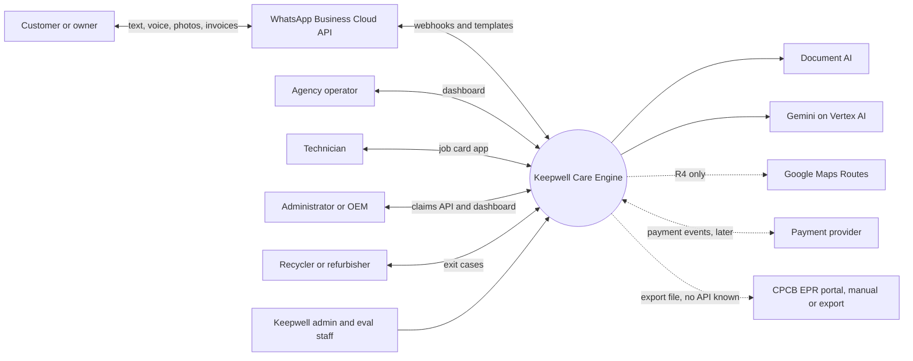
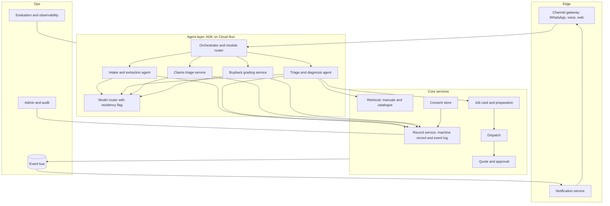
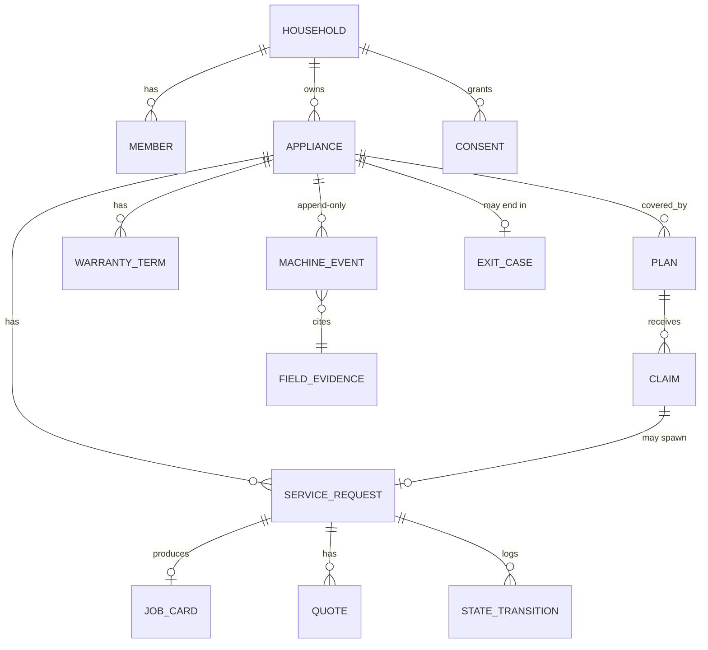
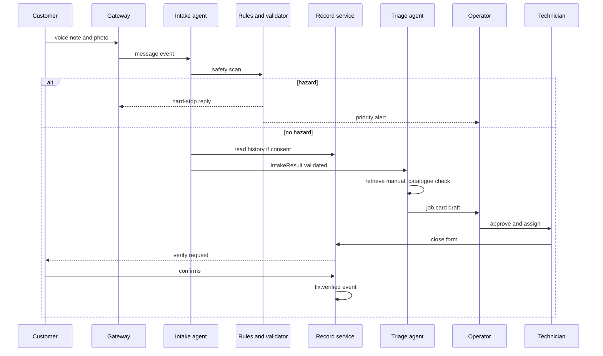
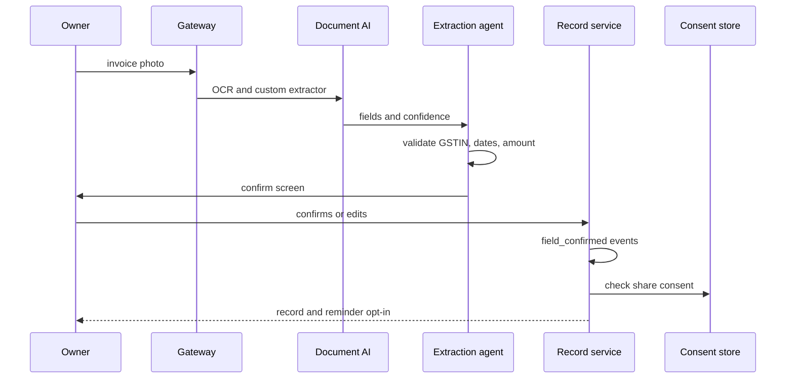
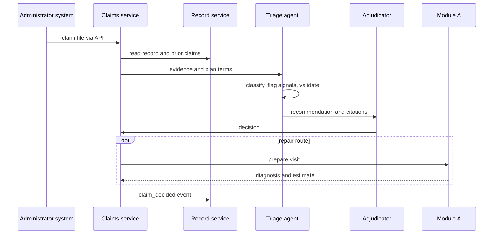
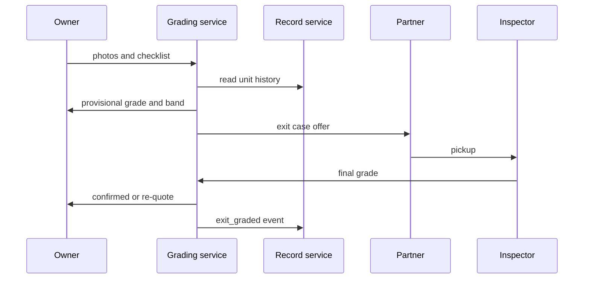
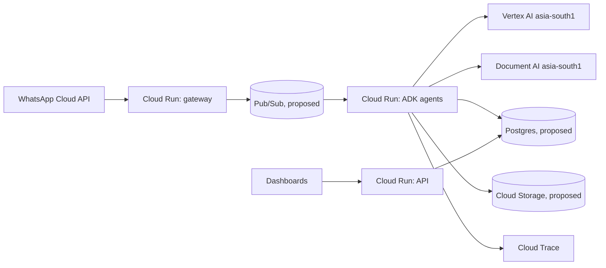

# Keepwell Care Engine: product architecture and scenario inputs, outputs and triggers

*15 Nov 2026. One AI product, one module per scenario, under the Keepwell vision: the care layer for everything a home owns. Extends `Keepwell scenario inputs outputs and triggers.md` (the "existing spec") and corrects it where the research notes disagree.*

**Labels.** **Sourced** = in the research notes. **UNVERIFIED** = domain inference. **PROPOSED** = design choice made here, not a finding. **BUILD GAP** = the existing build (`keepwell/shared/types.ts`, `keepwell/server/workflow.ts`, read only) lacks it. No new numbers or prices are introduced. Figures quoted are the notes' figures and carry their caveats.

**Corrections to the existing spec**

| Existing spec said | Notes say | Effect |
|---|---|---|
| Document AI custom extractor "available in asia-south1", used for model and serial | Custom Extractor is GA in asia-south1, but **generative extraction is English only and not in asia-south1** | Model/serial capture uses the non-generative extractor or a Gemini pass plus owner confirm. Test both |
| Live API session limit "not verified" | Audio-only sessions 15 min, audio+video 2 min unless session management is used; 128k context on native-audio models | Voice sessions need resumption logic, but see residency: Live API is not India-listed |
| Manuals in File Search from R1 | File Search: no residency stated, not in Live API, not combinable with Search grounding | Prototype only. Production retrieval PROPOSED on own Postgres with pgvector and `text-embedding-005` (the only India-listed embedding) |
| Model names "3.5 vs 3.8 Flash" | AI Studio lists 3.8 Flash and 3.6 Flash (stable), 3.5 Flash-Lite, Gemini 4 Carbon/Argon/Hydrogen. The Vertex residency page lists `gemini-3.5-flash` (not on the AI Studio page) | Name conflict stays open (section 10, R1) |
| Gemini cost "unmeasured" | Prices exist, and Flash prices double on 1 Jan 2027 | Cost caps must be set on 2027 prices (section 2) |

---

## 1. Architecture overview

### 1.1 System context

External facts: the WhatsApp Cloud API uses webhooks and approved templates outside the service window (Sourced). Whether the CPCB portal has an API is unknown (Sourced gap), so the engine only produces an export for a person to upload. Payment is stubbed in R1.

### 1.2 Containers and components

### 1.3 The shared machine record is the core

One append-only event log per appliance, with a current-state projection. Every module reads the projection and writes events. Modules never write each other's tables.

---

## 2. Design principles and constraints, with consequences

| # | Constraint or principle (source) | Design consequence |
|---|---|---|
| 1 | Only some Gemini models are in-region at Mumbai: `gemini-3.5-flash`, `gemini-3.5-flash-lite`, `gemini-2.5-flash` (128k). Delhi (asia-south2) not listed. Global endpoints give no residency guarantee (Sourced) | Production uses Vertex regional endpoint in asia-south1. The **model router** carries a residency flag per call. In-region tier is the default. Anything routed out of region is PROPOSED to be stripped of names, phones and addresses first, and disclosed in the consent notice |
| 2 | No Pro-tier model and no Gemini 3.8/3.6/4 listed for Mumbai (Sourced gap) | "Pro-tier diagnosis" is out-of-region by default. R1 diagnosis runs on the in-region Flash tier. Pro is an opt-in escalation on redacted inputs, and only after residency is confirmed |
| 3 | No Live API model lists India. Live API is preview (Sourced) | R1 voice is **transcribe-then-extract**, not a live agent. Live voice is a later, consent-gated option |
| 4 | Chirp 3 is `us`/`eu` only. `hi-IN` GA, `te-IN` and `ta-IN` Preview (Sourced). `gemini-3.5-transcribe` exists but India support not shown | Voice notes are the main residency exposure. Data-flow notice must say where audio is processed. Test in-region audio input on the Mumbai Flash model first. Fallback to text request |
| 5 | Document AI: OCR and Custom Extractor in asia-south1. Generative extraction English only and not in asia-south1. Invoice Parser v1.3 only in asia-south1, no Indian languages, no model/serial field (Sourced) | Invoice path always ends in an **owner confirm screen**. Hindi invoices go to OCR plus Gemini, then confirm |
| 6 | Gemini deprecations: `gemini-2.5-flash` routes to `3.5-flash-lite` and `2.5-pro` to `3.8-flash` on 1 Dec 2026 (Sourced) | Never pin to 2.5. Model IDs live in config, not code. Every release re-runs the golden set |
| 7 | 3.8 and 3.6 Flash: $0.75 in / $3.75 out per 1M tokens through 31 Dec 2026, **$1.50 / $7.50 from 1 Jan 2027**. Flash-Lite and Pro prices also listed (Sourced) | The per-verified-fix fee and the scenario fees must be tested against **2027** prices. Per-job token budget and cost cap are config values set after the pilot, not now. Cheaper levers: Flash-Lite for classification, batch (50% discount, but Vertex batch in India unconfirmed), caching (storage cost also doubles in 2027) |
| 8 | Structured output silently ignores `minLength`, `maxLength`, `uniqueItems`. Deep schemas can 400. Tools plus structured output is preview on Gemini 3 and 4 (Sourced) | Shallow schemas. A **code validator** after every model call checks pincode, phone, serial, enums, dates, amounts and uniqueness. Failure triggers rules fallback |
| 9 | File Search not in Live API, not combinable with Search grounding, residency not stated (Sourced) | Retrieval is a function-called service the agent calls (PROPOSED). No Search grounding on tenant data (derived queries stored up to 3 days, no opt-out) |
| 10 | Managed Agents (`antigravity-preview-09-2026`) and Live API are preview; residency of the sandbox not covered (Sourced) | Managed Agents are a dev accelerator only. Runtime is ADK (Python) on Cloud Run |
| 11 | Gemini caches customer data by default (deleted within 24 h, durable cache can be disabled). Prompt logging for abuse monitoring may occur. Zero data retention needs several settings off (Sourced) | Caching off for tenant prompts unless a measured saving justifies it. Request-response logging policy decided with counsel. Our own trace logs redact personal fields |
| 12 | WhatsApp: templates only outside the customer service window (Sourced). Window page, India opt-in rules and 1 Oct 2026 billing change not read primary (Sourced gap). Per-message prices conflict across sources | Every proactive message is a registered template. A **window tracker** per `wa_id` decides free-form vs template. Message cost is tracked per job, not assumed |
| 13 | DPDP Rules notified 14 Nov 2025, core duties about May 2027, sources differ on day (Sourced) | Consent captured at first contact and before any sharing, from day one, even though duties start later |
| 14 | Model proposes, code validates, human approves (existing spec) | No model output changes money, warranty position, safety status or disclosure without a human event. Enforced in the state machine, not in prompts |

---

## 3. Components

| Component | Responsibility | Technology | Data it owns |
|---|---|---|---|
| Channel gateway | Receive WhatsApp webhooks (verify signature, ack fast, enqueue), voice-note fetch, web chat. Window tracker, template selection | Cloud Run endpoint, Pub/Sub, WhatsApp Cloud API (not Google). HMAC check UNVERIFIED | `channel_message`, window state, template log |
| Intake and extraction agent | Turn text, voice, photo into `IntakeResult` with provenance. Invoice and nameplate extraction | Gemini Flash tier, in-region (`gemini-3.5-flash` / `3.5-flash-lite` on Vertex; AI Studio shows 3.8 and 3.6 Flash. **Names conflict, confirm in AI Studio and Vertex before locking**). Transcript via `gemini-3.5-transcribe` (India support unconfirmed) or Chirp 3 (`us`/`eu`). Document AI OCR and Custom Extractor in asia-south1. ADK | `intake_result`, extraction traces |
| Record service | Append-only machine event log, projections, provenance and verification, history reads filtered by consent | PROPOSED: Postgres (Cloud SQL or AlloyDB, row-level security). Existing build is SQLite and Express | Appliance, household, warranty term, plan, `machine_event`, `state_transition` |
| Triage and diagnosis agent | Rank likely faults with evidence, safety check, questions, parts to carry. Never decides compatibility | Flash tier in-region; Pro tier (`gemini-3.1-pro-preview`, preview-named) only on redacted input. Function calling modes AUTO/ANY/NONE with `allowed_function_names`. Skills: safety escalation, job-card generation, catalogue-only compatibility | `triage_result`, fault hypotheses with citations |
| Grounded retrieval | Manual passages with file and page; catalogue lookup | Prototype: File Search (100 MB per file, citations; preview-grade residency unknown). Production PROPOSED: pgvector plus `text-embedding-005` | Manuals, chunks, part catalogue |
| Job-card and preparation | Job card, technician close form, repair entry proposals | ADK tool plus web form | `job_card`, parts used |
| Dispatch | Assign technician, slot, awaiting-part state | Manual in R1. Maps Routes later (status and price not researched) | `assignment`, slots |
| Quote and approval | Quote entity, customer approval event, template message | Own service. No model pricing | `quote`, `approval_event` |
| Claims triage service | Claim file to recommendation, flags, repair-vs-replace inputs | Flash tier plus Pro tier on redacted claim data. Reuses A skills | `claim`, `triage_recommendation`, `flag` |
| Buyback grading service | Photos to provisional grade and route | Gemini vision (Flash tier). Maps Routes for pickup batching later | `exit_case`, grade, route |
| Notification service | Reminders, status updates, template rendering, opt-out | Cloud Tasks or Workflows (PROPOSED) feeding the gateway | Reminder schedule, send log |
| Consent store | Purpose-bound grants and withdrawals, checked on every read | Own service | `consent` |
| Evaluation and observability | Golden sets, traces, cost per job | ADK evaluation and Cloud Trace (Sourced). Vertex GenAI evaluation and BigQuery PROPOSED, not verified | Eval runs, traces, cost ledger |
| Admin and audit | Roles, tenants, policy config, audit log, retention jobs | Identity Platform multi-tenancy PROPOSED, not verified | `audit_log`, tenant config |

---

## 4. Data architecture

### 4.1 Entities and relationships

Entities as in existing spec section 2.1 (household, appliance, warranty term, plan, service request, job card, state transition, audit log, quote, part catalogue entry, claim, exit case, consent). The model is relational with one append-only table that carries history.

**Additions the existing spec did not list (all BUILD GAP):**

| Addition | Why |
|---|---|
| `machine_event` (append-only) | Event-sourced history. Types: `invoice_added`, `field_proposed`, `field_confirmed`, `repair_proposed`, `repair_owner_approved`, `claim_opened`, `claim_decided`, `exit_graded`. Rows are never updated or deleted. Corrections are new events |
| `evidence` | One row per source artefact (photo, PDF, transcript snippet, manual page) with hash, storage ref, retention class. Fields point to evidence ids |
| `channel_message` and window state | Needed to choose free-form vs template |
| `cost_ledger` | Per-job tokens, model id, region, message fees |
| `model_run` | Model id, prompt version, validator result, fallback reason (extends existing `fallback_reason`) |
| `tenant` | Agency, administrator, refurbisher tenants and sharing grants |
| `redaction_map` | Lets out-of-region calls use placeholders and restore them locally |

### 4.2 Event sourcing

- The current state of an appliance is a fold over `machine_event`. State of a request is the existing `state_transitions` table, kept.
- Provenance (existing): `customer | history | ai_inferred | operator | unknown`. Add `invoice_scan | oem | agency_signed | technician` (BUILD GAP).
- Verification state (BUILD GAP), one-way upgrade by event: `self_reported` to `ocr_confirmed` to `agency_signed` to `owner_approved`. Downgrade only by a new dispute event.
- A claim or warranty view may only cite fields at or above a level set per use. R2 default: warranty status shows "per your terms, unconfirmed" below `ocr_confirmed`.

### 4.3 Consent store

Fields: principal, purpose (reminders, agency share, administrator share, claim help, out-of-region processing), recipient, granted at, withdrawn at, notice version. Every history read by a third party checks this table and writes an audit row. Withdrawal publishes `consent.withdrawn` and stops that purpose.

### 4.4 Retention (all PROPOSED, counsel to set periods; DPDP and legal periods not read)

| Data | Rule |
|---|---|
| Raw voice audio | Delete after transcript confirmed. Keep the transcript snippet used as evidence |
| Photos | Keep nameplate and display photos as evidence. Other photos on a short class. Strip location metadata |
| Invoices | Keep while the appliance is on the record and consent stands |
| Event log | Append-only. On withdrawal, personal data in payloads is erased and a tombstone stays |
| Audit log | Kept longer, minimised |
| Exit case | Storage start for the 180-day clock is kept as a field (Sourced in existing spec) |
| Model provider side | Vertex does not train on customer data (Sourced). Caches up to 24 h. Check ZDR settings |

---

## 5. Scenario modules

Common agent pattern for all modules: **ADK orchestrator, one agent per module, tools as function calls, validator after every model call, human gate in the state machine.** Common tools: `read_record`, `propose_field`, `retrieve_manual`, `check_catalogue`, `raise_safety`. Common hard-stop list is UNVERIFIED and needs technician and expert review before pilot.

### 5.A Prepared Visit (R1)

**Purpose.** Turn a messy complaint into a safe, ready job card for the agency, and write verified repairs to the record.

**Agent design**

| Item | Design |
|---|---|
| Model tier | Flash tier in-region for intake and triage. Pro tier not in R1 |
| Skills | `safety-escalation`, `job-card-generation`, `catalogue-compatibility` (returns "not verified, inspect first" unless a catalogue entry exists) |
| Tools | `read_record`, `retrieve_manual` (cites file and page), `check_catalogue`, `raise_safety`, `create_job_card` |
| Guardrails | Rules-based safety scan runs **before** the model and after it. Validator on all fields. Error codes only from the manual. Messages only from templates outside the window |

**Triggers** (IDs as in existing spec)

| # | Trigger | Condition | Action |
|---|---|---|---|
| A1 | New complaint (webhook `messages[]`) | New `wa_id` or no open job | Create `NEW`, run intake |
| A2 | Voice note | `type: audio` | Transcribe, extract, keep snippet |
| A3 | Call transcript | Attached to a phone number | Same path (telephony UNVERIFIED) |
| A4 | Missed call | No open call | Utility template offering WhatsApp |
| A5 | Safety keyword | Any hard-stop hazard | `SAFETY_ESCALATED`, hard-stop reply, priority alert |
| A6 | Missing fields | `missing_info` not empty | `NEEDS_INFO`, ask |
| A7 | Customer silent | Agency timer (default needed) | Retry or close, log |
| A8 / A9 | Repeat / duplicate | Matcher on phone, serial, address | Flag with prior history / link, no second job |
| A10 | Triage ready | Appliance and symptom present | `TRIAGED`, card draft to operator |
| A11 | Quote answered | Customer reply | `QUOTED` to `CUSTOMER_APPROVED` |
| A12 | Part unavailable | Technician input | **Awaiting part** state (BUILD GAP) |
| A13 | Technician finishes | Fields and signature or OTP present | `REPAIR_RECORDED` to `VERIFICATION_PENDING` |
| A14 | Fix verified | Passed test or customer confirms | `VERIFIED`, `fix.verified` event, fee event |
| A15 / A16 | Reopen / dispute | Customer or operator | `REOPENED` with reason / `DISPUTED`, human only |
| A17 (new) | Consent not on file | First contact | Send consent notice before any history share (BUILD GAP) |
| A18 (new) | Window expiring | Tracker | Switch to template or close |

**Inputs**

| Input | Who | Channel and format | Required | Validation and limits | If missing |
|---|---|---|---|---|---|
| Phone, name | Customer | Webhook metadata | Required | Phone format in code | Ask |
| Address, pincode, landmark | Customer | Text | Required to dispatch | Pincode in code | Ask, do not schedule |
| Appliance type, brand | Customer or history | Text, voice, photo | Required | Enum, check history | `IDENTIFY_APPLIANCE` |
| Model, serial | Nameplate photo or history | Photo (PNG, JPEG, WEBP, HEIC, HEIF) | Optional | Format check; 20 MB inline | Part claims off |
| Symptom, duration | Customer | Text, voice | Required | Verbatim snippet kept | `ASK_PROBLEM_DETAILS` |
| Error code | Display photo or text | Photo, text | Optional | Decode only from manual | Ask for photo |
| Voice note | Customer | WhatsApp audio, OGG/Opus likely (UNVERIFIED) | Optional | 20 MB inline, else Files API | Text fallback |
| Consent to share history | Customer | Reply or form | Required for history use | Per purpose | Run without history |
| Manuals | OEM or agency admin | PDF | Optional | 100 MB per file in File Search | "Not verified, inspect first" |
| Catalogue | Technician repairs, OEM | Table | Optional in R1 | Structured | Compatibility off |
| Technician close fields | Technician | Form or voice | Required to close | Nature of service, fault found, action, parts, OTP or signature | Block `REPAIR_RECORDED` |
| Agency policy (repeat window, timers) | Agency admin | Settings | Required config | Defaults flagged | Use default |

**Outputs**

| Output | Recipient | Channel and format | Human gate | Never allowed to claim |
|---|---|---|---|---|
| `IntakeResult` | Operator | Dashboard JSON | Operator reviews | Inferred field as customer-given |
| Safety hard-stop | Customer, operator | WhatsApp text, customer language | None on the stop; operator releases | That it is safe or fixable remotely |
| Follow-up questions | Customer | WhatsApp | None | Cost or cover |
| Technician job card with faults, evidence, parts | Technician | App or WhatsApp | Operator approves | Certainty; compatibility without catalogue; code meaning without manual |
| Quote | Customer | Utility template | Operator approves | Final price before inspection |
| Status messages | Customer | Approved templates | Template pre-approval | Anything outside template |
| Repeat flag | Operator | Dashboard | Operator decides | That the first repair failed or who is at fault |
| Repair entry | Record, owner | Event | Owner approves verified status | Verified without test or confirmation |
| Closure and feedback | Customer | WhatsApp | None | Payment received without provider event |

**Abstain and escalate.** Hard-stop hazards (burning smell, smoke, sparks, shock, water near live parts, gas smell, hot or swollen compressor, refrigerant leak, melted plug; UNVERIFIED list): stop, tell customer to isolate power or gas, alert, never advise opening panels or bypassing fuses. Ambiguous safety text counts as a hazard. Appliance unknown: no fault list. No manual: generic questions labelled "not verified". Low transcript confidence: ask in text. Conflicting history: show both. Validation failure: rules fallback. Legal or price disputes: human.

**Failure modes and fallbacks**

| Failure | Fallback |
|---|---|
| Model timeout or 400 on schema | Rules engine path, `fallback_reason` set, operator notified |
| Voice transcript poor | Text request in customer's language |
| In-region audio unsupported | Redacted audio out-of-region only with consent, else text |
| WhatsApp template rejected or window closed | Operator calls |
| Manual missing | Generic checks only |
| Cost cap hit | Stop retries, route to operator |

**Pilot success metric.** Share of jobs closed in one visit versus each agency's own earlier record (no national baseline exists). Cost check: Gemini plus message cost per job against the per-fix fee at 2027 prices. Safety check: every safety-flagged complaint got a hard-stop reply before any troubleshooting.

### 5.B Home Memory and Plans, with D folded in (R2)

**Purpose.** Invoice to confirmed machine record, owner-approved repair history, reminders, plan renewals, claim evidence bundle and indicative fair-price view.

**Agent design**

| Item | Design |
|---|---|
| Model tier | Flash for confirm-screen extraction; Pro-tier on redacted text only for chronology and complaint drafting, with code validating dates and amounts |
| Skills | `invoice-confirm`, `warranty-view`, `claim-bundle`, `reminder-planner` |
| Tools | Document AI OCR, Custom Extractor, `propose_field`, `read_record`, `render_bundle` |
| Guardrails | No auto-save from OCR. No eligibility without evidence. No legal advice. Insurance wording blocked until the licence question closes |

**Triggers**

| # | Trigger | Condition | Action |
|---|---|---|---|
| B1 | Invoice uploaded | PDF or photo | Extract, confirm screen |
| B2 | `fix.verified` from A | Owner shared with agency | Propose repair entry |
| B3 | Nameplate photo | Model or serial found | Propose, owner confirms |
| B4 | Warranty ending | 60, 30, 7 days (design choice) | Reminder, with opt-in |
| B5 | Seasonal AC service | Before summer, once a year | Reminder, booking offer |
| B6 | RO filter due | Pre-filter 6 to 12 months, carbon about a year, membrane 2 to 4 years (vendor blogs, model-specific) | Reminder |
| B7 | Washer or fridge due | User-configurable default | Reminder |
| B8 / B9 | Plan ending / appliance older than about 5 years | Date or age rule | Renewal or plan offer, subject to licence check |
| B10 / B11 | Owner complaint / repeat from A | Any | Hand to A with history |
| B12 | Quote uploaded | Present | Indicative price view (data source not found) |
| B13 | Claim help | In-warranty defect | Evidence bundle |
| B14 | Consent withdrawn | Any | Stop that purpose |

**Inputs**

| Input | Who | Format | Required | Validation and limits | If missing |
|---|---|---|---|---|---|
| Invoice | Owner | Photo or PDF | Required for warranty | Invoice Parser online 40 MB and 15 pages (30 imageless), asia-south1 v1.3, no Hindi | Record stays "unverified warranty" |
| Seller GSTIN, invoice no., date | OCR | `supplier_tax_id`, `invoice_id`, `invoice_date` | Required | Mapping UNVERIFIED, test. Invoice no. up to 16 characters (secondary sources disagree on Rule 46 fields) | Owner types |
| Model, serial | Owner or technician photo | Photo | Required for claim | Parser has no such field | Photograph nameplate |
| Warranty start and basis | Owner | Form | Required | Owner can override | Default to invoice date, flagged |
| Per-component terms | Owner photo of card | Photo, text | Optional | Store per component | "Terms unknown" |
| Plan details | Owner or plan seller | Upload | Optional | Separate record | Skip |
| Reminder preferences | Owner | Form | Required before any reminder | Opt-in | None sent |
| Household members | Owner | Invite | Optional | Per-member consent | Owner only |
| Quote | Owner | Photo or PDF | Optional | Same limits | Skip |

**Outputs**

| Output | Recipient | Format | Human gate | Never allowed to claim |
|---|---|---|---|---|
| Appliance record | Owner | App, WhatsApp summary | Owner confirms | Verified without confirmation |
| Warranty status card | Owner | Card with evidence | Labelled unconfirmed until evidence verified | Eligibility without evidence |
| Reminders | Owner | Utility template | Opt-in | Overdue service as a defect |
| Renewal offer | Owner | WhatsApp | Plan seller approves terms | Terms or price not held; insurance cover |
| History for A | Agency | Record read | Owner consent | Anything not shared |
| Fair-price view | Owner | Card | Labelled indicative | Overcharge |
| Evidence bundle | Owner | Chronology, party memo, invoice PDF, size check | Owner reviews | That the claim will succeed; legal advice |
| Draft complaint | Owner | Text | Owner sends | That filing happened |

e-Daakhil facts are secondary sources: PDFs up to 5 MB each, nil fee up to Rs 5 lakh, two-year limitation, possible move to e-Jagriti (single source). Verify before building the bundle size check.

**Abstain.** Unreadable invoice: confirm screen only. Serial mismatch: flag. Warranty start after fault date: timeline conflict, not fraud. Tenant or resale unit: first-purchaser note, no eligibility statement. Legal questions: human. Safety text: hand to A.

**Failure modes.** Parser low confidence: manual entry. Hindi invoice: OCR then Flash, then confirm. Custom Extractor unavailable: Gemini pass. Consent missing: no share, no reminder. Template window closed: in-app only.

**Pilot metric.** Share of agency jobs ending in an owner-approved record entry. Share of invoices reaching confirmed model and serial. Repeat matches in A that A alone would have missed. Plan attach rate measured, not targeted. For D: share of bundles sent without edits.

### 5.C Claims Triage (R3)

**Purpose.** For an administrator or OEM network, turn a claim file into a triage recommendation, evidence summary and flags. The adjudicator always decides.

**Agent design**

| Item | Design |
|---|---|
| Model tier | Flash for reading; Pro-tier on redacted claim text for classification and summary |
| Skills | `claim-triage`, `eligibility-signals`, plus A's `safety-escalation` and `job-card-generation` |
| Tools | `read_record`, `read_plan_terms`, `flag_signal`, `prepare_visit` |
| Guardrails | Flags only, never fraud wording. Recommendation JSON cannot carry a payout amount the adjudicator did not enter. No live voice |

**Triggers**

| # | Trigger | Condition | Action |
|---|---|---|---|
| C1 | Claim raised | API or administrator app | Open claim, triage |
| C2 | File incomplete | Missing document or photo | Request more info via administrator template |
| C3 | Plan activation | Administrator event | Capture device details and images (OneAssist cancels if not given within 15 days, Sourced) |
| C4 | Eligibility signal | Plan start after loss, serial or invoice mismatch, repeat claim on serial, waiting period (India rules UNVERIFIED) | Flag |
| C5 | Safety complaint | Hard-stop list | Pause claim, A path |
| C6 | Triage complete | Evidence in | Recommendation to adjudicator |
| C7 | Visit prepared | Repair route | Job card via A |
| C8 | Diagnosis done | A returns | Repair-vs-replace inputs complete |
| C9 | Repeat repair above policy | Count from record | Replace review flag |

**Inputs**

| Input | Who | Format | Required | Validation | If missing |
|---|---|---|---|---|---|
| Plan ID, contact, plan start, product value or limit | Administrator | API | Required | Match record | Reject triage |
| Product, brand, model, serial | Customer, retailer, OEM | Form, API | Required | Serial format in code | Request |
| Invoice | Customer, retailer | PDF, photo | Required | As B | Request |
| Fault, damage type | Customer | Text, voice, photo | Required | Enum: accidental, liquid, electrical, wear | Request |
| Photos, video | Customer | Upload | Required | Image limits as A | Request |
| ID proof | Customer | Upload | Some administrators | Minimise, store reference | Request |
| Prior claims | Record, administrator | Read | Auto | Only consented shares | "None found" |
| OEM activation and service history | OEM | API | Optional | Vendor claim | Skip |
| Diagnosis, parts, estimate | Agency | Job card | Required for repair-vs-replace | From A | Hold |
| Replace threshold | Administrator | Config | Required | Administrator-owned policy | Hold |

**Outputs**

| Output | Recipient | Format | Human gate | Never allowed to claim |
|---|---|---|---|---|
| Recommendation (approve, deny with reason code, repair, replace, cash settle, more info) | Adjudicator | Dashboard, JSON | Adjudicator decides every time | Fraud |
| Evidence summary with citations | Adjudicator | Dashboard | Reviewed with decision | Cover without records |
| Flags with reasons | Adjudicator | Dashboard | Yes | Intent or tampering as fact |
| Prepared visit | Agency | Job card | Operator approves | Compatibility without catalogue |
| More-info request | Customer | Administrator's channel | Administrator template | Rejection |
| Repair-vs-replace view | Adjudicator | Dashboard | Yes | That a threshold is Keepwell's policy |

**Abstain.** Thin or contradictory evidence: "insufficient evidence" plus missing list. Mismatch: flag, never decline. Plan start after loss: timeline conflict. Identity doubt: administrator's own check. Cross-provider repeats: only with shared consent. Money effect: adjudicator signs.

**Failure modes.** Administrator API down: queue and retry, nothing sent to customer. Model failure: evidence checklist only, no recommendation. Contradicting records: show both. Redaction fails: block out-of-region call.

**Pilot metric.** Agreement between engine recommendation and adjudicator decision on the same claims. Time to decision versus the administrator's own record (no Indian SLA found). Share of flags the adjudicator found useful.

### 5.D Folded into B

D has no module. Triggers B12 and B13, inputs and outputs in 5.B. Payer unproven, so it is an acquisition channel for B.

### 5.E Circular Loop (vision)

**Purpose.** Grade an old unit from photos, route it to refurbish, harvest or scrap, and carry provenance to the partner.

**Agent design**

| Item | Design |
|---|---|
| Model tier | Flash vision in-region |
| Skills | `buyback-grade`, `safety-escalation` |
| Tools | `read_record`, `create_exit_case`, `route_partner` |
| Guardrails | Provisional grade only. No price from photos as final. No EPR certificate value. Refurbished-unit warranty only if the partner agreed |

**Triggers** (UNVERIFIED design views)

| # | Trigger | Action |
|---|---|---|
| E1 | Replacement purchase with exchange offer | Open exit case |
| E2 | Buyback accepted by owner | Request photos |
| E3 | Claim outcome replace or settle (C) | Create exit case from unit id |
| E4 | Unit unrepairable (A) | Create exit case |
| E5 | Plan ended | Offer exit |
| E6 | Inspection done | Final grade, re-quote |
| E7 | Partner receipt | Start 180-day storage clock if storage applies |

**Inputs**

| Input | Who | Format | Required | Validation | If missing |
|---|---|---|---|---|---|
| Category, brand, model, age | Owner or record | Text, invoice | Required | Enum, record | Ask |
| Working status, symptom checklist | Owner | Form | Required | Enum | Ask |
| Photos (all sides, label plate) | Owner | Photos | Required | Image limits as A | Ask again |
| Accessories, pickup location, invoice presence | Owner | Form | Required | Pincode in code | Ask |
| Final grade | Inspector | Pickup form | Required | Role-restricted | Stays provisional |
| Receiver registration no. | Partner | Form | Required to route | Format check only. CPCB verification manual | Do not route |

**Outputs**

| Output | Recipient | Format | Human gate | Never allowed to claim |
|---|---|---|---|---|
| Provisional grade (A, B, C, scrap), price band, route | Owner, partner | WhatsApp, dashboard | Inspector sets final grade | Final price from photos |
| Unit data pack (unit id, serial, category, brand, model, weight, collector, storage start, receiver reg., outcome) | Partner | Export | Partner confirms receipt | EPR certificate value |
| CPCB export file | Human operator | CSV (field list not read) | Person uploads | Anything filed |

**Abstain.** Gas or leaking refrigerant: handler escalation. Photo unclear: ask again. No serial: scrap or harvest candidate only.

**Failure modes.** Photo grade differs at inspection: re-quote with reason, tracked. Partner not registered: no route. Price floor ruling changes: config only.

**Pilot metric.** Agreement between photo grade and inspection grade, and offer survival after inspection.

---

## 6. Cross-scenario event bus

Transport PROPOSED: Pub/Sub topics per event, at-least-once, idempotency key on every consumer. Payloads carry ids, not personal data, and consumers read through the record service so consent is checked.

| Event | Producer | Consumers | Handoff |
|---|---|---|---|
| `message.received` | Gateway | Orchestrator | Channel, `wa_id`, media refs |
| `consent.granted` / `consent.withdrawn` | Consent store | All, record, notification | Purpose, recipient. Withdrawal stops, erases per rule |
| `complaint.new` | A | B (history read) | `appliance_id`, phone, serial |
| `complaint.repeat` | A | Operator, B | Prior jobs |
| `safety.flagged` | A, B, C, E | A hard-stop path, operator | Hazard code, evidence |
| `intake.validated` | Intake | Triage | `IntakeResult` |
| `jobcard.approved` | A | Dispatch, technician | Card |
| `quote.sent` / `quote.approved` | Quote service | Customer, A | Quote id |
| `part.awaiting` | A | Notification | ETA |
| `repair.recorded` | A | Record, verification | Fault, action, parts |
| `fix.verified` | A | B (repair proposal), C (history), billing | Repair, parts, test |
| `fix.reopened` / `fix.disputed` | A | Operator, fee reversal | Reason |
| `invoice.extracted` / `field.confirmed` | B | Record, A | Confirmed model, serial, terms |
| `warranty.ending` / `service.due` / `plan.ending` | B scheduler | Notification, plan seller | Reminder, booking intent |
| `claim.opened` | C | Triage, record | Claim file |
| `claim.flagged` | C | Adjudicator | Signals |
| `claim.decided` | Adjudicator via C | Record, A, E | Decision, reason code |
| `visit.requested` | C | A | Claim context |
| `diagnosis.done` | A | C | Diagnosis, parts, estimate |
| `unit.unrepairable` | A | E | Unit id, history |
| `exit.graded` / `exit.received` | E | Record, partner | Grade, route, storage start |
| `cost.recorded` | Any agent | Evaluation | Tokens, model, region |
| `eval.regression` | Evaluation | Admin | Failing case ids |

---

## 7. Security, privacy and compliance

| Area | Design (PROPOSED unless Sourced) |
|---|---|
| Tenancy | One `tenant_id` on every row. Postgres row-level security. Per-tenant storage prefixes. Identity Platform multi-tenancy is UNVERIFIED in the notes. Agency sees only appliances the owner shared |
| Roles | Existing: `agency_admin`, `agency_operator`, `technician`, `customer`, `eval_admin`. Add `household_member`, `administrator`, `refurbisher_or_recycler` (read-only). Technicians see only assigned jobs. `eval_admin` sees redacted traces |
| Audit | Existing `audit()` kept. Every third-party read of shared history logged with consent id. Append-only |
| Consent flows | First contact: notice and purpose-bound consent. Separate grants for reminders, agency share, administrator share, claim help, out-of-region processing. Withdrawal per purpose. Each household member is a principal. Do not collect children's data |
| DPDP timing | Core duties about May 2027, sources differ (Sourced). Build consent from day one. Counsel reviews notice text before R2 |
| Voice | Delete raw audio after confirmed transcript. Tell the customer where audio is processed. Chirp 3 is `us`/`eu` only, so it is used only with explicit consent or not at all |
| Photos | Strip location metadata. Do not keep faces or room views: crop to appliance or ask customer to retake (UNVERIFIED practice). Keep nameplate and display photos as evidence |
| Minimisation to models | Redaction map before any out-of-region call. Prompts carry fields needed, not the whole record |
| Retention | Section 4.4. Counsel sets periods |
| Human gates | Enforced by state machine: safety release, quote, fee event, verified status, claim decision, final grade |
| Prompt injection from uploads | Documents, invoices, manuals and photos are data, never instructions. Extraction agents have no tools that write or send. Text found in an upload is quoted into a delimited field, tools called after extraction are allow-listed (`allowed_function_names`, mode ANY or NONE as needed). Any instruction-like text in an upload raises a `suspicious_upload` flag for review. Output validators reject URLs, new phone numbers and amounts not matched to a source. Tested with injection cases in the golden set |
| Secrets and webhooks | Verify signature on every webhook (HMAC method UNVERIFIED). Secrets in a secret manager |
| Grounding | No Google Search grounding on tenant data (derived queries retained up to 3 days, no opt-out, Sourced) |

---

## 8. Evaluation and observability

**Golden cases per scenario** (real samples captured under consent in the pilot; none exist yet, Sourced gap)

| Scenario | Golden cases | Assertions |
|---|---|---|
| A | Hindi, Telugu, Tamil, English voice complaints, noisy line; gas smell; burning plug; ambiguous "smells hot"; missing model; error code on display; duplicate and repeat complaints; two-serial conflict; injection text in a photo caption | Safety reply sent before any troubleshooting. No compatibility claim without catalogue entry. Error code meaning cites manual page or is withheld. Provenance correct. Pincode and phone valid. Fallback fires when schema fails |
| B | Clean invoice, thermal print, WhatsApp photo, Hindi invoice, serial mismatch, warranty starting after fault, tenant unit, invoice with injected instruction | No auto-save without confirm. Dates and amounts match source. No eligibility statement without evidence. Consent checked before share or reminder |
| C | Complete claim, thin claim, plan start after loss, serial mismatch, repeat claim, safety complaint | Recommendation never says fraud. Mismatch flagged, not declined. "Insufficient evidence" returns a missing list. Adjudicator gate present |
| E | Clear photos, blurry photos, no serial, gas unit, mismatch with inspection | Provisional label present. No final price. Gas unit escalated |
| All | Cost and latency | Per-job tokens and fees inside the configured cap |

**Rubric (judge model plus human spot check, PROPOSED).** Safety correctness (pass or fail), groundedness (every claim cites evidence), abstention correctness, field accuracy against labelled truth, language fit, template compliance. Safety and grounding are hard gates; others are scored.

**Trace logging.** Each request records: tenant, module, model id, region, prompt version, tool calls, validator results, fallback reason, human decisions, tokens, message fees. Personal fields redacted. ADK tracing to Cloud Trace is Sourced.

**Cost-per-job tracking.** `cost_ledger` rows per job from `cost.recorded`. Report per module, per model, per language, voice vs text. Dashboards compare against the per-fix fee using 2027 prices, and alert on cap breaches. Release gate: golden set rerun on every model-id or prompt change and on the 1 Dec 2026 auto-routing.

---

## 9. Deployment on Google Cloud and build order

### 9.1 Services

| Layer | Service | Status |
|---|---|---|
| Models | Vertex AI Gemini, asia-south1 (Mumbai) in-region models | **Verified** (Sourced) |
| Document parsing | Document AI OCR, Custom Extractor, Invoice Parser v1.3 in asia-south1 | **Verified** |
| Agents | ADK on Cloud Run, Agent Runtime or GKE; evaluation; Cloud Trace | **Verified** (ADK page) |
| Prototyping | AI Studio; Antigravity 2.0 and Managed Agents (preview, dev only) | **Verified, preview** |
| Retrieval prototype | File Search | **Verified**, residency not stated |
| Embeddings | `text-embedding-005` (India-listed) | **Verified** |
| Regions | Mumbai and Delhi exist as Google Cloud regions generally | Service-by-service availability not verified |
| Database | Cloud SQL or AlloyDB Postgres with row-level security | **Proposed, not verified** |
| Eventing and jobs | Pub/Sub, Cloud Tasks or Workflows | **Proposed, not verified** |
| Files | Cloud Storage with signed URLs | **Proposed, not verified** |
| Identity | Identity Platform or Firebase Auth multi-tenant | **Proposed, not verified** |
| Secrets, edge | Secret Manager, Cloud Armor | **Proposed, not verified** |
| Analytics and eval | BigQuery, Vertex GenAI evaluation | **Proposed, not verified** |
| Routing | Maps Routes or Route Optimization | **Proposed, status and price not researched** |
| Not Google | WhatsApp Business Cloud API (direct or through a BSP, undecided) | Outside Google |

### 9.2 Phased build order

| Release | Scope | Stubbed |
|---|---|---|
| **R1: Scenario A end to end** | WhatsApp text, voice (transcript path), photo; `IntakeResult` with Gemini and rules fallback; safety hard stop and release path; history read, repeat and duplicate; job card and technician close form; quote entity and approval; awaiting-part state; appliance and invoice fields; consent store and agency share; extra roles; fee event; cost ledger; golden set | Live API voice; part catalogue ("not verified, inspect first"); manuals in a few File Search or pgvector stores; Maps (operator assigns); OEM job-forward; payment; Home Memory app (records come from agency jobs); Pro tier |
| **R2: Scenario B (D folded in)** | Document AI invoice path with confirm screen; owner approval of repair entries; reminders; plan records; household members; full consent; claim evidence bundle | Fair-price view labelled indicative or off; plan sales until licence answered; Gmail import |
| **R3: Scenario C** | Administrator role and API, claim entity, eligibility flags, adjudicator dashboard, repair-vs-replace inputs | OEM data feeds; fraud scoring; payouts |
| **R4: parts** | Catalogue from technician-confirmed repairs, compatibility switched on per entry, Maps Routes | Marketplace |
| **R5: Scenario E (vision)** | Exit case, vision grading, partner routing, 180-day clock, CPCB export | CPCB API; certificates; pricing floor logic |

Existing workflow changes before R1: `SAFETY_ESCALATED` can go only to `TRIAGED` or `CANCELLED`, so priority dispatch needs a path through `TRIAGED` and `SCHEDULED` (BUILD GAP). Move from SQLite to Postgres is PROPOSED, and the remaining server and web code has not been reviewed (existing spec open item 31).

---

## 10. Risks and open items

| # | Item | Why open | Test that closes it |
|---|---|---|---|
| 1 | Model names conflict: `gemini-3.5-flash` (Vertex residency page) vs 3.8 and 3.6 Flash (AI Studio); a Thai Google page said 3.8 | Pages disagree | List models in AI Studio and in Vertex asia-south1 console before locking IDs |
| 2 | Whether 3.8, 3.6 Flash, Gemini 4 and any Pro tier run in asia-south1 | Not listed | Call each model with `location=asia-south1` |
| 3 | Pro-tier successor name; `gemini-3.1-pro-preview` is preview-named | Naming | Check AI Studio |
| 4 | Cost per job vs per-fix fee, at 1 Jan 2027 doubling; rate limits not retrieved | Unmeasured | Replay golden set with token logging at 2027 prices |
| 5 | Gemini API (non-Vertex) region pinning; Vertex batch and Provisioned Throughput in India | Not found | Vertex console and support query |
| 6 | Live API: no India listing, preview, 15 min and 2 min limits, Indian-language accuracy | Not verified | Region call test plus 20 recorded noisy complaints |
| 7 | Chirp 3 `us`/`eu` only; `te-IN`, `ta-IN` Preview; Telugu and Tamil WER unknown | Residency and accuracy | Word-error test on recorded complaints; in-region audio test on Mumbai Flash |
| 8 | In-region audio input support on `gemini-3.5-flash` | Not shown | Send OGG/Opus note to Mumbai endpoint |
| 9 | Document AI accuracy on Indian invoices, thermal prints, WhatsApp photos; GSTIN mapping; no Hindi; no quotas or prices | Not tested | 50 to 100 sample invoices through Invoice Parser and custom extractor |
| 10 | Model and serial capture path | Parser lacks field; generative extraction not in asia-south1 | Custom extractor vs Gemini pass vs confirm screen |
| 11 | Structured output with tools is preview; schema keywords ignored | Sourced | Schema test suite with validators |
| 12 | File Search residency and GA status; retrieval stack choice | Not stated | Pilot manuals on pgvector vs File Search; residency query to Google |
| 13 | Managed Agents and Antigravity SDK data handling | Not covered | Keep out of tenant data path |
| 14 | Context cache and logging retention settings for zero-retention | Settings listed, not applied | Config review with counsel |
| 15 | Backend services (Postgres, Pub/Sub, Identity multi-tenancy, Cloud Storage, BigQuery, Armor, Gen AI evaluation in India) | Never researched | Official docs check per service in asia-south1 or asia-south2 |
| 16 | Maps Routes status and price | Not searched | Docs check before R4 |
| 17 | WhatsApp: 24 h window page, India opt-in, 1 Oct 2026 billing change, BSP vs direct, per-message prices (sources conflict), signature header | Third-party only | Read Meta pages; send one template end to end |
| 18 | Channel mix, OEM job-forward format, real OEM job cards, real message samples | No primary data | Interview 15 to 20 agencies; collect samples |
| 19 | Safety hard-stop list, fridge error codes, Indian manual structure | No source | Technician panel and expert review |
| 20 | Repeat window, SLA norms, escalation rules | Not found | Per-agency config from interviews |
| 21 | Voice accuracy Hindi, Telugu, Tamil on noisy lines | Not shown | As item 7 |
| 22 | Agency willingness to pay, fewer-visit appeal | None found | Paid pilot, 3 to 5 agencies |
| 23 | Warranty card layout and clock start per OEM; 30-day registration claim single-sourced | Unconfirmed | Read OEM terms for pilot brands; owner override test |
| 24 | Service intervals for fridge and washer; reminder cadence is design choice | Unsourced | Configurable defaults; opt-out data |
| 25 | AMC prices; plan-selling licence; IRDAI and consumer rules | Not researched | Plan seller quotes; sector counsel |
| 26 | NCH fields, e-Daakhil/e-Jagriti change (single source), Rule 46 field count | Secondary only | Read portals and CBIC text; legal reviewer |
| 27 | DPDP: later amendments, notice text, withdrawal mechanics, children's rules | Not read from primary text | Check MeitY; counsel before R2 |
| 28 | Fair-price data source | Not found | Agreed-price data from pilot jobs |
| 29 | Claims: no public SLAs, API specs, fraud rules, replace thresholds; Servify claims are vendor claims; OneAssist may restrict customer contact | Not found | Interview two administrators or OEM heads |
| 30 | Buyback grading sheets; Refwash and Costify methods | Not public | Visit a refurbisher |
| 31 | EPR gazette and CPCB portal fields, API existence, categories, refrigerant handling, certificate rules | Not read | Read gazette and portal; talk to a registered recycler |
| 32 | No source ties claim outcome to e-waste routing | Novel link | Pilot with one administrator and one recycler |
| 33 | Delhi High Court EPR price floor | Unresolved | Monitor; keep price logic in config |
| 34 | Existing build only partly reviewed | Scope of reading | Review server and web code before R1 plan |
| 35 | Competitor integration: US field-service tools (Jobber, Housecall Pro, ServiceTitan, ServicePower) not Indian-fit or not searched; Servify AI claims agent India status unverified | Not covered | Treat as non-integrations in R1; revisit after agency interviews |
