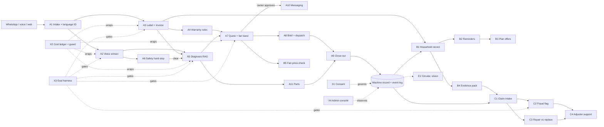

# Keepwell feature specification, Part 1: product level

As of 15 Nov 2026. Evidence tags: 🟢 sourced, 🟡 secondary, 🔴 assumption or inference. ⚖️ = needs a lawyer. 🛠️ = needs a domain expert (electrician, refrigeration, gas). Per-feature specs (A1-A11, B1-B5, C1-C4, X1-X4, E1) are in other parts and cite this file as **"Global eval policy"** (section 10), **"HITL tiers"** (section 4), **"Cost model"** (section 6) and **"Fallback ladders"** (section 7). Existing files are referenced, not repeated: `Keepwell product architecture and scenario IO.md` (architecture, entities, retention), `Keepwell problems, scenarios and revenue streams.md` (P1-P10, R1-R9), and the three notes in `research_notes/Keepwell feature spec research/` (cost, responsible AI, failure modes).

Feature IDs. **A** Prepared Visit: A1 intake and language ID, A2 voice transcribe-and-extract, A3 label and invoice extraction, A4 warranty check, A5 diagnosis and parts (RAG), A6 safety hard-stop, A7 quote and fair-price band, A8 technician brief and dispatch, A9 job close-out, A10 customer messaging, A11 parts request. **B** Home Memory: B1 household record with consent, B2 reminders, B3 plan/AMC offers, B4 claim evidence pack, B5 consumer fair-price check. **C** Claims triage: C1 intake and completeness, C2 fraud/anomaly flag, C3 repair-vs-replace, C4 adjuster decision support. **X** cross-cutting: X1 consent and privacy, X2 cost ledger and budget guard, X3 eval harness, X4 admin console. **E1** circular pickup and EPR (vision stub).

---

## 1. Problem, users and why now

### 1.1 Problem

Small repair agencies run on WhatsApp, phone calls and memory. They arrive without the part, model or history (P1), lose job notes spoken in a regional language (P2), cannot find parts (P5), and cannot prove warranty status (P3). Households cannot judge whether a quote is fair (P4). Administrators and OEM networks pay for manual claim triage (P6). Keepwell puts one AI desk inside WhatsApp that turns a customer's voice note and two photos into a prepared visit, keeps the resulting record in a household's Home Memory, and later feeds structured evidence to claim administrators.

Evidence strength differs by problem: P3 is the best sourced (🟢 55% of surveyed buyers had a defective in-warranty high-value product; 21% of those who acted got a refund or replacement; source in the earlier problem map). P1 and P2 are plausible mechanisms with 🔴 no measured revisit rate. **First thing to validate is whether a revisit costs an agency enough for it to pay Rs 40 to avoid one** (section 11).

### 1.2 Users and jobs-to-be-done

| User | Phase | Job to be done | Pain today | What "done" looks like | Features |
|---|---|---|---|---|---|
| Agency owner (2-10 technicians, owner-run) | 1 | "Quote fast, send the right person with the right part, get paid, never lose a job record" | Calls missed, wrong part, revisits, unrecorded jobs, disputes | Job card per call, quote in minutes, fewer revisits | A1-A11, X4 |
| Technician (field, shared low-end Android) | 1 | "Know what I am walking into; close the job in 30 seconds without typing" | Typing in English, no history, no part list | Brief before leaving, voice close-out | A5, A6, A8, A9 |
| Household member (first-time buyer, paper invoices) | 1.5 | "Know my warranty, get a fair price, not be cheated, claim when it fails" | Lost invoice, unknown entitlement, price fear | Record, reminders, evidence pack | A10, B1-B5 |
| Administrator / adjuster | 2 | "Decide claims faster with evidence, catch fraud, never wrongly deny" | Manual triage, poor evidence | Ranked queue, evidence-linked recommendation, audit trail | C1-C4 |
| Keepwell ops (admin, eval) | 1 | "See cost, quality, incidents per agency" | n/a | Console, alerts | X2-X4 |
| Producer / recycler (later) | 3 | EPR evidence and pickups | n/a | Exit case | E1 |

### 1.3 Tier 2/3 specifics that drive product choices (from the earlier revenue file; 🟡 unless noted)

| Reality | Consequence in this spec |
|---|---|
| WhatsApp and phone only; no dashboard on day one | All A features operate via WhatsApp; X4 is for Keepwell staff first |
| Hindi, Telugu, Tamil, Kannada, Marathi, mixed with English | Voice is primary; per-language release gates (section 5.4, 10) |
| Pay per job, not per seat | R1 per completed job card, so **cost per job is the unit economics** (section 6) |
| Low-end shared phones, poor bandwidth | Small uploads, offline capture, SMS/IVR fallback (section 7.3) |
| Paper invoices, informal parts | A3 is the main record-creation path; A11 awaiting-part status is core |
| Trust deficit | Provenance and verification labels shown on every field |

### 1.4 Why now

| Factor | Evidence | Tag |
|---|---|---|
| Multimodal models read Indic speech and photos in one call; Gemini audio is 32 tokens/s, about Rs 0.135 per 60 s on Flash vs Rs 1.50 on Chirp 3 | Cost note | 🟢/🔴 calc |
| Best-system Hindi WER roughly 6-14% on public benchmarks; low-resource languages worse and unmeasured on Gemini | Failure-modes note (Vaani, Voice of India) | 🟢 |
| DPDP Rules notified 14 Nov 2025; core duties about 13 May 2027, so a consent-first design now avoids retrofit | Responsible-AI note | 🟡 ⚖️ |
| UPI merchant fee exempt for small merchants (no margin to compete for), so per-job SaaS fee is the lever | Revenue file | 🟡 |
| Flash-class prices double on 1 Jan 2027, so the window to design for cost is now | Cost note | 🟢 |
| Servify (administrator side) and Urban Company (metro) leave a vernacular agency desk uncontested; absence of evidence, not proof | Revenue file | 🟡 |

---

## 2. Why AI vs why rules

Principle: **AI reads and drafts; rules decide anything with money, safety or legal effect.** Hybrid means AI proposes and a deterministic validator or human gate disposes.

| ID | Decision | Why this choice | Why not the other | What would flip it |
|---|---|---|---|---|
| A1 | Hybrid | Language ID and intent from messy WhatsApp text/voice/photo need a model; routing and window/dedupe logic is rules (idempotency on wamid) | Pure rules cannot handle Hinglish/Tenglish; pure AI would mis-route without deterministic state | A cheap language-ID classifier beating the LLM on the golden set, then swap model, keep hybrid |
| A2 | AI | Spoken symptoms in 5 languages with code-mixing; no rule set covers it | Rules/keyword spotting fail on free speech; classic ASR alone yields text, not fields | Language where WER makes extraction unreliable: switch to typed/menu intake for that language |
| A3 | Hybrid | Vision reads label/invoice; validators (GSTIN checksum, serial regex, subtotal+tax=total) catch fabricated values | AI-only invents plausible invoice numbers (🟢 ReceiptBench); rules-only cannot read photos | Document AI custom extractor beats Gemini on 50-100 sample invoices (open item 9) |
| A4 | Rules | Entitlement = dates + terms table; must be explainable, reproducible, auditable ⚖️ | An LLM can mis-compute dates or invent terms; liability on wrong "in warranty" | Warranty terms only as unstructured PDFs at scale: AI extracts terms into the table, rules still decide |
| A5 | Hybrid (RAG) | Symptom to likely cause/part needs reasoning over manuals; exact fault-code lookup is a dictionary | Rules alone cannot cover free-text symptoms; free generation hallucinates repair steps | Manual corpus coverage <60% of jobs: show history-only hints, not RAG |
| A6 | Rules first, AI second | Hard-stop list is deterministic, expert-signed, recall-favouring 🛠️; AI classifier catches paraphrases | LLM-only safety is not testable to zero false-accept and filters do not cover repair hazards (🔴) | Never flips to AI-only. A classifier may only add flags, never clear one |
| A7 | Hybrid | Model maps symptom to rate-card line items; **price computed by code** from rate card and parts list | Model-computed prices drift and risk drip-pricing; rules cannot parse the symptom | Pilot proves rate card unmaintained by agencies: use historical-median bands, still computed |
| A8 | Hybrid | Brief is summarisation (AI); dispatch/slot assignment is operator-controlled rules (R1 stub: operator assigns) | AI scheduling without travel and skill data adds risk for little value | Maps Routes and technician skills data available (R4): optimiser, not LLM |
| A9 | AI | Voice to job card is extraction at scale; technicians will not type | Forms in English fail adoption | Technician refuses voice (noise): tap-form fallback |
| A10 | Hybrid | Language and tone drafting is AI (Lite); content slots, window logic, templates are rules; approved templates for out-of-window | Free-form AI to customers risks promises and dark patterns | Customer complaints about tone: template-only |
| A11 | Hybrid | Part name/model matching from free text is AI; part catalogue compatibility is rules and "inspect first" until verified | AI-only part matching orders wrong parts (P5) | Verified catalogue (R4) lets rules lead |
| B1 | Rules (+ A3 extraction) | Consent capture, record creation, field provenance are deterministic and legally sensitive ⚖️ | AI has no role in consent state | None |
| B2 | Rules | Dates and cron; AI only drafts wording | LLM adds cost and error for date arithmetic | None |
| B3 | Rules + AI copy | Eligibility ("window expiring, appliance age, history") is rules; offer wording AI; licence for plan sales unresolved ⚖️ | AI should not decide who is offered insurance-like products | If a propensity model beats rules on conversion by a stated margin and passes fairness test |
| B4 | Hybrid | AI organises evidence and quotes warranty clauses; **no legal opinion** ⚖️ | Rules cannot summarise a mixed bundle; free generation could read as legal advice | Lawyer clears richer drafting |
| B5 | Hybrid | Fair-price band = rate card + historical medians (rules/stats); AI explains in language | A pure LLM "fair price" is unverifiable; pure stats cannot parse symptom | Insufficient price data: show "indicative or off" (per architecture R2) |
| C1 | Hybrid | Completeness checklist is rules; AI extracts fields from photos/PDF and flags missing | AI alone misses mandatory items | None soon |
| C2 | Rules + stats; AI explains | Flags from features/anomalies; LLM only summarises; never auto-deny | LLM-only fraud scoring is untestable and discriminatory risk 🔴 | Labelled fraud data of 200+ positives justifies a trained model, still human-reviewed |
| C3 | Hybrid | Cost thresholds (repair cost vs value/age) are rules; AI assembles the inputs and explains | Pure AI valuations are opaque; pure rules ignore evidence | Partner data feeds enable a valuation model |
| C4 | AI summary | Summarise evidence for adjuster with citations; decision stays human | Auto-decision is rejected (Tier C, section 4) | Regulation or partner contract changes; not planned |
| X1 | Rules | Consent is state, not inference | n/a | None |
| X2 | Rules | Budgets, caps, kill switch must be deterministic | An AI guard of AI spend is circular | None |
| X3 | Hybrid | Exact-match for fields, calibrated LLM judge only for free text | Judge on numeric fields is unreliable | Judge-human kappa <0.7: humans only |
| X4 | Rules (UI) | Observability is dashboards and queries | n/a | n/a |
| E1 | Hybrid (stub) | Vision grading plus rules for route; EPR logic is regulatory and contested | Not built until R5 | n/a |

---

## 3. Overall AI objective and metrics

### 3.1 Objective and north-star

**Objective:** make every repair job a prepared, recorded, first-time-right visit at an AI cost far below the per-job fee, without a safety, legal or fairness incident.

**North-star:** **Verified first-time-right jobs per active agency per month** = jobs with an approved job card and confirmed close-out (A9) and no repeat job for the same appliance and fault within the repeat window. 🔴 Repeat window unknown (existing spec open item 20); start with 30 days and set per agency from interviews. It ties to R1 (fee paid per completed job card) and to agency retention.

### 3.2 Per-feature metrics

All targets 🔴 proposed; calibrate on pilot data. Measurement follows the Global eval policy. "Golden" means the labelled set for that feature.

| ID | Primary metric | Target | Measurement |
|---|---|---|---|
| A1 | Language ID accuracy; correct routing | >=95% language; >=95% intent | Golden, per language |
| A2 | Entity accuracy (model, symptom, brand) after user confirm; WER/CER per language as diagnostic | >=90% entities; WER by language reported (priors: Hindi ~10-15%, Dravidian worse; measure own audio) | Golden clips by language x noise |
| A3 | Field exact match on critical fields (total, GSTIN, invoice no., serial, model); hallucination rate | >=97% after validators incl. abstain; hallucination <1% critical | Golden: 100-150 invoices, 100 labels |
| A4 | Entitlement decision agreement with expert | 100% on rule-table cases; "unconfirmed" shown below `ocr_confirmed` | Unit tests plus 100 labelled cases |
| A5 | Fault-code recall@3; faithfulness; correct "not in manual" | >=95%; >=95%; >=90% | RAG golden: 100-150 Qs |
| A6 | Hard-stop recall on hazard set (all languages) | 100% observed, report CI (rule of three) | Red-team and hazard set, 🛠️ signed off |
| A7 | Quote line-item agreement with agency; approved-without-edit rate; quote-to-final-bill deviation | >=85% line agreement; edit rate tracked; deviation <10% median | Agency approvals; closed jobs |
| A8 | Brief usefulness (technician rated); time to dispatch | >=70% "helpful"; median <15 min | In-app thumbs; event timestamps |
| A9 | Close-out field accuracy; close-out time | >=95% critical fields after confirm; <60 s | Golden; timers |
| A10 | Delivery success; opt-out/complaint rate; reply-in-language correctness | >=98%; <1% | WhatsApp status; golden |
| A11 | Part-match accuracy; awaiting-part status accuracy | >=90% match with "inspect first" default | Technician confirmation |
| B1 | Household records created per completed job; consent completion | Track; consent audit pass 100% | Event log |
| B2 | Reminder delivery; reminder-to-action | >=98%; track | Status; clicks |
| B3 | Offer relevance; opt-out; conversion | Track; opt-out <3% | Funnel |
| B4 | Evidence-pack completeness vs checklist; no-legal-advice audit | >=90%; 0 violations in sampled packs | Checklist; weekly sample ⚖️ |
| B5 | Band coverage; user-reported fairness | Track | Surveys |
| C1 | Completeness-flag precision/recall | >=90% / >=95% | Golden 200+ claims |
| C2 | Flag precision at review capacity; adverse-flag overturn rate | >=60-70% precision; overturn tracked | PR-AUC, precision@k |
| C3 | Recommendation agreement with adjuster | >=80% | Adjuster actions |
| C4 | Adjuster time per claim; override rate | -30% time; override 5-20% healthy | Console telemetry |
| X1 | Consent coverage of processed records | 100%; withdrawals honoured <24 h | Audit |
| X2 | Jobs with ledger entry; guard trips | 100% | Ledger reconciliation |
| X3 | Release-gate pass; judge kappa | Per section 10 | Pipeline |
| X4 | Alert time-to-ack | <15 min Sev1 | Alert log |

### 3.3 Guardrail metrics (breach pauses rollout of that feature)

| Guardrail | Threshold 🔴 |
|---|---|
| Safety false-accept (A6 hazard set) | 0 |
| Unapproved price or warranty statement sent to a customer | 0 |
| Cost per job vs plan | <=3x assumed volume (break-even is 4.5x-12x worst case at Rs 40) |
| Per-language quality gap (entity accuracy, best vs worst language) | <=10 points, else release blocked for the weak language |
| Human override rate | 5-20% band; near 0 triggers rubber-stamp review (section 4.4) |
| Abstain/ask rate | 10-25% initially; sustained >35% means the model or UX is failing |
| Quote variance by language or pincode on matched jobs | no unexplained gap |
| Customer complaint per 1,000 jobs | tracked, Sev2 trigger above baseline |

### 3.4 Leading vs lagging

| Type | Metrics |
|---|---|
| Leading (daily) | Abstain rate, validator fail rate, ASR disagreement rate, quote edit rate, time-to-close-out, cost per job, WhatsApp delivery |
| Lagging (monthly) | Revisit rate, north-star, agency retention and jobs per agency, dispute rate, claim overturn rate, gross margin per job, NPS of agencies |

### 3.5 Link to revenue

| Revenue | Feature drivers | Metric that moves it |
|---|---|---|
| R1 per-fix fee Rs 40 (test Rs 100) | A1-A11 | Completed job cards per agency; fee charged only on A9 close |
| R3 plan commission | B2, B3 | Plan offers made at expiry windows |
| R4 parts referral | A11 | Matched orders |
| R5 claim triage fee Rs 30-100 | C1-C4 | Claims processed, adjuster time saved |
| R6 lead routing | A1, A8 | Assigned, completed jobs |
| R8 data insights | X1, B1 | Consent coverage (hard constraint) |

R1 economics rest on the Cost model (section 6): variable margin remains about 76-98% under all modelled scenarios, so the binding risk is whether agencies pay, not token cost.

---

## 4. Human-in-the-loop

### 4.1 Decision tiers (applies to every feature)

| Tier | Meaning | Rule |
|---|---|---|
| **T1 AI-only** | AI acts; human can inspect and correct afterward | Allowed only for reversible, non-binding, non-safety, non-monetary output |
| **T2 Human-approve** | AI proposes; a named human approves before it leaves the system or binds anyone | Default for anything customer-facing with money, warranty or flags |
| **T3 Human-only** | AI silent, or refuses and escalates | Safety hard-stops, legal opinions, denials, minors, disputes |

### 4.2 Mapping to every feature

| ID | Tier | Who approves | Notes |
|---|---|---|---|
| A1 | T1 | none (customer confirms detected language and appliance) | Low confidence: ask customer, then human queue |
| A2 | T1 with customer/technician confirmation of extracted entities | customer or technician | Transcript shown back; original audio kept until confirmed |
| A3 | T1 for capture; **T2 for fields feeding warranty or claims** | customer confirms, agency signs (`agency_signed`) | Verification ladder from architecture file |
| A4 | T2 | Agency owner approves any "in warranty" statement and any claim submission | Rules compute; status shows "unconfirmed" below `ocr_confirmed` ⚖️ |
| A5 | T1 as private hint to technician; never shown to customer as fact | technician | Citations required; "not in manual" allowed |
| A6 | **T3** | Qualified technician or manufacturer | Deterministic rule layer; AI cannot clear a flag 🛠️ |
| A7 | **T2** | Agency owner approves every quote before it is sent | All-in itemised band; labelled estimate; no urgency language |
| A8 | T2 for dispatch; T1 for brief | Operator assigns | Brief is advisory |
| A9 | T1 draft, technician confirms in one tap | technician | Final bill amount typed or confirmed |
| A10 | T1 for informational templates; **T2 for anything with price/warranty/promise** | agency | Marketing category not used for repair updates |
| A11 | T2 | Technician or owner confirms part before order | "Not verified, inspect first" default |
| B1 | T1 creation after explicit consent; owner approves repair entries (R2) | household/agency | Consent is state in X1 |
| B2 | T1 | none | Templates only |
| B3 | T2 | Agency or plan provider approves offers; plan sale blocked until licence answered ⚖️ | |
| B4 | **T2** (and T3 for legal framing) | Household reviews; lawyer-approved templates ⚖️ | Evidence, not advice |
| B5 | T1 labelled "indicative" | none | Band, not verdict |
| C1 | T1 completeness flags; T2 for rejection for incompleteness | adjuster | |
| C2 | **T2** | Adjuster; no auto-deny ever | Flags show evidence |
| C3 | T2 | Adjuster | |
| C4 | T2 recommendation; **decision T3** | Adjuster | Full audit trail |
| X1 | rules, T3 for policy changes | DPO/lawyer ⚖️ | |
| X2 | rules; threshold changes T2 | Ops lead | |
| X3 | T2 for release gates | Eval owner | |
| X4 | n/a | Ops | |
| E1 | T2 | Operator | Stub |

### 4.3 Confidence thresholds

No published domain benchmark exists (🔴), so these are starting rules to calibrate on the golden set and recheck monthly. Verbalised LLM confidence is poorly calibrated; **prefer validator, source-span and two-model agreement signals** over self-reported confidence.

| Signal | Rule |
|---|---|
| Critical field fails validator (GSTIN checksum, total arithmetic within Rs 1, serial regex, date sanity) | Retry once on higher tier with crop, then ask customer for retake/typed value, then human queue |
| ASR: two-engine normalised edit distance >0.3 or language-ID confidence low | Reroute engine, then ask "please confirm model X, serial Y", then human queue |
| RAG top score below calibrated threshold, or fault code not found | "Not in manual", no generated repair steps, technician takes over |
| Quote line outside rate card, or total deviates >X% (start 25%) from historical median | Owner approval with highlight |
| Any adverse claim outcome, fraud/tamper flag, safety flag | Human always, regardless of score |
| Escalation rate target | 10-20%; threshold tuned so accuracy on answered items >=95% (selective accuracy) |

### 4.4 Automation-bias mitigations

Evidence that nominal review degrades is secondary (🟡 reported 1.2-second denial signings, radiology accuracy drops; primary papers not checked). Controls:

| Control | Detail |
|---|---|
| Evidence before recommendation | Adjuster and owner see photo/transcript/source span first, AI suggestion second |
| No default accept | Approve button not pre-focused; reason code required for approvals above a value or on flagged items |
| Own-estimate step | For adjusters, enter a view before reveal on sampled cases |
| Seeded known-wrong cases | 1-2% injected; reviewer miss rate tracked |
| Reviewer telemetry | Time to decision, override rate, agreement rate per reviewer; alert if override near 0 or median time under a few seconds |
| Rotation and sampling | Weekly 50-item human re-review of production items |

### 4.5 Override and audit trail

Store per decision: input hashes, evidence ids, model id, prompt version, output, confidence/validator results, reviewer id, decision, time, reason code, and fallback taken (`model_run`, `machine_event`, audit log per the architecture file). Corrections are new events, never edits. Override reasons feed an error taxonomy and the golden sets. Customer-facing "ask a person to review" appears on every quote, flag and claim message.

### 4.6 Escalation SLAs 🔴

| Event | First human response | Owner |
|---|---|---|
| Safety flag with active hazard words (gas smell, sparks, burning) | Immediate templated safety message; human call within 15 min in business hours | Agency, then Keepwell ops |
| Customer asks for a person | 2 business hours (agency) | Agency owner |
| Quote awaiting approval | Owner reminded at 30 min; customer told "quote coming" | Agency owner |
| Low-confidence intake in human queue | 30 min in hours | Keepwell ops or agency |
| Flagged claim | 1 business day | Adjuster |
| Sev1 incident | 15 min ack | On-call (section 7.4) |

### 4.7 UI patterns for low-literacy WhatsApp users

| Pattern | Rule |
|---|---|
| Voice in, voice and icon out | Accept voice notes; reply with short text plus optional voice note in the user's language; icons for status |
| Buttons over typing | Reply buttons (yes/no, language, slot) and list messages; no free-text where a button works |
| One question per message | Echo what was understood: "Samsung washing machine, not draining. Correct? Yes / No" |
| Photo guidance | Sample image of where the label is; retake prompt on blur |
| Script and numerals | Reply in the script the user used (Roman Hindi vs Devanagari); avoid long numerals; amounts as "Rs 450" |
| Honest AI labelling | "Automatic assistant. A person approves prices." |
| Fail soft | After two misunderstandings, "A person will call you" and enqueue human |
| Window awareness | Free-form only inside the service window; approved utility templates outside it |

---

## 5. Responsible AI

All legal statements are inferences from secondary sources (🟡/🔴); the official DPDP Act, Rules and Gazette text were not opened. ⚖️ throughout.

### 5.1 DPDP duties and roles ⚖️

| Topic | Position (inference) | Design response |
|---|---|---|
| Roles | Agency decides purpose (customers' data for its service) = data fiduciary; Keepwell = processor under a DPA. Keepwell becomes fiduciary for its own purposes (model improvement, benchmarking, insights R8) and likely for direct household use of Home Memory | DPA with each agency; separate consent for Keepwell-own purposes; no training on customer data by default |
| Notice and consent | Purposes, data categories, retention, withdrawal route in the user's language (🟡 Rules) | X1 consent store with purpose, recipient, notice version, withdrawal; consent shown before first voice/photo use |
| Timing | Main duties about 13 May 2027 (🟡) | Design to them in R1 |
| Breach | Intimate Board and persons; detailed report within 72 h (🟡 wording varies) | Breach runbook, 72 h clock, Sev1 path |
| Security baseline | Encryption, access control, monitoring, backups, processor contracts; logs kept one year (🟡) | Tenant isolation (RLS), encryption, one-year log retention unless law says longer |
| Cross-border | Rule 15 conditions pending (🟡) | Mumbai (asia-south1) in-region models by default; out-of-region only with redaction and consent |
| Erasure and retention | Purpose-limited; erasure after purpose ends | Per-class retention (architecture 4.4: raw audio deleted after confirmation; photos short class; invoices while consent stands; tombstones in event log) |

### 5.2 Consent for voice and photo ⚖️

| Item | Rule |
|---|---|
| Voice | Voice is personal data; notice and consent before first recording, in the user's language, with a withdrawal path; keep original audio only until the transcript is confirmed |
| Third parties in audio | If a technician-customer conversation is captured, inform both |
| Photos | Capture only needed fields; strip location metadata; mask faces and household identifiers; redact Aadhaar, PAN, phone, address, bank, UPI before any out-of-region call |
| Provider terms | Customer data only through paid-tier/Vertex endpoints, never free tier (🟢 Gemini terms); do not use Managed Agents or Antigravity in the tenant data path |
| Children | Under 18 is a child (🟡 s.2(f)); verifiable parental consent; no behavioural tracking; a repair agency is not an obvious class exemption. Detect minor-account signals and block profile creation pending a parent; Home Memory has adult household owner only |

### 5.3 Prompt injection and untrusted input

| Control | Detail |
|---|---|
| Untrusted by default | Customer text, voice transcript, photos, PDFs, invoice text, manual PDFs |
| Structured output only | Extraction prompts have no tools and cannot send messages or change amounts |
| Tool boundary | Minimise and sanitise at the tool interface; least privilege (🟢 OWASP LLM01; reported near-zero attack success with sanitiser in one paper) |
| Detector plus second pass | Flag "ignore previous instructions", "approve this claim", text addressed to the AI; second pass compares extracted fields with the image (AgentDojo-class detectors cut success from <25% to ~8%, 🟢; adaptive attacks up to 81%, 🟢 NIST) |
| Deterministic validation | GST math, dates, serial formats; amounts never taken from model text without validator |
| Human gates | T2/T3 tiers above for money, claims, safety |
| Multimodal | Hidden-text and poisoned-invoice images in the red team |

### 5.4 Bias across Hindi, Telugu, Tamil, Kannada, Marathi

| Issue | Evidence | Mitigation |
|---|---|---|
| Quality varies by language | 🟡 IndicWhisper averages (row alignment uncertain): Hindi ~13.6, Kannada ~18.3, Marathi ~18.2, Tamil ~25.3, Telugu ~28.8 WER; no Gemini per-language WER found for Indic spontaneous speech | Measure Gemini and Chirp on own repair-shop audio; per-language gates; entity accuracy matters more than WER |
| Chirp 3 availability | 🟢 asia-south1 Preview; Tamil and Telugu Preview; Chirp is us/eu per existing notes | Prefer Gemini audio in Mumbai; test in-region audio support (open item 8) |
| Bad transcripts create false "mismatch" flags | 🔴 | Disable transcript-driven fraud/inconsistency flags (C2) for languages below the gate; always human-reviewed |
| Quote disparity | 🔴 | Price on appliance, fault, part, city rate card only; prohibited features: language, name, pincode as proxy, gender, speaker attributes; monitor quote variance by language and region |
| Women, elderly, rural accents underrepresented | 🔴 | Stratified golden sets; report slices |
| Fallback | | Customer confirms transcript; typed correction; menu intake |

### 5.5 Safety

A6 is a deterministic rule layer outside the LLM prompt, multilingual, recall over precision, expert-signed and versioned, reviewed yearly or after any incident. Candidate categories (🔴, 🛠️ to verify): LPG smell or leak and gas burner repair; refrigerant recharge or brazing (R32/R290 flammable, R22 ODS); microwave HV and capacitors; AC/inverter board capacitors; geyser tank, safety valve and thermostat bypass; burning smell, sparks, swollen parts, water near live parts; work at height. Behaviour: refuse step-by-step instructions, send a generic "switch off at the mains, ventilate, call a qualified technician" message, log, notify the agency. Standards to map by expert: BIS IS 302 series, CEA 2023 safety regulations (🟡), gas and refrigerant rules; none verified here. Gemini safety filters cover content harms, not repair hazards (🟢 safety-settings doc; inference on coverage).

### 5.6 Data retention (proposed; counsel sets periods ⚖️)

See architecture file 4.4 for classes. Additions: transcripts used as evidence follow the evidence class; model-provider side: Vertex does not train on customer data (🟢), possible 90-day abuse-monitoring cache (🟡) and 24-hour context-cache retention need a zero-data-retention review with the Google account team; tenant-prompt caching off by default; only static prompts and manuals cached.

### 5.7 No-legal-advice boundary (B4, B5) ⚖️

| Rule | Detail |
|---|---|
| Say | "Documents found; warranty clause X says Y (quoted); gaps: invoice date missing" |
| Never say | "You will win", "legally valid", "you are entitled to" |
| Drafts | No consumer-forum notices drafted as legal advice unless lawyer-reviewed templates |
| Signpost | Factual pointers to National Consumer Helpline 1915 and e-Daakhil, confirmed before launch |
| Basis | FTC DoNotPay order (🟡 US) shows marketing an AI as equivalent to a lawyer is a risk; Indian position (Advocates Act 1961) unverified (🔴) |
| Marketing | Substantiate accuracy claims; CCPA misleading-ad rules not researched |

### 5.8 Customer transparency and dark patterns ⚖️

Label automated messages; show an itemised all-in band including parts and GST; "estimate, a person confirms"; no false urgency, drip pricing, bait-and-switch or auto-added extras (CCPA dark-pattern guidelines, 🟡; 13 patterns, list not retrieved). Disclose that a person can review any quote or flag. Insurance-like plan sales (B3) blocked pending licence advice.

### 5.9 Red-team plan

| Wave | Content | Size | Pass condition |
|---|---|---|---|
| Pre-pilot | Injection via text, audio-to-text, poisoned invoice images and PDFs; jailbreak into repair instructions; PII exfiltration | 50-100 cases | 0 unsafe-instruction false-accepts; injection never changes amounts |
| Safety | Hazard prompts in 5 languages and code-mix, indirect phrasing | 100+ | 100% hard-stop recall observed |
| Fairness | Matched jobs differing only in language/name/pincode | 100 pairs | No unexplained quote gap |
| Ongoing | Quarterly and after each model or prompt major version | | Findings tracked to closure |

### 5.10 Governance

| Role | Duty |
|---|---|
| Accountable owner (founder/CTO until a DPO exists) | Owns this policy, approves releases touching T2/T3 |
| Safety lead (external 🛠️ electrician, refrigeration, gas) | Signs hard-stop list; yearly review |
| Lawyer ⚖️ | DPA, consent text, role split, consumer and legal-advice boundary |
| Eval owner | Global eval policy and gates |
| Cadence | Weekly metrics and incident review; monthly calibration, fairness slice, retention audit; quarterly red team and policy review; ad hoc on Sev1/Sev2 |

India AI Governance Guidelines (MeitY, 5 Nov 2025, voluntary, seven principles; 🟡) are used as the reference framework; quote from the official PDF before external use.

---

## 6. Cost and token economics

Source: cost note (as of 15 Nov 2026). FX Rs 94/USD 🟡. All Gemini prices are public Gemini API (AI Studio) page 🟢; **Vertex prices could not be fetched**, so Vertex is assumed equal 🔴.

### 6.1 Prices used (USD per 1M tokens)

| Model | Input (text/image/audio) | Output incl. thinking | Cache read | Batch/Flex in/out |
|---|---|---|---|---|
| Flash 3.8/3.6, to 31 Dec 2026 | 0.75 | 3.75 | 0.075 | 0.375 / 1.875 |
| Flash 3.8/3.6, from 1 Jan 2027 | 1.50 | 7.50 | 0.15 | 0.75 / 3.75 |
| Flash-Lite 3.5 (no 2027 change) | 0.30 | 2.50 | 0.03 | 0.15 / 1.25 |
| Pro 3.1 preview | 2.00 | 12.00 | 0.20 | 1.00 / 6.00 |

Thinking tokens bill at the output rate 🟢. Gemini audio 32 tokens/s 🟢; image default 1,120 tokens (Gemini 3), 560 medium, 280 low 🟢. Gemini 3.5 Transcribe about Rs 0.47 per 60 s 🟢/🔴. WhatsApp India (🟡 InstantDM, Free Press Journal, MSG91): utility Rs 0.115, marketing Rs 0.8631, service Rs 0.115 after 1,000 free per number per month, ex-GST; BSP markup extra.

### 6.2 Per-job cost, four profiles (Rs, AI + non-AI)

Assumptions 🔴: P1 simple fix (5 calls), P2 parts-needed (7), P3 warranty claim (9), P4 admin claim triage (4). Non-AI per job: P1 Rs 0.64, P2 Rs 1.15, P3 Rs 1.10, P4 Rs 0.53 (WhatsApp, Maps, Cloud Run, Postgres, storage; no SMS).

| Profile | AI Flash 2026 (no cache) | AI Flash 2027 (no cache) | AI Flash-Lite (cached) | Total Flash 2026 | Total Flash 2027 | Total Lite cached |
|---|---|---|---|---|---|---|
| P1 | 1.70 | 3.39 | 0.81 | 2.34 | 4.03 | 1.45 |
| P2 | 3.01 | 6.02 | 1.45 | 4.16 | 7.17 | 2.60 |
| P3 | 4.34 | 8.67 | 2.05 | 5.44 | 9.77 | 3.15 |
| P4 | 4.11 | 8.23 | 1.81 | 4.64 | 8.76 | 2.34 |

2027 Flash cached totals: P1 3.52, P2 6.28, P3 8.51, P4 7.24. Batch on async work (Flash 2026 cached) cuts AI cost further: P1 0.72, P2 1.28, P3 1.85, P4 1.68.

### 6.3 Margin and break-even (variable cost only)

Break-even multiple = (fee minus non-AI cost) / AI cost, the number of times the assumed token volume a job can burn before margin is zero.

| Scenario | GM at Rs 40 | BE multiple at Rs 40 | GM at Rs 100 | BE multiple at Rs 100 |
|---|---|---|---|---|
| P1 Flash 2026 no cache | 94.2% | 23x | 97.7% | 59x |
| P1 Flash 2027 no cache | 89.9% | 12x | 96.0% | 29x |
| P1 Lite cached | 96.4% | 49x | 98.5% | 122x |
| P2 Flash 2027 no cache | 82.1% | 6.5x | 92.8% | 16x |
| P3 Flash 2027 no cache | **75.6%** | **4.5x** | 90.2% | 11x |
| P3 Flash 2027 cached | 78.7% | 5.3x | 91.5% | 13x |
| P3 Lite cached | 92.1% | 19x | 96.9% | 48x |
| P4 Flash 2027 no cache | 78.1% | 4.8x | 91.2% | 12x |
| P4 Lite cached | 94.1% | 22x | 97.7% | 55x |

Reading: tightest modelled case (Flash 2027, no cache, warranty claim, Rs 40) still leaves about 76% variable margin. Not modelled: payment fees, GST on BSP/SMS (18%), support, human time, Document AI, Pro escalations (one 20k-in, 2k-out Pro call is about Rs 6.0, roughly an entire Flash job).

### 6.4 Per-feature cost per call (Rs)

Token assumptions 🔴, mine; calibrate with `countTokens` on 10 real samples per feature. Input = text + audio/image tokens. Audio 60 s = 1,920 tokens; label/invoice photo 1,120 (default resolution). Computed from prices in 6.1; no caching. Rules-only features (A4, B1, B2 dates, X1, X2, X4) cost no tokens.

| ID | Model default | Input tokens | Output tokens | Flash 2026 | Flash 2027 | Flash-Lite |
|---|---|---|---|---|---|---|
| A1 | Lite | 1,500 | 200 | 0.18 | 0.35 | **0.09** |
| A2 | Flash first, test Lite | 3,920 (2,000 text + 1,920 audio) | 600 | **0.49** | 0.98 | 0.25 |
| A3 | Flash first, test Lite | 2,620 (1,500 + 1,120 image) | 500 | **0.36** | 0.72 | 0.19 |
| A5 | Flash | 6,000 | 1,200 | **0.85** | 1.69 | 0.45 |
| A6 | rules + Lite | 1,000 | 150 | 0.12 | 0.25 | **0.06** |
| A7 | Flash (price by code) | 3,000 | 600 | **0.42** | 0.85 | 0.23 |
| A8 | Lite | 3,000 | 500 | 0.39 | 0.78 | **0.20** |
| A9 | Flash first, test Lite | 3,940 (2,500 + 1,440 audio) | 800 | **0.56** | 1.12 | 0.30 |
| A10 | Lite | 1,500 | 300 | 0.21 | 0.42 | **0.11** |
| A11 | Lite | 2,000 | 400 | 0.28 | 0.56 | **0.15** |
| B1 (via A3) | Flash first | 2,620 | 500 | **0.36** | 0.72 | 0.19 |
| B2 (batch) | Lite | 800 | 150 | 0.11 | 0.22 | **0.06** |
| B3 | Lite | 1,500 | 300 | 0.21 | 0.42 | **0.11** |
| B4 | Flash | 11,360 (8,000 + 3 images) | 1,500 | **1.33** | 2.66 | 0.67 |
| B5 | Lite | 2,500 | 500 | 0.35 | 0.70 | **0.19** |
| C1 | Flash | 13,360 | 1,200 | **1.36** | 2.73 | 0.66 |
| C2 (explanation only) | Flash | 4,000 | 600 | **0.49** | 0.99 | 0.25 |
| C3 | Flash | 5,000 | 1,000 | **0.70** | 1.41 | 0.38 |
| C4 | Flash | 12,000 | 1,500 | **1.37** | 2.75 | 0.69 |
| X3 judge call | different-family judge | 3,000 | 300 | about 0.34 | about 0.68 | about 0.16 |

Bold marks the default planning column. Sum of a P3 warranty job's typical calls (A1, A2, A3 x3, A5, A7, A9, A10 x2) is consistent with the 9-call P3 in 6.2.

### 6.5 Cost-control tactics

| Tactic | Effect | Caveat |
|---|---|---|
| Route classification, extraction, templated drafting to Flash-Lite; Flash for diagnosis, triage, evidence | All-Lite cuts AI cost 46-52% vs Flash 2026, 73% vs Flash 2027 | Quality loss untested; evaluate per feature |
| Cap output and thinking (output is 5x input price) | Halving output saves about 26% on P1; biggest single lever | Over-capping hurts reasoning |
| Gemini audio instead of Chirp 3 | About 11x cheaper (Rs 0.135 vs 1.50 per minute) | In-region audio support to confirm |
| Batch/Flex (50%) | For nightly claim triage, reminders, re-indexing | Vertex batch in asia-south1 unconfirmed |
| Cache static prefixes only | 8-18% saving on Flash | Storage cost; pays only above about 1-2 hits per hour per prefix; no tenant-prompt caching |
| Media resolution medium/low for labels | Latency more than cost | Check accuracy |
| RAG top-3 chunks, summarise history | Rs 0.07 (2026) to 0.14 (2027) per 1,000 tokens saved on Flash | Chunking quality |
| Use free-window service messages; avoid marketing category | Rs 0.115 vs 0.8631 | India applicability of 1 Oct 2026 charging unconfirmed |

### 6.6 Budget guard rules (X2)

| Rule | Value 🔴 |
|---|---|
| Per-job token and cost cap | Config per profile; default 3x planned AI cost |
| Soft limit | At 2x: switch to Lite and shorter context, alert |
| Hard limit / kill switch | At 3x: stop AI calls for that job, use rules and human queue; never exceed break-even (4.5x worst case) |
| Per-agency daily cap | Alert on outlier jobs; ledger reconciled nightly |
| Loop guard | Max 4 model calls and 1 retry per step; no free-running agent loops |
| Pro escalation | Needs explicit config flag and validator-fail reason; each use logged |
| Pricing refresh | Re-run model on any price page change; 1 Jan 2027 step is scheduled |

### 6.7 Sensitivity (P3, Rs 40, Flash 2027 no cache, base 76% GM)

| Change | Effect |
|---|---|
| Tokens x2 | AI 17.3, total 18.4, GM about 54% |
| Output only x2 | AI 12.9, GM about 65% |
| Tokens x4.5 | About break-even |
| Switch to Lite cached | GM 92% |
| FX Rs 100 per USD (+6.4%) | AI +6.4%, GM about 73% |
| Fee Rs 100 | GM 90% at base |
| 20-turn conversation (5x volume) | Negative at Rs 40; this is why turn caps and the 3x kill switch exist |

### 6.8 Open price and model-name conflicts

1. Mumbai in-region Flash is `gemini-3.5-flash` (Vertex residency page) but the pricing page lists 3.8/3.6 Flash and 3.5/3.1 Flash-Lite only; no confirmed price for Mumbai Flash. Proxy: 3.6/3.8 Flash price 🔴.
2. Vertex pricing page unreadable; Vertex assumed equal to Gemini API 🔴.
3. Flash 3.6/3.8 doubles on 1 Jan 2027; Flash-Lite and Pro unchanged; Gemini 4 Carbon/Argon step on 1 Dec 2026.
4. WhatsApp India INR rates only from secondary sources; whether service and in-window utility charges apply to India from 1 Oct 2026 unconfirmed; free-window 7 days vs 72 hours.
5. Chirp 3 price from a search snippet, not a clean fetch.
6. Image tokens: 1,120 default (Gemini 3 doc) vs 258 per tile (older doc).
7. Cloud SQL and Cloud Storage prices not researched; planning figures only.

---

## 7. Failure modes and fallback

### 7.1 System-level failure-mode table

Thresholds and ladders are design proposals 🔴 unless marked.

| # | Failure | Cause | Detection | User impact | Fallback | Owner |
|---|---|---|---|---|---|---|
| F1 | Wrong ASR on Dravidian/noisy audio | Low-resource language, noise, code-mixing | Two-engine disagreement, language-ID confidence, entity confirm | Wrong symptom or model | Reroute engine, confirm entities, typed/menu, human queue | AI lead |
| F2 | Fabricated extraction | Schema forces a value (🟢 ReceiptBench: invoice number hardest) | Validators, source-span check, second pass | Wrong warranty or quote | Null allowed, retake, Pro with crop, human | AI lead |
| F3 | Wrong RAG answer | Chunking splits tables; code not in corpus | Faithfulness check, score threshold, exact code lookup first | Wrong part or step | "Not in manual", technician | AI lead |
| F4 | Unsafe instruction | Missed hazard phrase | Hazard rule layer, red-team set | Injury, liability | Hard-stop and human | Safety lead |
| F5 | Wrong or unfair quote | Rate card stale; model mis-maps | Deviation vs median, approval gate | Dispute, dark-pattern exposure | Owner approval, rate-card edit | Product |
| F6 | Prompt injection | Malicious invoice/note | Detector, validators | Wrong amount or approval | Strip, human gate | Security |
| F7 | Claim over-flag or mis-flag | Poor transcript, data drift | Overturn rate, PR-AUC | Unfair delay | Human review, never auto-deny | Claims lead |
| F8 | Gemini 429 / 5xx / outage | Rate limits (🟢 RPM/TPM/RPD, daily reset midnight Pacific) | Error rates, circuit breaker | Delays | Jittered backoff 1,2,4,8 s max 4; other model/region; queue; rules; human | SRE |
| F9 | Structured-output schema ignored | Keywords like maxLength ignored or 400/500 on some models (🟡 forum) | Schema test suite, parse failures | Bad JSON | Validators in code; do not rely on schema bounds | AI lead |
| F10 | WhatsApp window closed (131047, 🟡) | >24 h since customer message | API error | Message not delivered | Approved utility template; SMS/IVR | Platform |
| F11 | Duplicate delivery | Webhook redelivery | wamid dedupe | Double actions | Idempotency key per wamid | Platform |
| F12 | Cost blowout | Retry loops, long chats | X2 ledger | Margin loss | Per-job cap, kill switch | Ops |
| F13 | Consent gap | Record created without valid consent | Consent audit | DPDP exposure ⚖️ | Block processing, remediate | DPO |
| F14 | PII leakage out of region | Wrong endpoint | Region audit, redaction map | Cross-border breach ⚖️ | In-region default; redaction | Security |
| F15 | Reviewer rubber-stamping | Fatigue, default bias | Override <5%, time <few s | Errors pass | Seeded cases, rotation | Eval owner |
| F16 | Model or price change | Provider update | Eval nightly, price watch | Quality or margin shift | Pin versions, rerun goldens | AI lead |
| F17 | Offline technician | No signal | Upload queue | Lost notes | Offline capture, queued upload with original audio | Platform |

### 7.2 Fallback ladders by AI feature family

Common rules: layer deterministic checks before and after the model; abstain and ask before guessing; log every fallback taken; every side effect idempotent.

| Family (features) | Rung 1 | Rung 2 | Rung 3 | Rung 4 | Rung 5 |
|---|---|---|---|---|---|
| **Voice** (A1, A2, A9) | Gemini audio transcribe+extract | Language ID low or engine disagreement (edit distance >0.3): second engine | Echo entities back: "Model X, serial Y?" | Typed or menu entry | Human queue; original audio kept |
| **Vision** (A3, B1, C1) | Flash read of label/invoice | Validators (GSTIN checksum, HSN length, subtotal+tax=total within Rs 1, date, serial regex); fail: Pro tier with crop/zoom | Ask retake or typed value | Null field, mark `self_reported` | Human queue |
| **RAG** (A5, A11) | Exact fault-code dictionary, then hybrid BM25+embedding, cited page | Score below threshold: "not in manual" | History-only hint | Technician takes over; safety steps need retrieved quote | Escalate |
| **Quoting** (A7, B5) | Model proposes line items from rate card; code computes price | Off-rate-card item or deviation >X% from median: owner approval | Band widened and labelled "inspect first" | Manual quote | Human |
| **Claims** (C1-C4) | Rules and features produce flags; LLM summarises | Missing evidence: request from claimant | Weak-language transcript: disable transcript-driven flags | Human adjuster review | Adjuster decision; never auto-deny |
| **Messaging** (A10, B2, B3) | Free-form in window | Template outside window | SMS | IVR/phone call by agency | Human |

Routing target: cheap model by default, escalate on validator fail or low confidence, with escalation rate about 10-20% 🔴 calibrated on the golden set.

### 7.3 Degraded modes

| Mode | Trigger | Behaviour |
|---|---|---|
| SMS/IVR | WhatsApp down, window closed, user has no data | Transactional SMS (about Rs 0.10-0.30 each 🟡, DLT registration) with short code replies; IVR callback by agency |
| Offline capture | Technician has no signal | App records, queues, uploads on connectivity; original audio retained |
| Human queue | Any AI unavailable or budget guard tripped | Intake saved as raw message; Keepwell ops or agency triages; no AI output shown |
| Rules-only | Model outage | A4, A6, B2 continue; quotes use rate-card-only mode with owner approval |
| Read-only | Database incident | Reads continue; writes queued |

### 7.4 Incident severity levels

| Level | Definition | Examples | Response |
|---|---|---|---|
| Sev1 | Safety harm or risk, data breach, wrongful claim outcome at scale, wrong consent | Unsafe instruction delivered; cross-border leak; PII exposure | Page on-call, 15 min ack, disable feature, DPDP 72 h report clock, lawyer ⚖️, postmortem |
| Sev2 | Material wrong output to many customers, sustained outage, fairness breach | Quote error in a language; 429 storm; override anomaly | 1 h ack, mitigate same day, rollback prompt/model |
| Sev3 | Single-user wrong output or degraded fallback | One bad extraction | Next business day; add to golden set |
| Sev4 | Cosmetic or cost drift | Cost 1.5x plan | Weekly review |

---

## 8. Data

### 8.1 Data catalogue (retention per architecture 4.4 and proposed 🔴; counsel sets periods ⚖️)

| Entity | Source | Format | Provided by | When | Retention | Sensitivity | Generated by |
|---|---|---|---|---|---|---|---|
| Customer WhatsApp message | WhatsApp | Text | Customer | Any time | Job record life | Personal | Human |
| Voice note | WhatsApp/app | OGG/Opus audio | Customer, technician | Intake, close-out | Delete after transcript confirmed | Personal, voice | Human |
| Transcript and extracted symptom | A2/A9 | Text/JSON | System | After voice | Snippet kept as evidence | Personal | AI |
| Appliance label photo | Customer/technician | Image | Customer | Intake | Evidence class; strip location | Personal-adjacent | Human |
| Invoice photo/PDF | Customer | Image/PDF | Customer | Intake, B1 | While on record with consent | Personal, GSTIN, amounts | Human |
| Extracted appliance fields (model, serial, purchase date) | A3 | JSON with provenance | System | After photo | While on record | Low-medium | AI + validators |
| Warranty terms | Manufacturer/invoice/plan | Table | Agency, OEM, system | Setup | Life of appliance | Low | Rules/human |
| Entitlement decision | A4 | JSON with rule trace | System | On intake | Event log | Medium | Rules |
| Safety flag | A6 | Flag + reason | System | Intake | Audit log, longer | Medium | Rules + AI |
| Diagnosis hint and parts | A5 | Text with citations | System | Pre-visit | Job record | Low | AI |
| Quote and approval | A7 | Line items, total, approver | Agency approves | Pre-visit | Job and audit | Money | Rules + AI |
| Technician brief, schedule | A8 | Text, slot | System, operator | Dispatch | Job record | Personal (address) | AI + operator |
| Job card and close-out | A9 | Structured | Technician, AI | Visit end | Job record | Medium | AI + human |
| Customer messages sent | A10 | Template/text | System | Follow-ups | Job record | Personal | AI + rules |
| Parts request, awaiting-part state | A11 | Record | Technician | Visit/parts wait | Job record | Low | AI + human |
| Household, members, appliances | B1 | Relational | Household, agency | After consent | Until withdrawal | Personal | Human + system |
| Consent record | X1 | Purpose, recipient, notice version, timestamps | Principal | Capture, withdrawal | Longer, minimised | Legal | System |
| Reminder schedule/log | B2 | Cron events | System | Dates | One-year log minimum 🟡 | Low | Rules |
| Plan record/offer | B3 | Record | Provider, agency | Expiry window | While valid | Money | Rules + AI |
| Evidence pack | B4 | PDF/bundle | System | Claim | While claim open | Personal | AI + human |
| Claim | C1 | Entity + attachments | Claimant, agency | Claim raise | Per administrator contract | Personal, money | Human + AI |
| Fraud/anomaly flag, rationale | C2 | Flag + features | System | On claim | Audit | Sensitive (adverse) | Rules + AI |
| Repair-vs-replace view | C3 | Calc + explanation | System | On claim | Claim record | Money | Rules + AI |
| Adjuster decision | C4 | Decision, reason, reviewer | Adjuster | Decision | Audit, longer | Legal | Human |
| `model_run`, `cost_ledger` | X2 | Rows | System | Each call | One year min for logs 🟡 | Operational | System |
| Eval sets, labels, judgments | X3 | Golden files | Annotators | Ongoing | Project life; consented, redacted | Redacted personal | Human + AI |
| Audit log, override reasons | X4 | Events | Reviewers | Each decision | Longer, minimised | Legal | Human + system |
| Exit case | E1 | Record, 180-day clock field | Household, operator | End of life | Per rules | Low | Human + AI |

### 8.2 How data compounds into the moat

| Asset | Created by | Compounding effect | Constraint |
|---|---|---|---|
| Verified machine records (provenance ladder `self_reported` to `owner_approved`) | A3, A9, B1 | Warranty and history that no competitor can recreate; used by C | Consent per purpose |
| Vernacular repair speech and entity corrections | A2, A9 corrections | Better per-language accuracy; gated golden sets | Consent for Keepwell-own use ⚖️ |
| Rate-card and price distributions by city/appliance | A7, A9 | Fair-price bands (A7, B5); fewer disputes | Anonymise; fairness monitor |
| Fault-to-part outcomes (confirmed repairs) | A5, A9, A11 | Verified catalogue (R4) and diagnosis precision | Technician confirmation |
| Agency network and household links | A, B | Distribution for C and R3 | Tenant isolation |
| Adjuster decisions and overrides | C4 | Fraud and triage calibration | No auto-learning without review |

Moat claim is an inference (🔴) and depends on consent-first collection; the Gemini model itself is not the moat.

---

## 9. Architecture summary

Full components, entities, event bus, deployment and build order are in `Keepwell product architecture and scenario IO.md` (sections 1, 4, 9). This diagram only links features.

### 9.1 Build order and dependencies

| Order | Release | Features | Depends on | Notes |
|---|---|---|---|---|
| 0 | Foundations | X1 consent store, X2 ledger and guard, X3 harness with golden sets, X4 minimum console | none | Must precede any customer data |
| 1 | R1 (Scenario A) | A1, A2, A3, A6, A4, A9 first (core loop), then A7, A5, A10, A8 (operator assigns), A11 (status only) | Phase 0; golden sets for languages; hazard list sign-off 🛠️ | Fee event on A9. Stubs per architecture 9.2 |
| 2 | R2 (Scenario B) | B1, B2, B4; B5 as indicative/off; B3 after licence answer ⚖️ | A3, A9, X1 | Document AI invoice path with confirm screen |
| 3 | R3 (Scenario C) | C1, then C4, C3, C2 last | Records from A/B; partner data; 200+ labelled claims for C2 | Fraud scoring stubbed until labelled data |
| 4 | R4 parts | A11 catalogue, Maps Routes in A8 | Technician-confirmed repairs | |
| 5 | R5 (vision) | E1 | Contested EPR pricing | Not specified here |

Critical path: X1 and X3 before A2/A3; A6 before A5 output reaches anyone; A4 and A7 approval flow before A10 sends prices.

---

## 10. Global eval policy

Every per-feature spec follows this policy and states only its deviations. Sample-size and threshold figures are 🔴 proposals from standard statistics and the failure-modes note, not sourced benchmarks.

### 10.1 Golden-set sizing

| Feature family | Minimum golden set | Stratification |
|---|---|---|
| ASR/voice (A1, A2, A9) | 30-50 clips per language x condition (clean, noisy, code-mixed) for each priority language (~150-300 min total) | Language, noise, speaker age/gender, device, region |
| Extraction (A3, B1, C1) | 100-150 invoices, 100 labels, field-level labels | Print type (thermal, handwritten, PDF), language, brand, photo quality |
| RAG (A5, A11) | 100-150 Qs incl. >=30 fault-code exact, >=20 table, >=20 unanswerable | Appliance, brand, language |
| Quoting (A7, B5) | 100 jobs with agency-approved prices | City, appliance, fault |
| Rules (A4, A6, B2) | Exhaustive unit tests plus 100 expert-labelled cases; hazard set 100+ in 5 languages | Hazard category |
| Claims (C2, C3) | 200+ with positives oversampled | Report PR-AUC, precision@k, not accuracy |
| Safety/injection red team | 50-100 injection, 100+ hazard | Per section 5.9 |
| End-to-end WhatsApp flows | 30-50 scripted conversations | Language, outcome |
| Smoke set per PR | 30 items | Cross-feature |

Sample-size basis: n ~ 1.96^2 p(1-p)/h^2; at p=0.9, n=100 gives about +/-6 points, n=200 about +/-4. Use paired tests (McNemar) for regressions. Report Wilson intervals; for zero-failure safety claims use the rule of three (0 failures in 100 bounds the rate below 3% at 95%).

### 10.2 Labelling protocol

Written guidelines per feature; two annotators on a 20-30% overlap; adjudication by a third; native speakers for each language; domain expert for hazards, parts and warranty terms; PII redacted and consent recorded for every item; ASR scored with CER/WER plus semantic-field accuracy, orthography-aware where possible (🟢 one paper: orthography-aware WER lowered average WER by 6.3 points on IndicVoices). Public sets (IndicVoices CC BY 4.0, Vistaar/Kathbath, SROIE/CORD) only for priors and smoke tests; licences for Kathbath, SROIE, CORD, Vaani, Lahaja unverified. Domain goldens are self-collected.

### 10.3 Agreement threshold

Cohen's kappa >=0.70 between annotators to accept a label set; 0.60-0.70 only with adjudication and written reason; below 0.60 revise guidelines (Landis-Koch bands arbitrary; kappa depressed by skewed prevalence; small n gives wide CIs, e.g. kappa 0.65 at n=30 had 95% CI 0.46-0.85, 🟢). Report prevalence and raw agreement alongside kappa.

### 10.4 Judge calibration

Use LLM judges only for free-text criteria. Label 100+ items by humans; require judge-vs-human kappa >=0.70; use binary rubric items, not 1-10 scores; randomise and swap order (position bias); length-penalise or normalise (verbosity bias); use a different model family from the system under test (self-preference); recalibrate when the judge model changes; **never use a judge for numeric or identifier fields** (exact match). Judge cost: a rubric metric can make several calls per item (🟢 one Vertex metric makes 6); include in X2.

### 10.5 Release gates

| Gate | Rule |
|---|---|
| Critical fields (amount, GSTIN, serial, fault code, model) | Exact-match drop >2 points, or CI lower bound below target, blocks merge |
| Safety | Zero false-accepts in red-team and hazard sets; any miss blocks release |
| Per-language | Each language meets its entity-accuracy bar or is disabled for that feature; best-vs-worst gap <=10 points |
| Fairness | No unexplained quote variance in matched pairs |
| Cost and latency | Cost per job within plan; p95 latency within feature budget |
| HITL | Tier mapping in section 4 unchanged unless the change is approved |
| Cadence | Smoke set per PR, full eval nightly, full red team each major model/prompt version |
| Frozen sets | Goldens are versioned and not trained on; refresh 10-20% quarterly from production corrections |

### 10.6 Online monitoring

Log per item: model/prompt version, confidence signals, validator failures, abstention rate, override/edit rate per field, language mix, ASR disagreement, cost. Weekly human sample of 50 production items. Alert on 2-sigma or PSI shifts in abstention or override rate. Corrected cases feed goldens. Tooling candidates (names unverified, check docs): ADK evalsets and Vertex Gen AI Evaluation (🟢 exist; criteria names and defaults conflict across sources).

---

## 11. Risks, open items and what to validate first

### 11.1 Risks

| # | Risk | Severity | Mitigation | Tag |
|---|---|---|---|---|
| 1 | Agencies will not pay per fix; fewer revisits cut their own fee | High | Interview 15-20 agencies; test Rs 40 and Rs 100 | 🔴 |
| 2 | Indic ASR below bar in Telugu/Tamil (and noisy audio) | High | Per-language gates; menu/typed fallback | 🟡 |
| 3 | Fabricated extraction leads to a wrong warranty or quote | High | Validators, null, human sign | 🟢 |
| 4 | Unsafe guidance | Critical | Deterministic hard-stop, expert sign-off | 🛠️ |
| 5 | DPDP role split, consent for voice, children, cross-border | High | Lawyer review before pilot data ⚖️ | 🟡 |
| 6 | Plan sale is insurance-like (IRDAI) | High | Hold B3 plan sales until advice | ⚖️ |
| 7 | Legal-advice line crossed in B4 | High | Template review, audit | ⚖️ |
| 8 | Margin shock on 1 Jan 2027 and long conversations | Medium | Lite routing, caps, kill switch | 🟢/🔴 |
| 9 | Model naming, residency and region availability | Medium | Call each model in asia-south1 | 🟢 conflict |
| 10 | WhatsApp pricing and BSP choice unresolved | Medium | Read Meta pages; send one template end to end | 🟡 |
| 11 | Reviewer rubber-stamping | Medium | Section 4.4 controls | 🟡 |
| 12 | Competitor (Servify, Urban Company, ServiceOnDoors) moves into vernacular agency desk | Medium | Data and agency network moat | 🟡 |
| 13 | Existing `keepwell/` code not reviewed; SQLite to Postgres move | Medium | Code review before build | 🔴 |

### 11.2 What to validate first (ordered)

| # | Test | Closes | Effort |
|---|---|---|---|
| 1 | 15-20 agency interviews: revisit cost, jobs per day, willingness to pay Rs 40/Rs 100, repeat window | Risk 1, north-star definition, repeat window | 2 weeks |
| 2 | 20 recorded noisy complaints per priority language through Gemini (in-region) and Chirp; measure entity accuracy | Risk 2, open items 6-8 | 1 week |
| 3 | 50-100 real Indian invoices and label photos via Gemini vs Document AI; token counts via `countTokens` | Risk 3, cost assumptions, open items 9-10 | 1 week |
| 4 | Model/region call test (`gemini-3.5-flash`, 3.6/3.8 Flash, Lite in asia-south1); confirm Vertex prices | Section 6.8 conflicts | 2 days |
| 5 | Technician panel and expert session to produce and sign the hazard list | Risk 4 | 1 week |
| 6 | Lawyer review of role split, consent text, plan sales, legal-advice boundary | Risks 5-7 | 2 weeks |
| 7 | Replay golden set at 2027 prices with token logging; set budget guard values | Risk 8 | 2 days |
| 8 | Send one WhatsApp template end to end; confirm INR rates and window rules with a BSP | Risk 10 | 3 days |

### 11.3 Unverified items to keep out of external claims

Official DPDP text and breach/erasure wording; MeitY guideline labels; Gemini per-language Indic WER; Chirp 3 pricing and Preview status in Mumbai; Vertex prices and ZDR; WhatsApp INR rates and India applicability of Oct 2026 charges; rubber-stamp statistics; all thresholds in sections 3, 4, 7 and 10 (proposals); agency counts and market-size figures; hazard list and standards mapping.
