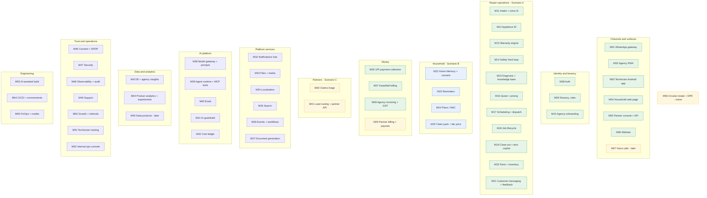

# KeepWell: end-to-end product modules and Google mapping

As of 15 Nov 2026. This document lists every module needed to run KeepWell as a real product. That includes the AI features and also the plain parts every product needs: sign-in, payments, billing, notifications, support, analytics, security, release tooling. Each module is mapped to the Google DeepMind models, Google Cloud services, Firebase, Maps, Android, Workspace, MCP servers and developer tools we would use, plus the non-Google pieces where Google has no product.

It builds on, and does not repeat, `Keepwell Google stack mapping.md` (per-feature model choices, prices, region checks) and the feature spec (`spec_parts/`). Feature codes (A1–A11, B1–B5, C1–C4, X1–X4, E1) refer to the spec.

**Evidence tags.** 🟢 confirmed on an official page in our research notes · 🟡 secondary source or partly confirmed · 🔴 our assumption or not yet checked. **Decision key.** NOW = buildathon prototype or Phase 1 pilot · NEXT = Phase 2 · LATER = Phase 3 or vision · WATCH = verify before relying on it · AVOID = do not use.

---

## 0. First principles: what the product must do

KeepWell exists to make one repair job go right the first time, and to leave a record behind that is useful later. Working back from that:

1. **Someone reports a problem.** The customer is on WhatsApp, speaks Hindi, Telugu, Tamil, Kannada or Marathi, and sends a voice note or a photo. → We need a channel gateway, language and voice understanding, and photo reading.
2. **The agency needs to know what it is dealing with.** Which appliance, which model, is it in warranty, is it dangerous, what is probably wrong, what part is needed. → Appliance ID, a warranty rules engine, a safety hard-stop, diagnosis with manuals.
3. **The customer needs a price they trust.** → A rate card, quote generation, approval, and a fair-price reference.
4. **Someone has to turn up at the right time with the right part.** → Scheduling, dispatch, routes, parts and inventory.
5. **The job has to be closed and paid for.** → Technician close-out, job card, customer sign-off, UPI payment, GST invoice.
6. **The record has to last.** → Home Memory, consent, reminders, plan/AMC offers, claim evidence.
7. **KeepWell has to get paid and stay safe.** → Usage metering, billing, partner fees, DPDP compliance, security, cost controls, evals.
8. **The business has to grow and be run.** → Onboarding, sign-in, support, analytics, growth, training, release tooling, an internal console.

Five rules shape every module:
- **WhatsApp first, app second.** Customers never install anything. Agencies start on WhatsApp plus a light web app. Technicians get an Android app when offline capture and scanning matter.
- **The model proposes, code and people decide.** Prices, warranty verdicts, safety stops and money movements come from code or a human approval, never from the model alone.
- **India region by default.** Mumbai (asia-south1) for data at rest and processing wherever the service allows. Anything that leaves India needs consent (see the stack mapping, section 1).
- **Cheapest model that passes the eval.** Flash-Lite by default, Flash when it measurably helps, Pro-class only with consent on redacted data.
- **Portable core.** Postgres, ADK, MCP and containers, so no single Google sub-product becomes a trap.

---

## 1. Users and surfaces

| User | What they need | Surface | Google pieces |
|---|---|---|---|
| Household customer | Report a fault, get a quote, pay, see warranty and history | WhatsApp; a no-login web page for Home Memory, quote and invoice (magic link) | Cloud Run, Firebase Hosting, Maps (location), Google Pay as the UPI app |
| Agency owner / dispatcher | Inbox of jobs, approve quotes, assign technicians, see money and parts | WhatsApp (approvals as buttons) + PWA web app | Firebase Auth (Google Sign-In), Firebase Hosting / App Hosting, Maps JavaScript API, FCM web push, Looker Studio embeds |
| Technician | Job brief, navigation, scan labels, voice close-out, works offline | Android app (PWA fallback) | Android (Jetpack Compose, CameraX, WorkManager), ML Kit, FCM, Play Integrity, Crashlytics, Remote Config |
| Plan provider / OEM / warranty administrator | Claims queue, evidence, decisions, lead routing, reports | Partner web console + API | Identity Platform (SAML/OIDC), Cloud Run, Looker, API Gateway / Apigee (later) |
| KeepWell ops team (two people now) | Support, onboarding, kill switches, eval review, finance | Internal console + Google Workspace | Identity-Aware Proxy, Workspace (Gmail, Chat, Meet, Sheets, Drive), Cloud Logging/Monitoring |
| Public visitors | Learn, sign up as an agency | Website | Firebase Hosting, GA4, Search Console, Tag Manager, reCAPTCHA, Google Ads, YouTube |

---

## 2. Module map at a glance

Green = Phase 1, blue = Phase 2, yellow = Phase 3 / vision. Uncoloured boxes are shared services needed from day one.

---

## 3. Modules in detail

Each table lists the features, including the small and obvious ones, then the Google products, then what is not Google. "Phase" is when we need it.

### 3.1 Channels and surfaces

#### M01 WhatsApp conversation gateway · NOW
| | |
|---|---|
| **Features** | Webhook receive with HMAC check and 200 within 2 s; dedupe on message ID; media download (voice, photo, video, documents, location); interactive buttons and list messages; WhatsApp Flows for structured forms (slot picking, address, consent); approved template library per language; 24-hour service-window tracking; opt-in/opt-out and STOP handling; per-customer and per-agency rate limits; multiple agency numbers (one WABA per agency, or a shared KeepWell number with agency branding); operator takeover ("talk to a person"); read receipts and delivery status; dead-letter queue and replay |
| **Google** | Cloud Run (webhook + workers, asia-south1) 🟢 · Pub/Sub (`wa.inbound` + DLQ) · Cloud Tasks (throttled sends, quiet hours) · Secret Manager (tokens) 🟢 · Cloud Storage (media, EXIF stripped) 🟢 · Cloud Logging |
| **Not Google** | WhatsApp Business Cloud API or a BSP (Meta) · Meta Embedded Signup so agencies connect their own number · RCS Business Messaging via Indian aggregators as a later second channel 🟡 (Google Business Messages is dead 🟢) |

#### M02 Agency web app (PWA) · NOW
| | |
|---|---|
| **Features** | Job inbox with filters and status board; one-tap quote approval; technician assignment and day view; customer and appliance lookup; rate card editor; parts and stock; money view (collected, pending, KeepWell fees); settings (business hours, service pincodes, languages, templates); installable PWA; works on low-end Android Chrome; offline read cache; web push; multi-user with roles; dark mode; UI in English plus the agency's language |
| **Google** | Firebase Hosting or Firebase App Hosting (Next.js/Angular) 🟡 · Firebase Auth / Identity Platform · Maps JavaScript API + Places Autocomplete (address entry) 🟢 · FCM web push · Material 3 components, Google Fonts Noto Sans for Indic scripts · Looker Studio embedded reports (simple dashboards) · Lighthouse / Chrome DevTools for PWA performance |
| **Not Google** | Framework choice (Next.js or Angular; Angular is Google's) |

#### M03 Technician app (Android) · NOW (PWA) → NEXT (native)
| | |
|---|---|
| **Features** | Today's jobs; job brief in the technician's language with audio read-out; one-tap navigation (deep link to the Google Maps app); scan model/serial plates and barcodes; capture before/after photos; voice close-out; customer OTP or signature sign-off; offline queue that syncs later; parts used from van stock; attendance/check-in at job location; earnings view; low data usage; works on Android 8+ phones with 2–3 GB RAM 🔴 |
| **Google** | Android (Kotlin, Jetpack Compose, CameraX, WorkManager for offline sync, Room) · ML Kit barcode scanning, text recognition v2 (Latin + Devanagari only 🟢), Document Scanner 🟢 · Gemini Nano / ML Kit GenAI APIs (WATCH, alpha/beta 🟢) · Gemma 4 E2B/E4B on-device (WATCH, no Indic benchmarks 🟡) · FCM push · Play Integrity API (stops tampered or fake apps) · Credential Manager (passkeys / Google sign-in) · Firebase Crashlytics, Performance Monitoring, Remote Config · Firebase App Distribution (pilot builds) · Google Play Console (internal/closed testing, Android vitals) · Firebase Test Lab (test on real low-end devices) · Android App Links (Firebase Dynamic Links is shut down 🟡) · Google Maps app intents for navigation instead of the Navigation SDK (cost) 🟢 |
| **Not Google** | None needed |

#### M04 Household web page (no app) · NOW
| | |
|---|---|
| **Features** | Magic-link page from WhatsApp: quote with accept/decline; job status and technician ETA; invoice download; Home Memory (appliances, warranty dates, service history, documents); consent controls and data download/erase request; share record with family; add-to-Google-Wallet warranty pass (WATCH) |
| **Google** | Firebase Hosting + Cloud Run API · Maps (ETA from Routes API) · Google Wallet API generic pass (WATCH: availability for Indian users unconfirmed 🟢) · reCAPTCHA Enterprise on public forms |
| **Not Google** | — |

#### M05 Partner console and API · LATER
| | |
|---|---|
| **Features** | SSO for plan providers/OEMs; claim queue with evidence viewer; decision with reason codes; lead routing settings; SLA and quality reports; API keys, webhooks, OpenAPI docs; sandbox tenant |
| **Google** | Identity Platform (SAML/OIDC, multi-tenancy 🔴) · Cloud Run · API Gateway first, Apigee only if partners demand it · Looker (embedded analytics) · A2A protocol for partner agents (WATCH) |
| **Not Google** | Partner claim schemas (none public) |

#### M06 Website and marketing site · NOW
| | |
|---|---|
| **Features** | Landing page in English + Hindi/Telugu; agency sign-up form; pricing; demo video; FAQ; privacy policy and grievance officer contact; blog; SEO |
| **Google** | Firebase Hosting · Google Analytics 4 · Google Tag Manager · Search Console · reCAPTCHA Enterprise (10k free/month 🟢) · YouTube (demo videos) · Google Business Profile (KeepWell listing) · Google Ads (later) · Nano Banana for illustrations, which carry a SynthID watermark |
| **Not Google** | Domain registrar |

#### M07 Voice calls (phone channel) · LATER
| | |
|---|---|
| **Features** | Customer calls a number; voice agent takes the complaint in their language; hands off to a person; call summary into the job; missed-call-to-WhatsApp callback |
| **Google** | Gemini 3.8 Live API (no confirmed India region 🟢; sessions capped at about 15 min) · Gemini 3.5 Transcribe for call logs · Gemini Flash TTS / Flash-Lite TTS for read-back 🟢 · Conversational Agents (Dialogflow CX) / Customer Engagement Suite as an alternative telephony-ready option (WATCH 🔴) |
| **Not Google** | Telephony / missed-call provider (e.g., Exotel, Knowlarity 🔴) |

### 3.2 Identity, tenancy and onboarding

#### M08 Authentication · NOW
| | |
|---|---|
| **Features** | **Google Sign-In** for agency owners and staff; **WhatsApp OTP** for technicians and customers (cheaper than SMS: about Rs 0.115 per authentication message 🟡 vs Firebase SMS about $0.07 🟡); email magic link as fallback; passkeys; session management and device list; sign out everywhere; MFA for KeepWell staff and partner admins; invite links for technicians; account recovery; rate limiting and bot defence |
| **Google** | Firebase Authentication / Identity Platform (Google provider, email link, custom tokens minted by our backend after WhatsApp OTP, multi-tenancy for partners 🔴) · Credential Manager (Android passkeys and Google sign-in) · Firebase App Check + reCAPTCHA Enterprise / Play Integrity · Identity-Aware Proxy for internal tools · Google Workspace accounts for the team |
| **Not Google** | WhatsApp authentication templates (Meta) · DLT-registered SMS gateway only as a fallback 🔴 |

#### M09 Tenancy, roles and permissions · NOW
| | |
|---|---|
| **Features** | Agency = tenant; roles: owner, dispatcher, technician, accountant, read-only; per-role limits (discount caps, who approves quotes); household data visible only to the serving agency and the household; partner scopes; KeepWell staff break-glass access with reason and audit |
| **Google** | Cloud SQL for PostgreSQL row-level security by `tenant_id` 🟢 · Firebase Auth custom claims for roles · Cloud IAM for service accounts · Cloud Audit Logs |
| **Not Google** | — |

#### M10 Agency onboarding · NOW
| | |
|---|---|
| **Features** | Self-sign-up or assisted sign-up; business profile (name, GSTIN, address, service pincodes, brands serviced, languages); **GSTIN check**; photo of the paper price list turned into a rate card; bulk import from a Google Sheet; invite technicians; connect WhatsApp number; set payout/UPI details; consent and data-processing agreement acceptance (e-sign); guided first job with sample data; onboarding checklist and progress |
| **Google** | Gemini 3.8 Flash vision (price list photo → rate card JSON, owner confirms) · Google Sheets API (import/export) · Places API + Geocoding + Maps polygons (service area) 🟢 · Document AI Enterprise OCR (cross-check of KYC/GST documents, Mumbai, 10 Indian languages 🟢) · Cloud Run · Gemini Flash-Lite to write the onboarding WhatsApp messages |
| **Not Google** | GST verification via a GST Suvidha Provider API 🔴 · e-sign (e.g., Aadhaar e-sign via a provider 🔴) · Meta Embedded Signup · payment-gateway merchant KYC (see M26) |

### 3.3 Repair operations (Scenario A, the Phase 1 core)

#### M11 Intake and voice understanding (A1, A2) · NOW
| | |
|---|---|
| **Features** | Language detection with a 1–6 language menu fallback; intent (new complaint, status, reschedule, payment, other); voice note → transcript + symptom tags + urgency; code-mixed speech (Hinglish, Tanglish); asks one clarifying question at a time; recognises a returning customer and their appliances; handles spam and abuse; duplicate-complaint detection |
| **Google** | Gemini 3.5 Flash-Lite (language, intent, audio at 32 tokens/s 🟢) → Gemini 3.8 Flash retry · Gemini 3.5 Transcribe (stable, about $0.005/min 🟢) as dedicated STT option · Chirp 3 STT only with consent (us/eu only 🟢) · ADK intake agent on Cloud Run · Vertex AI (now Gemini Enterprise Agent Platform) regional endpoint via the `google-genai` SDK |
| **Not Google** | Glossary of appliance terms per language (our asset) |

#### M12 Appliance identification (A3) · NOW
| | |
|---|---|
| **Features** | Read brand, model, serial, manufacture date from a nameplate photo; read invoice (seller, date, GSTIN, amount); validators (GSTIN checksum, serial patterns, totals); confirm screen when unsure; link to an existing appliance record; barcode/QR read |
| **Google** | Gemini Flash-Lite → Flash vision with media resolution control · Document AI Enterprise OCR cross-check (asia-south1 🟢) · ML Kit barcode + text recognition on the technician's phone · Gemini Embedding 2 for photo similarity to known nameplates (NEXT) |
| **Not Google** | Brand serial-pattern files (our asset) |

#### M13 Warranty engine (A4) · NOW
| | |
|---|---|
| **Features** | Rules per brand/category/component (e.g., compressor 10 years); extended warranty and AMC overlays; proof required; verdict with reasons and terms version; never auto-denies, it only says "covered / not covered / needs check" |
| **Google** | Cloud SQL (rules tables) · Gemini Flash batch to draft candidate rules from OEM PDFs for human review (build-time) · Document AI Layout Parser for manual/terms ingestion (public documents only; not in Mumbai 🟢) |
| **Not Google** | OEM warranty terms (public downloads; licence check 🔴) |

#### M14 Safety hard-stop (A6) · NOW
| | |
|---|---|
| **Features** | Hazard lexicon in 6 languages (gas smell, sparking, burning, water + electricity, refrigerant leak, child safety); runs before any model; stop message with safety instructions; alerts the owner; model can only raise severity, never clear it; expert-reviewed list |
| **Google** | Postgres lexicon + rules · Gemini Flash-Lite classifier (escalate only) · Model Armor on inbound text (WATCH 🔴) · Gemini safety settings · Agent Skill packaging the hazard checklist (shared by agents and evals) |
| **Not Google** | Electrician and gas-safety expert review |

#### M15 Diagnosis and knowledge base (A5) · NOW
| | |
|---|---|
| **Features** | Exact fault-code lookup; likely causes and parts with citations to manual pages; repair history for this appliance; "inspect first" when unsure; knowledge-base admin: upload manuals, fault-code tables, technician tips; versioning; gap reports ("questions we couldn't answer") |
| **Google** | Gemini 3.8 Flash (reasoning) · ADK triage agent with tools · `text-embedding-005` / Gemini Embedding 2 + pgvector in Cloud SQL 🟢 · Document AI Layout Parser (ingestion) · MCP Toolbox for Databases (exposes vetted SQL queries to the agent as tools) · Grounding with Google Search only for public, labelled references (never tenant data) 🟢 · Deep Research (preview) and NotebookLM for build-time research by the team · Vertex AI Search / RAG Engine (WATCH, lock-in) |
| **Not Google** | OEM manuals, fault codes, technician playbooks |

#### M16 Quote and pricing (A7) · NOW
| | |
|---|---|
| **Features** | Map symptom to rate-card items; parts + labour + visit charge + GST computed by code; discount limits by role; fair-price band from past jobs; owner approves; customer accepts via a WhatsApp button or the web page; quote PDF; quote expiry; revised quote with reason; spoken quote for low-literacy users |
| **Google** | Gemini Flash-Lite (customer wording) · Cloud SQL (rate card, stats) · Gemini 3.8 Flash-Lite TTS for read-back (NEXT) 🟢 · Cloud Run PDF service (M37) |
| **Not Google** | — |

#### M17 Scheduling and dispatch (A8) · NOW (manual) → NEXT (optimised)
| | |
|---|---|
| **Features** | Slot booking (customer picks from offered slots in a WhatsApp Flow); technician calendars, skills and leave; auto-suggest technician by skill, distance and load; day route optimisation; customer ETA and "technician on the way" message; reschedule and cancel; emergency jobs; Google Calendar sync for owners who want it |
| **Google** | Routes API (Compute Routes $1.50/1k, 70k free in India 🟢) · Route Optimization (single vehicle $0.80, fleet $2.40 per shipment, free caps 🟢) · Places API (New) + Geocoding · Address Validation (WATCH, India quality varies 🟢) · Maps Grounding Lite managed MCP server for the agent (experimental 🟡) · Google Calendar API (optional) · Cloud Tasks for reminders |
| **Not Google** | WhatsApp location messages (best source of a precise pin) · India Post pincode data |

#### M18 Job lifecycle · NOW
| | |
|---|---|
| **Features** | States: new → triaged → quoted → approved → scheduled → en route → in progress → awaiting part → completed → paid → closed (plus cancelled, revisit, escalated); SLA timers and overdue alerts; revisit linking (feeds the first-time-right metric); internal notes; before/after photos; customer sign-off with OTP; job card PDF; full audit trail |
| **Google** | Cloud SQL (system of record) · Pub/Sub events per state change · Cloud Scheduler/Tasks for SLA timers · Cloud Storage for photos |
| **Not Google** | — |

#### M19 Close-out and technician copilot (A9) · NOW → NEXT
| | |
|---|---|
| **Features** | Technician speaks for 30–60 s → structured job card (fault found, action, parts used, advice); tap-form fallback; parts aliases matched to catalogue; **live camera help** (technician shows the fault; the assistant guides step by step) later; safety reminders before risky steps |
| **Google** | Gemini Flash-Lite audio → Flash retry · Gemini 3.8 Live API with video input for camera-guided help (NEXT, preview limits 🔴) · Gemini Flash TTS · pgvector alias match |
| **Not Google** | — |

#### M20 Parts and inventory (A11) · NOW (basic) → NEXT
| | |
|---|---|
| **Features** | Part request from a job; agency stock and van stock; barcode in/out; reorder alerts; supplier list and purchase orders; "awaiting part" status messages to the customer; compatibility rules (verified vs "inspect first"); parts margin report; parts referral marketplace (R3, NEXT) |
| **Google** | Gemini Flash-Lite (normalise part requests) · pgvector fuzzy match · ML Kit barcode · BigQuery ML demand forecast per part and city (LATER) · Sheets API export |
| **Not Google** | Parts catalogue and suppliers (no Google product) |

#### M21 Customer messaging, feedback and reviews (A10) · NOW
| | |
|---|---|
| **Features** | Status updates at each state; follow-up after 3 days ("is it working?"); rating and NPS in WhatsApp; complaint escalation; review request with a link to the agency's Google Business Profile; win-back messages; quiet hours; per-template opt-out |
| **Google** | Gemini Flash-Lite (interprets free-text replies, drafts operator replies) · Cloud Tasks/Scheduler · Google Business Profile APIs (access by request 🟢; until then, a plain review link) |
| **Not Google** | WhatsApp templates (Meta approval) |

### 3.4 Household (Scenario B, Phase 2)

| Module | Features | Google | Not Google |
|---|---|---|---|
| **M22 Home Memory and consent (B1)** · NEXT | Household record built from completed jobs + invoice photos; appliances, warranty dates, documents, service history; field provenance (photo/user/agency); share with family; move house; consent per purpose; export and erase | Cloud SQL · Cloud Storage with retention · Gemini Flash vision (warranty clauses) · Document AI Invoice Parser (English invoices only 🟢) · Google Wallet pass (WATCH) | DPDP notices (lawyer) |
| **M23 Reminders and maintenance (B2)** · NEXT | Warranty expiry, service intervals (AC before summer, RO filter, chimney), seasonal campaigns; snooze; household picks the channel | Cloud Scheduler or `pg_cron` in Cloud SQL 🟢 · Cloud Tasks · Gemini Flash-Lite batch for wording drafts (human-approved) · FCM (if app) | WhatsApp templates |
| **M24 Plans / AMC offers (B3)** · NEXT | Eligibility by rules; plan comparison; buy via UPI; policy document; renewal reminders; commission tracking | Gemini Flash-Lite (rewrite supplied plan text) · Cloud SQL · payment via M26 | Plan providers; licence check for selling plans (lawyer) |
| **M25 Claim evidence pack and fair-price check (B4, B5)** · NEXT | Evidence pack with quoted clauses, invoice, photos and timeline (no legal advice); file hashes; consumer fair-price check against past local jobs | Gemini 3.8 Flash · pgvector · Cloud Storage retention locks · Sensitive Data Protection before any opt-in Pro call 🟡 · BigQuery nightly price stats | e-Daakhil / consumer forum facts |

### 3.5 Money

#### M26 UPI payment collection (customer → agency) · NOW
| | |
|---|---|
| **Features** | UPI payment link and dynamic QR in WhatsApp; UPI intent on mobile (opens Google Pay, PhonePe, Paytm, BHIM); cash marked by technician with OTP confirmation; part-payment/advance for parts; payment status webhooks; auto-receipt; refunds; reconciliation report; settlement straight to the agency's bank account |
| **Google** | Google Pay is the customer's UPI app (works automatically through UPI intent/QR) · Google Pay API for India (direct integration needs a verified merchant VPA and console registration 🟢; WATCH for us) · Cloud Run webhook handler · Cloud SQL payment ledger · Pub/Sub `payment.events` |
| **Not Google** | **Payment gateway / aggregator** (Razorpay, Cashfree, PhonePe PG or similar 🔴): the agency is the merchant of record and money settles to the agency, so KeepWell never holds customer funds (avoids needing an RBI payment-aggregator licence; lawyer to confirm 🔴) · WhatsApp Payments in India (Meta) as an option 🔴 |

#### M27 KeepWell billing (agency → KeepWell) · NOW
| | |
|---|---|
| **Features** | Metering: one billable event per completed, customer-confirmed job card (R1, Rs 40 test / Rs 100 test); free trial jobs; prepaid wallet top-up by UPI, or UPI AutoPay mandate for monthly settlement; low-balance alerts; KeepWell's own GST invoices; usage statement; credits and goodwill adjustments; dunning and soft suspension (never block a safety message) |
| **Google** | Cloud SQL (usage events, ledger, append-only) · Cloud Scheduler (monthly runs) · BigQuery (revenue reporting) · Looker Studio (finance dashboard) · Google Sheets (accountant export) |
| **Not Google** | Payment gateway subscriptions / UPI AutoPay 🔴 · GST invoicing (e-invoice IRN only if KeepWell crosses the turnover threshold 🔴) · accounting software (Tally/Zoho) · Note: bill outside the Android app; check Google Play Payments policy before adding any in-app purchase 🔴 |

#### M28 Agency invoicing and GST · NOW
| | |
|---|---|
| **Features** | Customer invoice or bill of supply (agency may not be GST-registered); GST split (CGST/SGST/IGST) by place of supply; HSN/SAC codes for parts and labour; invoice numbering per agency; PDF in WhatsApp; monthly GST summary export for the agency's accountant |
| **Google** | Cloud Run (invoice service) · Cloud SQL · M37 PDF service · Sheets export |
| **Not Google** | GST rules (CBIC); Tally export format |

#### M29 Partner billing and payouts · LATER
| | |
|---|---|
| **Features** | Claims-triage fees per claim, lead-routing fees, plan commissions, parts referral fees; partner statements; payouts to agencies for routed jobs |
| **Google** | Cloud SQL ledger · BigQuery · Looker |
| **Not Google** | Gateway payouts product (e.g., RazorpayX 🔴) |

### 3.6 Partners (Scenario C, Phase 3)

| Module | Features | Google | Not Google |
|---|---|---|---|
| **M30 Claims triage (C1–C4)** · LATER | Claim intake and completeness check; image classification; fraud/anomaly signals (rules + stats, never auto-deny); repair-vs-replace by thresholds; adjudicator summary with citations; decision with reason codes; override analytics | Gemini Flash-Lite / 3.8 Flash · Document AI OCR · BigQuery ML (once 200+ labelled cases) · pgvector · Computer Use for partner portals with no API (WATCH 🟡) · Gemini 4 Hydrogen as an upgrade if it wins evals and is India-listed (WATCH 🟢) | Administrator claim data and policies |
| **M31 Lead routing and partner API** · LATER | OEMs and plan providers send jobs to verified agencies by skill, area, rating; SLA tracking; quality score per agency; partner webhooks | Cloud Run · API Gateway / Apigee · Pub/Sub · A2A for agent-to-agent handoff (WATCH) · Route Matrix for distance scoring | Partner contracts |

### 3.7 Platform services (shared, from day one)

| Module | Features | Google | Not Google |
|---|---|---|---|
| **M32 Notifications hub** | One API to send WhatsApp, push, email, SMS fallback; templates per language; quiet hours; per-user channel preferences; retries; delivery tracking | Cloud Tasks · Pub/Sub · FCM (push, free) · Cloud Run | WhatsApp (Meta); transactional email provider 🔴 (Gmail API is not for bulk transactional mail); DLT SMS gateway |
| **M33 Files and media** | Upload, signed URLs, EXIF/location strip, image resize/compress for low bandwidth, audio transcode (OGG/Opus), virus scan, SHA-256 evidence hashes, lifecycle delete, retention locks for claims | Cloud Storage (Mumbai) 🟢 · Cloud Run (libvips/ffmpeg workers) · Eventarc on object finalize · Transcoder API only if video grows | Open-source virus scanner (ClamAV) on Cloud Run |
| **M34 Localization** | UI strings in English, Hindi, Telugu, Tamil, Kannada, Marathi; appliance glossary; number/date/currency formats; right fonts; human review of every customer-facing template | Gemini Flash with glossary for first-draft translation, human reviewed · Cloud Translation Advanced with glossaries as an alternative 🟡 · Google Fonts Noto Indic · Gboard handles typing and transliteration on the user's phone | Native-speaker reviewers |
| **M35 Search** | Find a customer by phone/name/address, appliance by serial, job by number or text; typo-tolerant; Indic text | Postgres full-text + trigram + pgvector in Cloud SQL · Vertex AI Search (WATCH) | — |
| **M36 Events and workflows** | Domain events (job.created, quote.approved, payment.received); retries; scheduled jobs; long multi-step flows (claim lifecycle) | Pub/Sub · Eventarc · Cloud Tasks · Cloud Scheduler · Workflows (WATCH, Mumbai unverified 🔴) | — |
| **M37 Document generation** | PDFs for quote, job card, invoice, warranty card, claim pack; QR code to the web record; Indic fonts; templates per agency (logo) | Cloud Run (headless Chrome/Puppeteer or WeasyPrint) · Cloud Storage · Google Docs API only for internal templates | — |

### 3.8 AI platform

| Module | Features | Google | Not Google |
|---|---|---|---|
| **M38 Model gateway and prompt registry** | One client for all model calls; model routing (Lite → Flash → opt-in Pro); structured JSON output + code validators; prompt versions in git; temperature/thinking/output caps per feature; context caching where it pays; batch for nightly work; fallback chains and circuit breakers; region pinning asserted in tests | Gemini 3.5 Flash-Lite, 3.8 Flash, 3.5 Flash (in-country commitment for India 🟢), 3.6 Flash fallback · Vertex AI (Gemini Enterprise Agent Platform) regional endpoints · `google-genai` SDK · Google AI Studio for prompt design and schema testing · Batch prediction (50%) · context caching · Provisioned Throughput only at scale | — |
| **M39 Agent runtime and tools** | Intake, triage, quote, dispatch and close-out agents; tool calling into our database, maps and rules; skills loaded only when needed; human-approval interrupts; agent traces | Agent Development Kit (ADK, open source) on Cloud Run · Agent Skills (SKILL.md: warranty rules, hazard checklist, glossary, quote format) · **MCP Toolbox for Databases** (Cloud SQL tools) · **Google-managed remote MCP servers** (50+ GA/preview 🟡): Cloud SQL, BigQuery, Firestore, Cloud Logging, Cloud Monitoring, Maps Grounding Lite (experimental) · A2A protocol (partners, WATCH) · Agent Engine / Agent Runtime (WATCH, lock-in) | — |
| **M40 Evals and AI quality** | Golden sets per feature and language; assertions, rubric scoring, trajectory checks; release gates in CI; LLM judge calibrated on human labels; production sampling; drift alerts; before/after reports | ADK evals · Gen AI Evaluation Service (WATCH regions 🔴) · BigQuery (results) · Cloud Run jobs (nightly) · Looker Studio (eval dashboard) · a different-family judge via Model Garden | Human labellers; IndicVoices and similar public sets (licence-gated) |
| **M41 AI guardrails** | Prompt-injection defence (customer content is data); PII redaction before logs and any out-of-region call; output filters; safety rules first; generated images watermarked; abstain-and-ask behaviour | Model Armor (WATCH 🔴) · Gemini safety settings · Sensitive Data Protection (India infoTypes 🟡) · ShieldGemma 2 (WATCH) · **SynthID** watermark on any Nano Banana-generated image (built in) and SynthID Detector for checks 🔴 | Our regex + Verhoeff redactor (primary) |
| **M42 Cost ledger and budget guard (X2)** | Cost per call, per job, per agency; soft cap 2x, hard cap 3x per job; price table with dated rows (Flash doubles 1 Jan 2027 🟢); alerts | Cloud Billing budgets and alerts · billing export to BigQuery · Gemini usage metadata · Cloud Monitoring alerts | Meta WhatsApp INR rate card |

### 3.9 Data and analytics

| Module | Features | Google | Not Google |
|---|---|---|---|
| **M43 BI and agency insights** | Agency dashboard: jobs, first-time-right rate, revisit rate, quote time, collections, top faults, technician performance; **"ask your data" in WhatsApp** ("how many AC jobs last week?"); KeepWell internal metrics | Datastream (Cloud SQL → BigQuery CDC) · BigQuery 🟢 · Looker Studio (free) / Looker embedded · BigQuery ML (forecasting) · Conversational Analytics API / Gemini in BigQuery data agents (WATCH 🔴) · BigQuery MCP server for an analytics agent | — |
| **M44 Product analytics and experiments** | Funnels (sign-up → first job → paid), feature use, retention cohorts; A/B tests (e.g., Rs 40 vs Rs 100 messaging); feature flags and staged rollout; kill switches | Google Analytics 4 + Firebase Analytics · BigQuery export · Firebase Remote Config (client and server templates) + A/B Testing · Firebase Crashlytics | — |
| **M45 Data products (R8)** · LATER | Anonymised failure rates by model/region, repair-quality reports for OEMs; consented, aggregated, with minimum cell sizes | BigQuery · Analytics Hub / BigQuery data clean rooms 🔴 · Sensitive Data Protection de-identification | Data-sharing contracts |

### 3.10 Trust, security and operations

| Module | Features | Google | Not Google |
|---|---|---|---|
| **M46 Consent and DPDP compliance** | Consent ledger per purpose; notices in 6 languages; access, correction, erase requests; retention schedules; breach runbook; grievance officer; data-processing agreements with agencies; data maps; India-only processing by default | Cloud SQL (ledger) · Cloud Storage lifecycle + retention locks · Sensitive Data Protection · Cloud Audit Logs · Access Transparency · Organization Policy resource-location constraint (asia-south1) · Cloud KMS CMEK (if a partner asks) | Lawyer review (DPDP Rules notified 14 Nov 2025; main duties around May 2027 🟡) |
| **M47 Security** | Least-privilege IAM; secrets rotation; encryption; WAF and DDoS once public; bot defence; app integrity; dependency and container scanning; vulnerability management; pen test before partners | Secret Manager · Cloud KMS · IAM + Workload Identity · Cloud Armor (when traffic grows) · reCAPTCHA Enterprise · Firebase App Check · Play Integrity · Artifact Analysis (container scanning) · Binary Authorization · Security Command Center (Standard, free tier 🟢) · Web Security Scanner · VPC Service Controls (LATER) | External pen-test firm |
| **M48 Observability and audit** | Structured logs with job IDs; traces across webhook → agent → model; error alerts; uptime checks; SLO dashboards (webhook ack, reply latency); model-deprecation alerts; append-only business audit log | Cloud Logging · Cloud Monitoring (+ uptime checks, SLOs) · Cloud Trace (OpenTelemetry) · Error Reporting · Cloud Profiler · Crashlytics · Gemini Cloud Assist for troubleshooting 🔴 · Google Chat webhooks for alerts | — |
| **M49 Support** | In-WhatsApp help for agencies ("how do I add a technician?") answered from a help centre; escalation to a person; ticket tracking; status page; help articles in local languages | Gemini Flash-Lite + help-centre retrieval (pgvector) · Google Workspace (Gmail, Google Chat, Meet for screen-share onboarding) · Google Sites or Firebase Hosting for the help centre · Google Forms for feedback | Ticketing tool, or a simple table in our own console |
| **M50 Growth and referrals** | Agency-to-agency referral codes with free jobs; distributor partnerships; local ads; case-study videos; SEO; Business Profile for KeepWell | Google Ads · Google Business Profile · YouTube · Search Console · GA4 attribution · Android App Links (Firebase Dynamic Links is shut down 🟡) · Nano Banana creatives (SynthID watermarked) | — |
| **M51 Technician training** | Short lessons per appliance fault in the technician's language; spoken audio; diagrams; quizzes; badges that agencies can show customers; safety modules first | Gemini 3.8 Flash (lesson drafts from our knowledge base, reviewed) · Gemini Flash TTS (audio) · Nano Banana (diagrams, SynthID) · YouTube (link to OEM videos; licence check 🔴) · NotebookLM for the team to build course material | Expert review |
| **M52 Internal ops console (X4)** | Tenant list, health, usage, fees; impersonate with consent and audit; kill switches per feature/agency; eval review queue; safety-event review; template approvals; price table editor | Cloud Run behind Identity-Aware Proxy · Cloud SQL RLS · Looker Studio · Remote Config server-side flags | — |

### 3.11 Engineering and delivery

| Module | Features | Google | Not Google |
|---|---|---|---|
| **M53 AI-assisted build** | Agents write code and tests against our eval cases while we review diffs; skills encode our rules; one workspace for spec, prompts, code; UI drafts from prompts | **Google Antigravity** (desktop, `agy` CLI, SDK; replaced Gemini CLI/Code Assist for most users 🟡) · **Agent Skills** · **Google AI Studio** (prompt design, Build mode, API keys; free-tier data is used to improve Google products 🟢, so synthetic data only) · **Firebase MCP server** (GA 🟢) · **Google-managed MCP servers** (Cloud SQL, BigQuery, Logging, Monitoring) · MCP Toolbox for Databases · Chrome DevTools MCP for web testing 🔴 · Stitch (Google Labs UI generation, WATCH 🔴) · Firebase Studio: AVOID (no new workspaces since 22 Jun 2026, shuts 22 Mar 2027 🟡) · Jules: AVOID (closing 31 Dec 2026 🟡) | GitHub |
| **M54 CI/CD and environments** | Separate projects: prototype (free key, synthetic data), pilot, prod; infrastructure as code; preview deploys; eval gate before release; mobile beta tracks; device testing on low-end phones | Cloud Build · Artifact Registry · Cloud Deploy · Infrastructure Manager (Terraform) · Firebase App Distribution · Play Console testing tracks · Firebase Test Lab · Firebase Hosting preview channels | GitHub Actions (optional) |
| **M55 FinOps and credits** | Budgets per project; cost per job tracking; credit applications; price-cliff calendar (1 Dec 2026, 1 Jan 2027) | Cloud Billing budgets, billing export to BigQuery, Recommender · Google for Startups Cloud Program (Start: up to about $2,000 🟡) · the $300 trial cannot pay for Gemini for sign-ups from 16 Nov 2026 🟢 | — |

### 3.12 Vision

| Module | Features | Google | Not Google |
|---|---|---|---|
| **M56 Circular resale, refurbish and EPR (E1)** · LATER | Grade an unrepairable unit from photos; route to refurbish, harvest parts or recycle; pickup scheduling; producer EPR evidence file | Gemini Flash vision (grading) · Routes / Route Optimization (pickups) · BigQuery (EPR reporting) | Recyclers, CPCB portal (no API known), EPR pricing |

---

## 4. Google product → module index

### 4.1 Google DeepMind models

| Model | Modules | Decision |
|---|---|---|
| Gemini 3.5 Flash-Lite | M10, M11, M12, M14, M16, M20, M21, M23, M24, M30, M49 | NOW (default) 🟢 |
| Gemini 3.8 Flash | M10, M11 (retry), M12, M15, M19, M25, M30, M51 | NOW 🟢 |
| Gemini 3.5 Flash (Vertex, India in-country processing) | M38 for partners that require residency | WATCH (lifecycle conflict 🟢) |
| Gemini 3.6 Flash | M38 fallback | NOW (fallback) 🟢 |
| Gemini 4 Hydrogen | M30, M15 upgrade if it wins evals | WATCH (India region unconfirmed 🟢) |
| Gemini 3.8 Live (audio + video) | M07 voice calls, M19 camera-guided help | NEXT (preview limits) |
| Gemini 3.5 Transcribe | M11, M07 call logs | NEXT 🟢 |
| Gemini 3.8 Flash TTS / Flash-Lite TTS | M16 spoken quote, M03 brief read-out, M51 lessons | NEXT 🟢 |
| Gemini Embedding 2, `text-embedding-005` | M15, M12, M20, M25, M49 | NOW 🟢 |
| Nano Banana family (image generation, SynthID) | M06, M50, M51 | NEXT (never a decision input) |
| Gemma 4 (E2B/E4B on-device; larger for self-hosting) | M03 offline helper, M38 portability fallback | WATCH 🟡 |
| ShieldGemma 2 | M41 | WATCH |
| Computer Use | M30 partner portals | WATCH 🟡 |
| Deep Research | M15 build-time research | WATCH (preview) |
| SynthID (watermark + Detector) | M41, M50, M51 | Built into image outputs |
| Chirp 3 (STT) | M11 consent-gated fallback | WATCH (us/eu only 🟢) |

### 4.2 Google Cloud

| Service | Modules |
|---|---|
| Cloud Run (services + jobs) | Nearly all: M01, M02 API, M04, M05, M10–M21, M26–M28, M32, M33, M37, M39, M40, M52 |
| Vertex AI / Gemini Enterprise Agent Platform | M38, M39, M40 |
| Cloud SQL for PostgreSQL (pgvector, pg_cron, RLS) | M09, M13–M18, M20, M22–M28, M35, M42, M46 |
| Cloud Storage | M01, M18, M22, M25, M33, M37, M46 |
| Pub/Sub, Cloud Tasks, Cloud Scheduler, Eventarc, Workflows | M01, M17, M18, M21, M23, M26, M32, M36 |
| Document AI (Enterprise OCR, Layout Parser, Invoice Parser, Custom Extractor) | M10, M12, M13, M15, M22, M30 |
| BigQuery, BigQuery ML, Datastream, Analytics Hub | M20, M25, M27, M30, M40, M42, M43, M45 |
| Looker Studio / Looker | M02, M05, M27, M40, M43, M52 |
| Identity Platform, Identity-Aware Proxy, IAM | M05, M08, M09, M52 |
| Secret Manager, Cloud KMS, Cloud Armor, Security Command Center, Artifact Analysis, Binary Authorization, VPC-SC | M47 |
| Sensitive Data Protection, Model Armor | M25, M41, M45, M46 |
| Cloud Logging, Monitoring, Trace, Error Reporting, Profiler, Audit Logs, Access Transparency | M46, M48 |
| Cloud Build, Artifact Registry, Cloud Deploy, Infrastructure Manager | M54 |
| Cloud Billing budgets + export, Recommender | M42, M55 |
| Cloud Translation Advanced | M34 (alternative) |
| API Gateway / Apigee | M05, M31 |
| Gemini Cloud Assist | M48 |
| Conversational Agents (Dialogflow CX) | M07 alternative (WATCH) |

### 4.3 Firebase, Android, Maps, Workspace and other Google products

| Product | Modules |
|---|---|
| Firebase Authentication, App Check, Hosting / App Hosting, Cloud Messaging (FCM), Remote Config, A/B Testing, Analytics, Crashlytics, Performance Monitoring, App Distribution, Test Lab | M02, M03, M04, M06, M08, M32, M44, M47, M52, M54 |
| Android: Jetpack Compose, CameraX, WorkManager, Credential Manager, Play Integrity, App Links, Play Console | M03, M08, M47, M50, M54 |
| ML Kit (barcode, text recognition v2, Document Scanner, GenAI APIs) | M03, M12, M20 |
| Google Maps Platform: Maps JS, Places (New), Geocoding, Routes, Route Optimization, Route Matrix, Address Validation, Maps app intents | M02, M03, M04, M10, M17, M31, M56 |
| Google Pay (UPI app; Google Pay API for India) | M26, M24 |
| Google Wallet API | M04, M22 (WATCH) |
| Google Workspace: Sheets, Calendar, Docs, Gmail, Chat, Meet, Forms, Sites | M10, M17, M20, M27, M28, M37, M48, M49 |
| Google Analytics 4, Tag Manager, Search Console, Google Ads, Business Profile, YouTube | M06, M21, M44, M50, M51 |
| reCAPTCHA Enterprise | M04, M06, M08, M47 |
| Google Fonts (Noto Indic), Material 3 | M02, M34, M37 |
| NotebookLM | M15, M51 (team research and course drafting) |

### 4.4 MCP servers and agent tooling

| MCP / tool | Where it is used | Runtime or build-time | Status |
|---|---|---|---|
| MCP Toolbox for Databases (open source) | Exposes vetted, parameterised Cloud SQL queries as tools to ADK agents (M15, M17, M20, M43) | Runtime | NOW 🔴 verify version |
| Google-managed remote MCP: Cloud SQL (`sqladmin.googleapis.com/mcp`) | Admin and schema work from Antigravity (M53) | Build-time | 🟡 |
| Google-managed remote MCP: BigQuery | Analytics agent (M43), eval analysis (M40) | Runtime + build-time | 🟡 (GA vs preview pages differ) |
| Google-managed remote MCP: Maps Grounding Lite (`mapstools.googleapis.com/mcp`) | Dispatch agent place/route facts (M17); never with customer personal data | Runtime (demo) | Experimental 🟡 |
| Google-managed remote MCP: Cloud Logging, Cloud Monitoring | Incident triage from the IDE or an ops agent (M48) | Build-time / ops | 🟡 |
| Google-managed remote MCP: Firestore, Spanner, Compute, GKE | Not needed (we use Postgres and Cloud Run) | — | AVOID for now |
| Firebase MCP server (`firebase-tools`) | Auth, Hosting/App Hosting, Remote Config, Crashlytics from Antigravity (M53) | Build-time | GA 🟢 |
| Chrome DevTools MCP | PWA testing and performance (M02, M04) | Build-time | 🔴 |
| Agent Skills (SKILL.md) | Hazard checklist, warranty rules, glossary, quote format, validators; shared by runtime agents and the eval runner | Both | NOW 🟡 |
| ADK + A2A | Agents (M39); partner agent handoff (M31) | Runtime | ADK NOW; A2A WATCH |
| Access | MCP Tool User role (`roles/mcp.toolUser`) for managed servers 🟡 | — | — |

Rule: runtime agents call only our own vetted tools (Toolbox queries, rules engine, Maps calls), never a general-purpose admin MCP server. Admin MCP servers stay in the developer's IDE with the developer's own IAM.

---

## 5. What Google does not cover, and what we use instead

| Need | Why not Google | Use instead |
|---|---|---|
| WhatsApp channel | Google Business Messages shut 31 Jul 2024 🟢 | WhatsApp Cloud API / BSP; RCS via aggregators later |
| UPI payment gateway, settlement, refunds, AutoPay | Google Pay API for India is a UPI acceptance API that needs a merchant VPA from a bank/PSP 🟢; it is not a gateway for a platform collecting for many agencies | A payment gateway (Razorpay, Cashfree, PhonePe PG etc. 🔴), agency as merchant of record |
| SMS OTP at low cost | Firebase SMS about $0.07 per message in India 🟡 | WhatsApp authentication template; DLT SMS fallback |
| GSTIN verification, e-invoicing | No Google product | GST Suvidha Provider API 🔴 |
| e-sign | No Google product for Aadhaar e-sign | e-sign provider 🔴 |
| Telephony | Not in Google's India stack per our notes | Exotel / Knowlarity etc. 🔴 |
| Transactional email at volume | Gmail API is for user mailboxes | Email provider 🔴 |
| Parts catalogue, OEM manuals, warranty terms, rate cards | Data, not software | Our own data assets, OEM sources (licence check) |
| Plan/AMC products, claims data | Partner-owned | Plan providers, administrators |
| Accounting | — | Tally / Zoho export |

---

## 6. Build order

| Stage | Modules | Google-heavy demo moments |
|---|---|---|
| **Buildathon prototype (2 days)** | M01, M08 (Google Sign-In), M11, M12, M13, M14, M15, M16, M18, M19, M26 (UPI payment link), M38, M39, M40 (10–20 eval cases live), M42, M53 | Hinglish voice note → job card (Gemini audio); nameplate photo → model/serial (Gemini vision + Document AI); ADK triage agent with MCP Toolbox tools; safety stop; quote by code; Maps day route for 2 technicians; eval run on screen; Antigravity + Agent Skills commit history |
| **Phase 1 pilot (Tier 2/3, 15–20 agencies)** | Add M02, M03 (PWA), M04, M06, M09, M10, M17, M20 (basic), M21, M27, M28, M32–M37, M41, M43 (basic), M44, M46, M47, M48, M49, M52, M54, M55 | Live in Mumbai region; per-fix billing; agency dashboard |
| **Phase 2 (5–10 cities)** | M03 native app, M07 (voice), M19 live camera help, M20 full, M22–M25, M24 plans, M51 training | Gemini Live; TTS read-back; Home Memory |
| **Phase 3 (Tier 1 partners)** | M05, M29, M30, M31, M45, M56 | Claims triage; A2A; data products |

---

## 7. Open checks before we commit

1. Mumbai availability for 3.8 Flash, 3.5 Flash-Lite, audio input and Live API (stack mapping, section 8).
2. Payment-gateway choice and whether KeepWell can stay a technology provider (agency as merchant) without an RBI payment-aggregator licence. Lawyer.
3. Identity Platform multi-tenancy and pricing for partner SSO.
4. Managed MCP server status (GA vs preview) on the English "Supported products" page, and whether any of them run in-region.
5. Google Play Payments policy if any billing appears inside the Android app.
6. Conversational Analytics API, Stitch, Chrome DevTools MCP and Gemini Cloud Assist: current status (all 🔴).
7. Buildathon credits: amount and whether they cover Gemini on Vertex AI.

---

## Sources added in this document

- [Google Cloud blog: 50+ fully managed MCP servers](https://cloud.google.com/blog/products/ai-machine-learning/google-managed-mcp-servers-are-available-for-everyone)
- [Google Cloud docs: MCP supported products](https://docs.cloud.google.com/mcp/supported-products)
- [Firebase MCP server docs](https://firebase.google.com/docs/cli/mcp-server) and [GA announcement](https://firebase.blog/posts/2025/10/firebase-mcp-server-ga)
- [Firebase Studio sunset and migration](https://firebase.google.com/docs/studio/migrating-project)
- [Google Pay API for India: APIs for integration](https://developers.google.com/pay/india/api/merchant-sdk/reference/api)
- [Razorpay: Google Pay on UPI](https://razorpay.com/docs/payments/payment-methods/upi/google-pay.md)
- [AP2 protocol](https://ap2-protocol.org/) and [NPCI Unified Agent Protocol report](https://www.outlookbusiness.com/news/india-plans-ai-powered-upi-payments-framework-through-unified-agent-protocol) (agent payments; WATCH, not in scope for Phase 1)

All other facts carry the tags and sources from `Keepwell Google stack mapping.md` and `research_notes/`.
